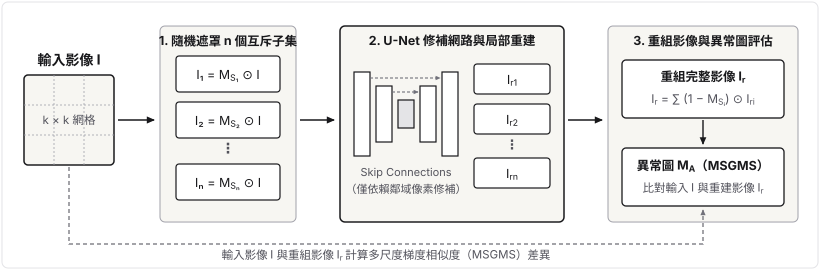

# 第 5 頁：RIAD

## 學習目標
理解 RIAD 如何透過「隨機網格挖空修補（Reconstruction by Inpainting）」阻斷異常像素照抄，並利用多尺度梯度幅值相似度（MSGMS）定位異常。

## 投影片內容

*示意圖，依論文 Fig. 1 重繪（遮罩拼貼細節對應 Fig. 3）*

- **輸入什麼？** 把圖切成網格，分 **3** 組輪流遮住一部分。
- **保存或學到什麼？** 學會只看周圍的正常區域，把遮住的地方補回來。
- **怎麼產生異常分數？** 比較原圖和補回的圖，差越多越可疑（`MVTec AD` 像素 `AUROC` **94.2%**）。
- **主要限制？** 一張圖要補 **12** 次；紋理很隨機或只有顏色異常時較弱。

## 延伸閱讀
- [Zavrtanik et al. (2021) — RIAD §4–§6](../../../wiki/papers/zavrtanik2021-riad.md#4-方法架構與核心設計)
- [遮罩修復重建與多尺度梯度相似度](../../../wiki/concepts/reconstruction-by-inpainting.md#1-概念定義與解決的問題)

## 講者備註（不顯示於投影片畫面）
- RIAD 預設採用 $K = \{2, 4, 8, 16\}$ 四種網格尺度與 $n = 3$ 組互斥遮罩，因此單張測試影像共需執行 $4 \times 3 = 12$ 次前向推論。

## 主張記錄表
| 主張 ID | 內容 | 方法 | 資料集 | 指標 | 數值與條件 | wiki 頁與段落 | 原文位置 | 原文事實／依原文數據計算／AI 推論 |
| :--- | :--- | :--- | :--- | :--- | :--- | :--- | :--- | :--- |
| `C05-01` | RIAD 將輸入影像（$256 \times 256$）切分為 $k \times k$ 網格（MVTec AD 預設 $K=\{2,4,8,16\}$）並隨機均分為 $n=3$ 個互斥子集輪流遮蔽，使含 Skip Connections 的 U-Net 在修補目標區塊時看不見該處原始像素，最後僅取被遮蔽區塊拼回完整重建影像 $\mathbf{I}_r$ | RIAD | MVTec AD | 架構與超參數設定 | 輸入 256×256，$n=3$，$K=\{2,4,8,16\}$，300 Epochs | `wiki/papers/zavrtanik2021-riad.md` `## 4. 方法架構與核心設計`；`wiki/papers/zavrtanik2021-riad.md` `### 5.1 實驗設定（出自論文 Sec. 4.1–4.3, p. 5–6）` | `zavrtanik2021-riad.pdf` Sec. 3.1–3.3, p. 2–4, Fig. 1, Fig. 4 & Sec. 4.3, p. 6 | 原文事實 |
| `C05-02` | RIAD 於 MVTec AD 全 15 類平均取得 91.7% Image ROC AUC（Table 1）與 94.2% Pixel ROC AUC（Table 2），紋理平均為 95.1% / 93.9%、物件平均為 89.9% / 94.3% | RIAD（Pattern Recognition 2021） | MVTec AD | 紋理平均 Image / Pixel ROC AUC (%) / 物件平均 Image / Pixel ROC AUC (%) / 全 15 類平均 Image / Pixel ROC AUC / PRO (%) | 95.1 / 93.9｜89.9 / 94.3｜91.7 / 94.2 / - | `wiki/datasets/mvtec-ad.md` `### 5.2 後續收錄方法於 MVTec AD 的演進表現匯總`；`wiki/papers/zavrtanik2021-riad.md` `### 5.2 MVTec AD 影像級異常檢測結果（出自論文 Table 1, p. 6，指標：Image ROC AUC %）` | `zavrtanik2021-riad.pdf` Table 1 & Table 2, p. 6 | 原文事實 |
| `C05-03` | 在 MVTec AD 消融實驗（Table 6）中，無 Skip Connections `RIAD_ns`（88.6%）vs. 改用 SSIM 評分 `RIAD_SSIM`（85.2%）vs. 完整 `RIAD`（91.7%），顯示加入 Skip Connections 與採用 `MSGMS` 評分皆能提升表現 | 3. U-Net Skip Connections 與異常評分函數 | MVTec AD | 關鍵比較設定與平均 Image ROC AUC (%) | 無 Skip Connections RIAD_ns (88.6%) vs. 改用 SSIM 評分 RIAD_SSIM (85.2%) vs. 完整 RIAD (91.7%) | `wiki/papers/zavrtanik2021-riad.md` `### 5.5 消融實驗重點（Ablation Studies，出自論文 Sec. 6 & Tables 4–6, p. 7–8）`；`wiki/papers/zavrtanik2021-riad.md` `### 5.2 MVTec AD 影像級異常檢測結果（出自論文 Table 1, p. 6，指標：Image ROC AUC %）` | `zavrtanik2021-riad.pdf` Sec. 6 & Table 6, p. 8 | 原文事實 |
| `C05-04` | RIAD 的主要限制包含：(1) 單張測試影像需執行 $N_K \times n = 4 \times 3 = 12$ 次 U-Net 前向修補；(2) 包含大量隨機結構或與鄰域缺乏強相關性的區域（如 `cable`、`hazelnut`）難以由鄰域準確重建；(3) 純顏色異常在 `MSGMS` 下不如 `SSIM` 敏感（如 `pill`、`screw`） | RIAD | MVTec AD | 推論次數與方法限制 | 單張影像需 12 次網路前向推論 | `wiki/papers/zavrtanik2021-riad.md` `## 6. 論文限制（Limitations）與延伸筆記` | `zavrtanik2021-riad.pdf` Sec. 3.1, 3.3–3.4, p. 2–4 & Sec. 5–6, p. 6–8, Table 6 | 原文事實 |
