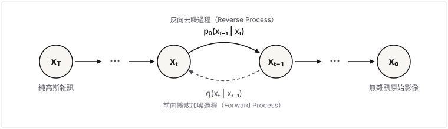

# 第 7 頁：DDPM 入門

## 學習目標
理解去噪擴散機率模型（DDPM）的前向加噪、逆向預測雜訊與單步重建估計 $\hat{\mathbf{x}}_0$，以及如何應用於異常檢測。

## 投影片內容

*示意圖，依論文 Fig. 2 重繪*

- **加雜訊（前向）**：用公式直接算出第 t 步的含噪圖。
- **學去雜訊（逆向）**：訓練網路預測混入的雜訊；原始 DDPM 生成圖片要走完 **1000** 步。
- **一步估計原圖**：由含噪圖和預測雜訊，可一步算出原圖的估計值：

$$\hat{\mathbf{x}}_0 = \frac{\mathbf{x}_t - \sqrt{1 - \bar{\alpha}_t}\boldsymbol{\epsilon}_\theta(\mathbf{x}_t, t)}{\sqrt{\bar{\alpha}_t}}$$

- **（AI 整理）** 後兩頁的異常檢測方法，借用這個估計式來重建正常外觀。

## 延伸閱讀
- [Ho et al. (2020) — DDPM §4–§5](../../../wiki/papers/ho2020-ddpm.md#4-方法架構與核心設計)
- [去噪擴散機率模型（DDPM） §3](../../../wiki/concepts/denoising-diffusion-probabilistic-models.md#3-核心數學原理與公式出自-ho2020-ddpmpdf-sec-2--sec-3-p-25)

## 講者備註（不顯示於投影片畫面）
- 原始 DDPM 是生成模型：完整生成要從純雜訊逐步去噪 1000 步；一步估計式只是對原圖的估計，不保證任何步數都能得到清楚、無瑕疵的影像。
- 「借用估計式來重建正常外觀」是後續方法（DiffusionAD、LAMBDA）的做法（AI 整理）；DiffusionAD 論文另外驗證了在何種加噪強度下一步去噪品質足夠，見第 8 頁。

## 主張記錄表
| 主張 ID | 內容 | 方法 | 資料集 | 指標 | 數值與條件 | wiki 頁與段落 | 原文位置 | 原文事實／依原文數據計算／AI 推論 |
| :--- | :--- | :--- | :--- | :--- | :--- | :--- | :--- | :--- |
| `C07-01` | DDPM 前向過程具閉式解 $\mathbf{x}_t = \sqrt{\bar{\alpha}_t}\mathbf{x}_0 + \sqrt{1-\bar{\alpha}_t}\boldsymbol{\epsilon}$，逆向過程將高斯平均數參數化為預測雜訊 $\boldsymbol{\epsilon}_\theta(\mathbf{x}_t, t)$ 並以無權重簡化損失 $L_{\text{simple}}$ 訓練（預設總步數 $T=1000$） | DDPM | 無（理論與架構設計） | 前向閉式解與逆向雜訊預測目標 | $T=1000$，Eq. 4 前向閉式解、Eq. 14 簡化損失 $L_{\text{simple}}$ | `wiki/papers/ho2020-ddpm.md` `## 4. 方法架構與核心設計` | `ho2020-ddpm.pdf` Sec. 2–3, p. 2–5, Eq. 4 & Eq. 14 | 原文事實 |
| `C07-02` | DDPM 在任意時間步 $t$ 可由含噪影像 $\mathbf{x}_t$ 與預測雜訊直接計算單步重建估計 $\hat{\mathbf{x}}_0 = (\mathbf{x}_t - \sqrt{1-\bar{\alpha}_t}\boldsymbol{\epsilon}_\theta(\mathbf{x}_t, t))/\sqrt{\bar{\alpha}_t}$，且固定中間時間步 $t$ 去噪時具有「大 $t$ 決定粗粒度全域結構、小 $t$ 保留細部特徵」之漸進式解碼特性 | DDPM | CIFAR10 / CelebA-HQ / LSUN | 重建估計公式與漸進生成特性 | Eq. 15 單步重建估計；$t \in \{1000, 750, 500, 250\}$ 插值與重建實驗 | `wiki/papers/ho2020-ddpm.md` `## 4. 方法架構與核心設計`；`wiki/papers/ho2020-ddpm.md` `## 5. 在異常檢測中怎麼被使用（與關鍵實驗特性）` | `ho2020-ddpm.pdf` Sec. 4.3, p. 6–7, Eq. 15, Fig. 7 & Appendix D, p. 15–16 | 原文事實 |
| `C07-03` | DDPM 完整執行 $T=1000$ 步逆向序列取樣速度較慢（在 TPU v3-8 上取樣一批 128 張 $256 \times 256$ 影像需 300 秒） | DDPM | LSUN / 256×256 影像 | 取樣耗時 | 128 張 256×256 影像需 300 秒（T=1000，TPU v3-8） | `wiki/papers/ho2020-ddpm.md` `## 5. 在異常檢測中怎麼被使用（與關鍵實驗特性）`；`wiki/papers/ho2020-ddpm.md` `## 6. 論文限制（Limitations）與延伸筆記` | `ho2020-ddpm.pdf` Sec. 4, p. 5 & Appendix B, p. 14 | 原文事實 |
| `C07-04` | 後續異常檢測方法（如 DiffusionAD 與 LAMBDA）利用 DDPM 的部分步數加噪（$t < T$）淹沒局部異常並保留正常全域結構，再藉由 Eq. 15 一步去噪重建正常外觀（AI 整理） | DDPM 應用於異常檢測 | 無 | 無 | 部分擴散 + 一步去噪於異常檢測之連結 | `wiki/papers/ho2020-ddpm.md` `## 5. 在異常檢測中怎麼被使用（與關鍵實驗特性）` | 無（跨論文方法連結分析） | AI 推論 |
