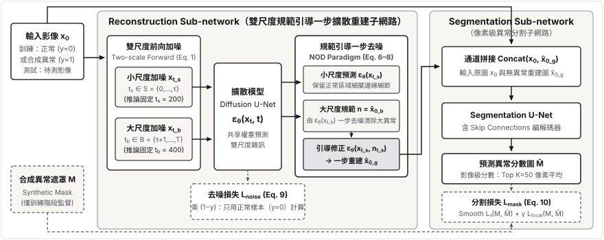

# 第 8 頁：DiffusionAD

## 學習目標
理解 DiffusionAD 如何透過「一步去噪（One-step Denoising）」與「雙尺度規範引導（NOD）」兼顧大面積異常抹除、正常細節保留與高速推論。

## 投影片內容

*示意圖，依論文 Fig. 3 重繪*

- **輸入什麼？** 推論時同一張圖加兩種雜訊（**200**、**400** 步）。
- **保存或學到什麼？** 訓練去雜訊與分割網路。
- **怎麼產生異常分數？** 強雜訊版先一步去噪得到正常範本，引導弱雜訊版重建，再與原圖分割（`MVTec AD` 影像 `AUROC` **99.7%**）。
- **主要限制？** 雜訊強度固定；合成瑕疵未必逼真。

## 延伸閱讀
- [Zhang et al. (2023/2025) — DiffusionAD §4–§6](../../../wiki/papers/zhang2023-diffusionad.md#4-方法架構與核心設計)
- [規範引導一步去噪與合成異常分割 §3](../../../wiki/concepts/norm-guided-one-step-denoising.md#3-核心原理與數學公式)

## 講者備註（不顯示於投影片畫面）
- 大尺度加噪（400 步）能抹除大面積異常但細節較模糊，小尺度加噪（200 步）能保留正常細節；雙尺度規範引導（NOD）結合兩者優勢並維持一步去噪的高速推論。

## 主張記錄表
| 主張 ID | 內容 | 方法 | 資料集 | 指標 | 數值與條件 | wiki 頁與段落 | 原文位置 | 原文事實／依原文數據計算／AI 推論 |
| :--- | :--- | :--- | :--- | :--- | :--- | :--- | :--- | :--- |
| `C08-01` | DiffusionAD 發現當加噪步數 $t < 500$（$t \le 400$）時一步去噪與逐步去噪重建品質相當；其雙尺度規範引導（`NOD`）以分界點 $\tau=300$ 劃分區間，推論時固定以大尺度 $t_b=400$ 一步重建參考規範 $n=\hat{x}_{0_b}$ 引導小尺度 $t_s=200$ 一步重建 $\hat{x}_{0_g}$（引導權重 $w=1$，前 $K=50$ 最高像素平均為影像級分數） | DiffusionAD | MVTec AD / VisA / DAGM / MPDD | 架構與超參數設定 | 輸入 256×256，$T=1000, \tau=300$，推論 $t_s=200, t_b=400, w=1, K=50$，Batch size 16（8 正常 + 8 合成異常），3000 Epochs | `wiki/papers/zhang2023-diffusionad.md` `## 4. 方法架構與核心設計`；`wiki/papers/zhang2023-diffusionad.md` `### 5.1 實驗設定、資料集與評估指標` | `zhang2023-diffusionad.pdf` Sec. IV-A–IV-C, p. 4–6, Eq. 6–12, Fig. 3–5 & Sec. V-A, p. 6–7 | 原文事實 |
| `C08-02` | 在 Table V 四大資料集綜合基準對比中，`DiffusionAD（本篇）` 於 MVTec AD 的 `I / P / O / A`（Image AUROC / Pixel AUROC / Pixel PRO / Pixel AP）為 `99.7 / 98.7 / 95.7 / 76.1`，於 VisA 的 `I / P / O / A` 為 `98.8 / 98.9 / 96.0 / 45.8` | DiffusionAD（本篇） | MVTec AD / VisA | MVTec AD (`I / P / O / A`) / VisA (`I / P / O / A`) | 99.7 / 98.7 / 95.7 / 76.1｜98.8 / 98.9 / 96.0 / 45.8 | `wiki/papers/zhang2023-diffusionad.md` `### 5.2 四大資料集綜合基準對比（出自論文 Table V）` | `zhang2023-diffusionad.pdf` Table V, p. 9 | 原文事實 |
| `C08-03` | DiffusionAD 作者指出的主要限制為：(1) 依賴預先固定的雙加噪尺度（$t_s=200, t_b=400$），缺乏自適應加噪尺度與動態引導；(2) 依賴基於 Perlin 雜訊與紋理替換的合成異常，未必能完全涵蓋所有複雜或邏輯異常 | DiffusionAD | 跨資料集 | 方法限制 | 固定加噪尺度限制與合成異常多樣性限制 | `wiki/papers/zhang2023-diffusionad.md` `## 6. 論文限制（Limitations）與延伸筆記` | `zhang2023-diffusionad.pdf` Sec. VI, p. 11 | 原文事實 |
