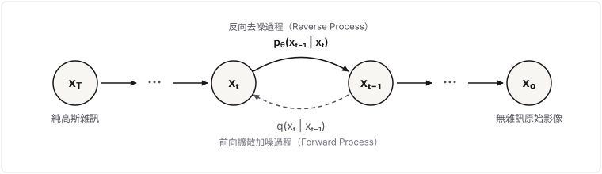

# 去噪擴散機率模型（Denoising Diffusion Probabilistic Models, DDPM）

## 1. 概念定義與解決的問題

**去噪擴散機率模型（Denoising Diffusion Probabilistic Models, DDPM）** 是一類受非平衡熱力學（Nonequilibrium thermodynamics）啟發的潛在變數生成模型（出自 `ho2020-ddpm.pdf` p. 1 Abstract、p. 2 Sec. 1）。它將複雜的資料生成問題拆解為兩個對稱的馬可夫鏈（Markov chains）：
1. **前向擴散過程（Forward Diffusion Process）**：不需學習參數，按固定變異數排程 $\beta_1, \dots, \beta_T$ 在 $T$ 個時間步內逐步向真實影像 $\mathbf{x}_0$ 加入微量高斯雜訊，最終將訊號完全破壞為標準常態雜訊 $\mathbf{x}_T \sim \mathcal{N}(\mathbf{0}, \mathbf{I})$（出自 `ho2020-ddpm.pdf` p. 2 Sec. 2）。
2. **逆向去噪過程（Reverse Denoising Process）**：使用參數化神經網路（通常為具時間步編碼的 `U-Net`）學習逆轉上述加噪過程，在每一步預測混入影像中的高斯雜訊 $\boldsymbol{\epsilon}_\theta(\mathbf{x}_t, t)$，從而將雜訊逐步還原為符合訓練資料分佈的清晰影像（出自 `ho2020-ddpm.pdf` p. 2 Sec. 2、p. 3–4 Sec. 3.2）。

在視覺異常檢測領域中，DDPM 解決了早期深度生成／重建模型（見 [Bergmann et al. (2019)](../papers/bergmann2019-mvtec-ad.md)）的兩大核心瓶頸：
- 克服 **Autoencoder（`AE (L2)` / `AE (SSIM)`）** 因低維度 Bottleneck 壓縮導致重建影像缺乏高頻細節、邊緣模糊的問題（出自 `bergmann2019-mvtec-ad.pdf` p. 8 Sec. 4.4.2）。
- 克服 **GAN（`AnoGAN`）** 訓練易發生 Mode Collapse（模式崩潰）且測試階段潛在空間搜尋難以穩定收斂的問題（出自 `bergmann2019-mvtec-ad.pdf` p. 8 Sec. 4.4.1）。

---

## 2. 初學者版（AI 整理）

> **（AI 整理）**
> - **為什麼「分 1000 小步去雜訊」比「一步重畫整張圖」容易得多？**
>   叫一個畫家憑空一筆畫出「一顆紋路逼真的榛果」，非常容易畫歪（就像 GAN 容易崩潰，或 Autoencoder 畫得模模糊糊）。
>   但如果你把任務拆成 **1,000** 個極小步驟：每一步只讓照片沾上一點點薄霧，然後訓練 AI 只做一件簡單的事——「**看出這層薄霧在哪裡，把它擦掉一點點**」。當每一步的雜訊都很小時，逆向擦除薄霧的數學分佈也剛好是簡單的高斯分佈！這就是為什麼 DDPM 訓練起來既穩定（只用簡單的均方誤差 Loss），畫出來的細節又比傳統自編碼器銳利得多。
> - **在抓瑕疵時，為什麼「加一半的雜訊」剛剛好？**
>   如果我們拿一張「有一道刮痕的螺絲」測試影像：
>   - **加太多雜訊（例如走到第 1000 步 $t = T$）**：整張圖變成純雪花，連原本螺絲擺什麼角度都忘光了，AI 倒帶重畫出來的螺絲會轉向別的角度，沒辦法跟原圖一格一格比對。
>   - **加適量雜訊（部分擴散 Partial Diffusion，例如走到中間步數 $t$）**：刮痕這種局部小異常已經被高斯雜訊蓋掉了，但螺絲的大致輪廓與擺放位置還留著！這時讓只學過「完美螺絲」的 AI 把雜訊擦掉，AI 就會把被雜訊蓋住的刮痕修補回正常的螺絲表面，拿修補後的圖跟原圖一比，刮痕立刻無所遁形。

---

## 3. 核心數學原理與公式（出自 `ho2020-ddpm.pdf` Sec. 2 & Sec. 3, p. 2–5）

*示意圖，依論文 Fig. 2 重繪（出自 `ho2020-ddpm.pdf` p. 2 Fig. 2）。*

### 3.1 前向加噪與任意步閉式取樣
設原始影像 $\mathbf{x}_0 \sim q(\mathbf{x}_0)$（像素線性縮放至 $[-1, 1]$，出自 `ho2020-ddpm.pdf` p. 4 Sec. 3.3），定義 $\alpha_t := 1 - \beta_t$ 及 $\bar{\alpha}_t := \prod_{s=1}^t \alpha_s$。前向過程單步轉移與任意第 $t$ 步之邊際分佈為（出自 `ho2020-ddpm.pdf` p. 2 Eq. 2 & Eq. 4）：

$$
\begin{gathered}
q(\mathbf{x}_t | \mathbf{x}_{t-1}) = \mathcal{N}\left(\mathbf{x}_t; \sqrt{1 - \beta_t}\mathbf{x}_{t-1}, \beta_t \mathbf{I}\right) \\
q(\mathbf{x}_t | \mathbf{x}_0) = \mathcal{N}\left(\mathbf{x}_t; \sqrt{\bar{\alpha}_t}\mathbf{x}_0, (1 - \bar{\alpha}_t)\mathbf{I}\right)
\end{gathered}
$$

因此訓練或推論時，可直接對任意目標步數 $t \in \{1, \dots, T\}$ 進行一步到位加噪：

$$
\mathbf{x}_t = \sqrt{\bar{\alpha}_t}\mathbf{x}_0 + \sqrt{1 - \bar{\alpha}_t}\boldsymbol{\epsilon}, \quad \boldsymbol{\epsilon} \sim \mathcal{N}(\mathbf{0}, \mathbf{I})
$$

### 3.2 逆向去噪參數化與簡化訓練目標
逆向過程學習高斯條件轉移 $p_\theta(\mathbf{x}_{t-1} | \mathbf{x}_t) = \mathcal{N}(\mathbf{x}_{t-1}; \boldsymbol{\mu}_\theta(\mathbf{x}_t, t), \sigma_t^2 \mathbf{I})$。[Ho et al. (2020)](../papers/ho2020-ddpm.md) 將平均數函數參數化為由網路 $\boldsymbol{\epsilon}_\theta(\mathbf{x}_t, t)$ 預測混入的雜訊 $\boldsymbol{\epsilon}$，並採用簡化加權變分目標 $L_{\text{simple}}$ 進行訓練（出自 `ho2020-ddpm.pdf` p. 4 Eq. 11、p. 5 Eq. 14）：

$$
\begin{gathered}
\boldsymbol{\mu}_\theta(\mathbf{x}_t, t) = \frac{1}{\sqrt{\alpha_t}} \left( \mathbf{x}_t - \frac{\beta_t}{\sqrt{1 - \bar{\alpha}_t}} \boldsymbol{\epsilon}_\theta(\mathbf{x}_t, t) \right) \\
L_{\text{simple}}(\theta) = \mathbb{E}_{t, \mathbf{x}_0, \boldsymbol{\epsilon}} \left[ \left\| \boldsymbol{\epsilon} - \boldsymbol{\epsilon}_\theta\left(\sqrt{\bar{\alpha}_t}\mathbf{x}_0 + \sqrt{1 - \bar{\alpha}_t}\boldsymbol{\epsilon}, t\right) \right\|^2 \right]
\end{gathered}
$$

在任意時間步 $t$，亦可由含噪影像 $\mathbf{x}_t$ 與網路預測雜訊 $\boldsymbol{\epsilon}_\theta(\mathbf{x}_t, t)$ 直接計算原始無雜訊影像之單步估計 $\hat{\mathbf{x}}_0$（出自 `ho2020-ddpm.pdf` p. 7 Eq. 15）：

$$
\hat{\mathbf{x}}_0 = \frac{\mathbf{x}_t - \sqrt{1 - \bar{\alpha}_t}\boldsymbol{\epsilon}_\theta(\mathbf{x}_t, t)}{\sqrt{\bar{\alpha}_t}}
$$

---

## 4. 在視覺異常檢測中的角色與演進脈絡（AI 整理）

> **（AI 整理）**
> 1. **從壓縮瓶頸（Bottleneck）轉向雜訊瓶頸（Noise Bottleneck）**：
>    傳統 Autoencoder 依靠「降低空間解析度與通道維度（如壓至 **100** 維向量）」來過濾異常，代價是連正常的高頻紋理也一併丟失。DDPM 的潛在變數 $\mathbf{x}_1, \dots, \mathbf{x}_T$ 與原始影像 $\mathbf{x}_0$ **具有完全相同的空間維度**（出自 `ho2020-ddpm.pdf` p. 2 Sec. 2），它不是靠縮小尺寸來過濾異常，而是靠「注入高斯雜訊破壞局部異常訊號，再由學習過正常資料分佈梯度（Score）的 `U-Net` 將影像拉回正常流形」。
> 2. **由粗到細的時間步控制（Timestep Granularity）與一步去噪演進**：
>    根據 `ho2020-ddpm.pdf`（p. 7 Sec. 4.3 & Fig. 7、p. 15–16 Appendix D），不同擴散步數 $t$ 控制了被破壞與被重建的特徵尺度（大 $t$ 決定全域結構，小 $t$ 決定局部紋理細節）。後續的 [DiffusionAD（Zhang et al., 2023/2025）](../papers/zhang2023-diffusionad.md) 進一步發現：當 $t < 500$（如 $t_s = 200, t_b = 400$）時，直接利用上述單步估計公式 $\hat{\mathbf{x}}_0$ 執行**一步去噪（One-step Denoising）**即可達到與逐步去噪相當的重建品質（快上數百倍），並透過**規範引導雙尺度一步去噪（[NOD](norm-guided-one-step-denoising.md)）**以大尺度無異常範本 $n = \hat{\mathbf{x}}_{0_b}$ 引導小尺度去噪，同時解決大面積異常清除與正常高頻細節保留的難題（出自 `zhang2023-diffusionad.pdf` Sec. IV, p. 4–5）。
> 3. **從像素空間走向潛在空間與記憶庫引導（Latent Diffusion + Memory Bank Guidance）**：
>    為進一步消弭像素空間雙尺度擴散的高昂記憶體成本（訓練需 `48.4 GB`），[LAMBDA（Lee & Kang, 2026）](../papers/lee2026-lambda.md) 將 DDPM 前向加噪與單步去噪（$t_s = 200$）移至預訓練 `VAE` 的潛在空間（$64\times$ 空間降維），並結合正常潛在記憶庫（`Memory Bank` $\mathcal{M}_b$）檢索出的最相似原型 $L^g$ 與引導尺度圖（[MBG & GSM](memory-bank-guided-latent-diffusion.md)）來引導去噪，使訓練 GPU 記憶體暴降 `80.8%`（僅 `9.3 GB`）、推論速度提升至 `42.3 FPS`（出自 `lee2026-lambda.pdf` Sec. 3, p. 3–6 & Table 1）。

---

## 5. 相關 Wiki 頁面連結

- **基礎與應用方法論文**：
  - [Ho et al. (2020) — DDPM](../papers/ho2020-ddpm.md)
  - [Zhang et al. (2023/2025) — DiffusionAD](../papers/zhang2023-diffusionad.md)
  - [Lee & Kang (2026) — LAMBDA](../papers/lee2026-lambda.md)
- **上位與延伸核心概念**：
  - [非監督式視覺異常檢測（Unsupervised Visual Anomaly Detection）](unsupervised-anomaly-detection.md)
  - [規範引導一步去噪與合成異常分割（Norm-Guided One-Step Denoising & Anomaly Synthesis）](norm-guided-one-step-denoising.md)
  - [潛在空間記憶庫引導去噪與引導尺度圖（Latent Diffusion with MBG & GSM）](memory-bank-guided-latent-diffusion.md)
- **對照概念與流派比較**：
  - [遮罩修復重建與多尺度梯度相似度（Reconstruction by Inpainting & MSGMS）](reconstruction-by-inpainting.md)（參見 [Zavrtanik et al. (2021) — RIAD](../papers/zavrtanik2021-riad.md)）
  - [局部特徵記憶庫與核心集下採樣（Patch-Level Memory Bank & Coreset Subsampling）](memory-bank.md)（參見 [Roth et al. (2022) — PatchCore](../papers/roth2022-patchcore.md)）
  - [預訓練特徵嵌入 vs. 重建式異常檢測流派對比](../comparisons/embedding-vs-reconstruction.md)
- **基準資料集**：[MVTec AD 資料集與評估指標](../datasets/mvtec-ad.md)
