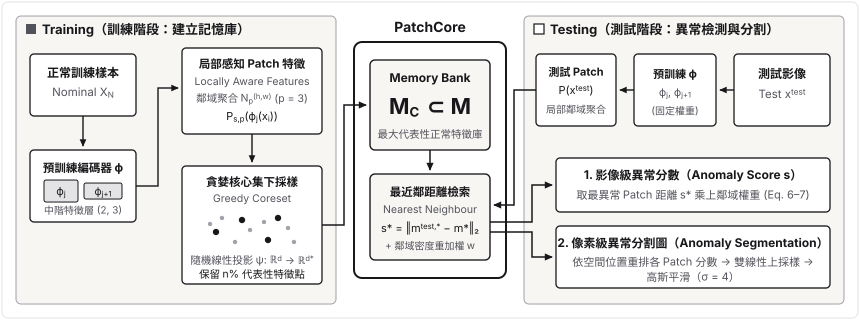

# 局部特徵記憶庫與核心集下採樣（Patch-Level Memory Bank & Coreset Subsampling）

## 1. 概念定義與解決的問題

**局部特徵記憶庫（Patch-Level Feature Memory Bank）** 與 **核心集下採樣（Coreset Subsampling）** 是預訓練特徵嵌入（Pretrained Feature Embedding）異常檢測流派的核心機制，由 [PatchCore（Roth et al., 2022）](../papers/roth2022-patchcore.md) 集大成並推向工業界實用化。其核心思想為：**不針對目標正常影像從頭訓練生成或自編碼模型，而是直接利用大型自然影像資料集（如 `ImageNet`）預訓練好的深層捲積網路 $\phi$，將所有正常訓練影像拆解為具局部空間上下文的中階 Patch 特徵向量並存入記憶庫 $\mathcal{M}$，再透過貪婪幾何核心集選擇（Greedy Coreset Selection）挑選出最具代表性的極小子集 $\mathcal{M}_C \subset \mathcal{M}$ 供測試期進行最近鄰距離檢索（Nearest Neighbour Search）**（出自 `roth2022-patchcore.pdf` p. 1 Abstract、p. 2 Sec. 1、p. 3–5 Sec. 3）。

此架構同時解決了先前預訓練特徵方法的三大結構性瓶頸（出自 `roth2022-patchcore.pdf` p. 1–4 Sec. 1–3.2）：
1. **克服深層特徵之 ImageNet 類別偏置與低空間解析度**：早期方法或 `SPADE` 的影像預篩選階段使用預訓練網路最末層（Last level）的全域平均特徵，不仅喪失局部空間位置資訊，且高階抽象特徵嚴重偏向自然影像分類語意，與工業冷啟動異常檢測任務重疊度極低（出自 `roth2022-patchcore.pdf` p. 1–2 Sec. 1、p. 3 Sec. 3.1）。
2. **克服位置綁定（Patch-specific Mahalanobis）對影像對齊的依賴**：`PaDiM` 雖改用局部 Patch 特徵，但僅在每個固定座標位置獨立計算高斯平均值與共變異數矩陣，使測試 Patch 只能與同座標的訓練統計量比對；一旦工業物件未嚴格剛性對齊或測試影像尺寸改變即會失效（出自 `roth2022-patchcore.pdf` p. 3 Sec. 2、p. 8 Sec. 4.6）。
3. **克服全量記憶庫 kNN 搜尋的高昂計算與儲存成本**：當正常訓練影像張數增加時，全量 Patch 記憶庫 $\mathcal{M}$ 動輒包含數十萬至數百萬個特徵向量，導致最近鄰檢索延遲過高；而單純隨機抽樣（Random subsampling）或增大步長（Striding）又會嚴重破壞正常特徵分佈的空間覆蓋率（出自 `roth2022-patchcore.pdf` p. 4 Sec. 3.2、p. 7 Sec. 4.4.2）。

---

## 2. 初學者版（AI 整理）

> **（AI 整理）**
> - **什麼是「局部特徵記憶庫（Memory Bank）」？（拼圖字典的比喻）**
>   想像你要檢查一塊複雜的印刷電路板有沒有瑕疵。與其自己從頭學畫整塊電路板（像 Autoencoder 或 [RIAD](../papers/zavrtanik2021-riad.md)），不如請一位視力極佳的專家（`ImageNet` 預訓練網路），拿放大鏡把 **200** 張良品電路板的每一個小角落（Patch，還包含它周圍 $3 \times 3$ 鄰居的關係）拍成特寫小卡片，全部收進一個巨大的**「良品拼圖檔案櫃（Memory Bank $\mathcal{M}$）」**。
>   當測試電路板送進來時，只要把測試板也切成一張張小卡片，去檔案櫃裡找「長得最像的那張良品卡片（最近鄰 $m^*$）」。如果某張測試卡片翻遍整個檔案櫃都找不到相似的良品卡片（距離 $s^*$ 很大），那這個角落肯定就是瑕疵！
> - **為什麼需要「貪婪核心集下採樣（Greedy Coreset Subsampling）」？（蓋消防局 vs. 丟骰子抽籤）**
>   **200** 張良品切出來可能有 **200 萬**張小卡片，每次檢查都要比對 **200 萬**次太慢了！而且裡面有 **180 萬**張可能都是一模一樣的綠色底板（高度冗餘）。我們想把檔案櫃縮小 **100** 倍（只留 **1%**），該怎麼挑？
>   - **隨機抽籤（Random Subsampling）**：閉著眼睛亂抽 **1%**。結果很可能會抽到一大堆常見的綠色底板，卻剛好把「全圖只有一顆的微型電容」卡片漏掉了！測試時看到正常電容就會誤以為是瑕疵（見 `roth2022-patchcore.pdf` p. 4 Fig. 3）。
>   - **貪婪核心集（Greedy Coreset）**：就像在城市裡蓋消防局，目標是「讓離消防局最遠的那戶人家，距離也能越近越好（Minimax Facility Location）」。每次挑卡片時，都去剩下的卡片堆裡找**「跟目前已經挑出來的卡片長得最不一樣（距離最遠）」**的那一張收進精簡檔案櫃 $\mathcal{M}_C$。這樣一來，常見的綠色底板只會留幾張代表，而罕見的正常電容、邊角、文字也一定會被挑中保留下來！

---

## 3. 核心原理與數學公式（出自 `roth2022-patchcore.pdf` Sec. 3, p. 3–5）

*示意圖，依論文 Fig. 2 重繪（出自 `roth2022-patchcore.pdf` p. 4 Fig. 2）。*

### 3.1 局部鄰域聚合與跨層中階特徵記憶庫 $\mathcal{M}$
設預訓練網路 $\phi$（預設 `WideResNet50`）於中階層級 $j \in \{2, 3\}$ 輸出特徵圖 $\phi_{i,j} \in \mathbb{R}^{c^* \times h^* \times w^*}$。對每個空間位置 $(h, w)$，取其 $p \times p$（預設 $p = 3$）鄰域 $\mathcal{N}_p^{(h,w)}$ 執行自適應平均池化 $f_{\text{agg}}$，並將 $j+1$ 層特徵雙線性上採樣至與 $j$ 層相同解析度後拼接為 $d$ 維局部感知特徵，匯集所有正常訓練影像 $x_i \in \mathcal{X}_N$ 形成完整記憶庫 $\mathcal{M}$（出自 `roth2022-patchcore.pdf` p. 3–4 Eq. 1–4）：

$$
\begin{gathered}
\mathcal{N}_p^{(h,w)} = \left\{ (a, b) \,\middle|\, a \in \left[h - \lfloor p/2 \rfloor, \dots, h + \lfloor p/2 \rfloor\right], \; b \in \left[w - \lfloor p/2 \rfloor, \dots, w + \lfloor p/2 \rfloor\right] \right\} \\
\phi_{i,j}\left(\mathcal{N}_p^{(h,w)}\right) = f_{\text{agg}}\left( \left\{ \phi_{i,j}(a, b) \,\middle|\, (a, b) \in \mathcal{N}_p^{(h,w)} \right\} \right) \\
\mathcal{M} = \bigcup_{x_i \in \mathcal{X}_N} \mathcal{P}_{s,p}(\phi_j(x_i))
\end{gathered}
$$

### 3.2 極小化極大設施選址與貪婪核心集選擇
為使壓縮後的核心集 $\mathcal{M}_C \subset \mathcal{M}$ 在特徵空間中維持與原始 $\mathcal{M}$ 近似的覆蓋支援度（Spatial support），定義極小化極大設施選址目標（出自 `roth2022-patchcore.pdf` p. 4 Eq. 5）：

$$
\mathcal{M}_C^* = \arg\min_{\mathcal{M}_C \subset \mathcal{M}} \max_{m \in \mathcal{M}} \min_{n \in \mathcal{M}_C} \|m - n\|_2
$$

由於精確求解為 NP-Hard，實作上結合 **Johnson-Lindenstrauss 隨機線性投影** $\psi: \mathbb{R}^d \to \mathbb{R}^{d^*}$（$d^* < d$）與 $l$ 步貪婪最遠點迭代（出自 `roth2022-patchcore.pdf` p. 5 Algorithm 1）：

$$
m_i \leftarrow \arg\max_{m \in \mathcal{M} - \mathcal{M}_C} \min_{n \in \mathcal{M}_C} \|\psi(m) - \psi(n)\|_2, \quad \mathcal{M}_C \leftarrow \mathcal{M}_C \cup \{m_i\}
$$

### 3.3 最近鄰距離檢索與局部密度重加權評分
測試時計算測試影像所有 Patch 特徵 $m^{\text{test}} \in \mathcal{P}(x^{\text{test}})$ 至記憶庫最近鄰之最大距離 $s^*$，並利用記憶庫中距離最近鄰點 $m^*$ 最近的 $b$ 個鄰居 $\mathcal{N}_b(m^*)$ 進行密度重加權以得到最終影像級異常分數 $s$（出自 `roth2022-patchcore.pdf` p. 5 Eq. 6–7）：

$$
\begin{gathered}
m^{\text{test},*}, m^* = \arg\max_{m^{\text{test}} \in \mathcal{P}(x^{\text{test}})} \arg\min_{m \in \mathcal{M}} \|m^{\text{test}} - m\|_2, \quad s^* = \|m^{\text{test},*} - m^*\|_2 \\
s = \left( 1 - \frac{\exp \|m^{\text{test},*} - m^*\|_2}{\sum_{m \in \mathcal{N}_b(m^*)} \exp \|m^{\text{test},*} - m\|_2} \right) \cdot s^*
\end{gathered}
$$

---

## 4. 在異常檢測中的演進：從 CNN Feature Dictionary、SPADE、PaDiM 到 PatchCore

根據 [Bergmann et al. (2019)](../papers/bergmann2019-mvtec-ad.md) 與 [Roth et al. (2022)](../papers/roth2022-patchcore.md) 之文獻脈絡與實證數據，預訓練特徵分佈／記憶庫方法經歷了四個關鍵演進階段（出自 `bergmann2019-mvtec-ad.pdf` p. 5 Sec. 4.1.3、`roth2022-patchcore.pdf` p. 2–4 Sec. 2–3.2 & p. 6–7 Tables 1–5）：

| 演進階段與方法 | 特徵擷取層級與空間特性 | 正常分佈建模／壓縮機制 | MVTec AD 表現（Image / Pixel AUROC / PRO）与關鍵取捨 |
| :--- | :--- | :--- | :--- |
| **1. CNN Feature Dictionary** *(Bergmann et al., 2019)* | `ResNet-18` `avgpool`（**512** 維），於 $16 \times 16$ 像素滑動視窗擷取 | PCA 降維（保留 **95%** 變異，約 **100** 維）+ **K-means（10 個群心）** | 紋理 Pixel AUROC 達 **0.59–0.93**，但僅 **10** 個群心且無空間與多尺度資訊，物件類別 Pixel AUROC 僅 **0.66–0.87**（出自 `bergmann2019-mvtec-ad.pdf` Table 3）。 |
| **2. SPADE** *(Cohen & Hoshen, 2020)* | 結合深層全圖特徵（用於影像級預篩選）與多階層像素特徵金字塔 | 儲存全量特徵記憶庫，先以影像級 kNN 取鄰近訓練圖，再做像素級 kNN | **85.5% / 96.0% / 91.7%**（推論 **0.66 s**）。受制於深層全圖特徵的 ImageNet 偏置，影像級檢測較弱且兩階段搜尋仍慢（出自 `roth2022-patchcore.pdf` Tables 1–3, 5）。 |
| **3. PaDiM** *(Defard et al., 2021)* | 多層級局部 Patch 特徵拼接，但**嚴格綁定每個空間網格座標 $(h, w)$** | 對每個座標 $(h, w)$ 獨立估計多元高斯分佈 $(\boldsymbol{\mu}_{h,w}, \boldsymbol{\Sigma}_{h,w})$ + 隨機通道選擇 | **95.3%**（`PaDiM*` **97.9%**）/ **97.5% / 92.1%**（推論 **0.19 s**）。推論快，但測試 Patch 只能與同座標高斯分佈算 Mahalanobis 距離，對未對齊物件與少樣本敏感（出自 `roth2022-patchcore.pdf` Sec. 2, Tables 1–3, 5）。 |
| **4. PatchCore** *(Roth et al., 2022)* | 中階層級（`2+3`）+ **$3 \times 3$ 局部鄰域自適應平均池化**，全圖共享記憶庫 | **Greedy Coreset Subsampling**（極小化極大設施選址 + 隨機投影）保留 **25% / 10% / 1%** | `PatchCore-25%`：**99.1% / 98.1% / 93.4%**；`PatchCore-1%`：**99.0% / 98.0% / 93.1%**（推論 **0.17 s**，記憶庫使用率自 **$<30\%$** 升至 **近 $95\%$**，出自 `roth2022-patchcore.pdf` Tables 1–3, 5 & Sec. 4.4.2）。 |
| **5. LAMBDA (MBG + GSM)** *(Lee & Kang, 2026)* | `Stable Diffusion v1.4` 預訓練 `VAE` 潛在空間表徵 $L \in \mathbb{R}^{4 \times H/8 \times W/8}$ | 隨機抽樣 **$n_m = 200$** 張正常訓練潛在表徵存入 $\mathcal{M}_b$，供**餘弦相似度檢索最近鄰 $L^g$** 並計算像素距離統計量 $M_b^D$ | MVTec AD：**98.2% / 97.5% / 94.9%**（AP: **69.1%**）；VisA：**98.1% / 98.6% / 94.2%**（推論 **42.3 FPS** / **23.6 ms**，將記憶庫由判別式檢索擴展為**生成式一步去噪擴散的空間自適應引導源**，出自 `lee2026-lambda.pdf` Sec. 4.4–4.5, Table 1, Table 5, Table A.2）。 |

---

## 5. 相關 Wiki 頁面連結

- **核心代表論文**：
  - [Roth et al. (2022) — PatchCore](../papers/roth2022-patchcore.md)
  - [Lee & Kang (2026) — LAMBDA](../papers/lee2026-lambda.md)
- **上位核心概念**：[非監督式視覺異常檢測（Unsupervised Visual Anomaly Detection）](unsupervised-anomaly-detection.md)
- **跨流派深度比較**：[預訓練特徵嵌入 vs. 重建式異常檢測流派對比](../comparisons/embedding-vs-reconstruction.md)
- **對照與融合重建概念**：
  - [潛在空間記憶庫引導去噪與引導尺度圖（Latent Diffusion with MBG & GSM）](memory-bank-guided-latent-diffusion.md)（參見 [Lee & Kang (2026) — LAMBDA](../papers/lee2026-lambda.md)）
  - [遮罩修復重建與多尺度梯度相似度（Reconstruction by Inpainting & MSGMS）](reconstruction-by-inpainting.md)（參見 [Zavrtanik et al. (2021) — RIAD](../papers/zavrtanik2021-riad.md)）
  - [去噪擴散機率模型（Denoising Diffusion Probabilistic Models, DDPM）](denoising-diffusion-probabilistic-models.md)（參見 [Ho et al. (2020) — DDPM](../papers/ho2020-ddpm.md)）
  - [規範引導一步去噪與合成異常分割（Norm-Guided One-Step Denoising & Anomaly Synthesis）](norm-guided-one-step-denoising.md)（參見 [Zhang et al. (2023/2025) — DiffusionAD](../papers/zhang2023-diffusionad.md)）
- **基準資料集**：[MVTec AD 資料集與評估指標](../datasets/mvtec-ad.md)（參見 [Bergmann et al. (2019) — MVTec AD](../papers/bergmann2019-mvtec-ad.md)）、[MVTec AD 2 資料集與進階評估協定（AU-PRO0.05、F1 與光照分佈偏移）](../datasets/mvtec-ad-2.md)（參見 [Heckler-Kram et al. (2025) — MVTec AD 2](../papers/hecklerkram2025-mvtec-ad-2.md)）
