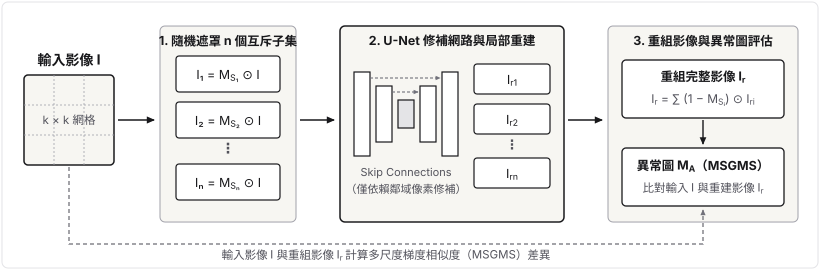

# 遮罩修復重建與多尺度梯度相似度（Reconstruction by Inpainting & MSGMS）

## 1. 概念定義與解決的問題

在基於重建的非監督式異常檢測中，**遮罩修復重建（Reconstruction by Inpainting）** 將傳統「輸入完整影像 $\mathbf{I} \to$ 壓縮重建 $\mathbf{I}_r$」的自編碼（Auto-encoding）任務，轉換為**「移除部分影像區域 $\mathbf{I}_i = M_{S_i} \odot \mathbf{I} \to$ 僅依賴周圍上下文修補被移除區域」**的自監督影像修補（Self-supervised Inpainting）任務（出自 `zavrtanik2021-riad.pdf` p. 1 Abstract & Sec. 1、p. 2 Sec. 3.1）。

此設計直接解決了傳統深度自編碼器（見 [Bergmann et al. (2019)](../papers/bergmann2019-mvtec-ad.md)）的兩難困境：
1. **過強泛化與恆等映射（Over-generalization / Identity Mapping）**：當自編碼器容量足夠大時，網路往往連未見過的異常區域也能高保真地重建出來，違反「模型無法重建異常」的核心假設（出自 `zavrtanik2021-riad.pdf` p. 1 Abstract & Sec. 1）。
2. **Bottleneck 模糊 vs. Skip Connections 平凡解**：傳統 Autoencoder 若不加捷徑會因 Bottleneck 壓縮而丟失高頻細節（造成邊緣模糊與假陽性）；但若直接加上 `U-Net` 的 Skip Connections，低階影像特徵會直接跨層複製到輸出端，產生「不論正常或異常皆原封不動照抄」的平凡解（Trivial solution）（出自 `zavrtanik2021-riad.pdf` p. 3 Sec. 3.2）。

---

## 2. 初學者版（AI 整理）

> **（AI 整理）**
> - **Autoencoder 的兩難：不開小抄畫不清楚，開了小抄又全盤照抄！**
>   想像叫一位畫家（Autoencoder）把看到的零件重畫一遍：
>   - **不給他描圖紙（無 Skip Connections 的傳統 AE）**：他只能憑大腦簡短的記憶（Bottleneck）重畫，結果畫出來的零件邊緣糊成一團，連正常的磁磚紋路都跟原圖對不上（誤報一堆假瑕疵）。
>   - **給他描圖紙（加上 `U-Net` Skip Connections）**：畫家直接把描圖紙蓋在原圖上照描！雖然正常紋路畫得超清楚，但原圖上有一道刮痕，他也一筆不漏地把刮痕描了下來，結果還是抓不到瑕疵。
> - **遮罩修復（Inpainting）的解法：把要畫的那一格貼上黑膠帶！**
>   [RIAD](../papers/zavrtanik2021-riad.md) 的做法是：允許畫家用描圖紙看周圍的細節（保留 `U-Net` Skip Connections），但**把當前要重畫的那個小方格用黑膠帶貼起來（像素設為 `0`）**！
>   因為黑膠帶底下的像素完全看不見，畫家就算想偷懶照描也描不到，只能觀察黑膠帶四周的紋路來「腦補」中間長什麼樣。由於畫家受訓時只看過完美良品，不管黑膠帶底下原本藏著什麼刮痕或污漬，他補出來的永遠都是乾淨的正常表面！
> - **為什麼比對圖片要用「多尺度邊緣梯度（MSGMS）」而不是直接看顏色相減（L2）？**
>   如果只把兩張圖每個像素的亮度直接相減（$L_2$ 距離），稍微一點點光影偏移或細微顆粒沒對齊就會算出一大堆誤差。`MSGMS` 則是改看**「線條與邊緣的結構斜率（梯度幅值）」**，而且同時在「原圖、縮小 $\frac{1}{2}$、縮小 $\frac{1}{4}$、縮小 $\frac{1}{8}$」四種遠近距離下檢查結構有沒有對齊，既能忽略微小的雜訊干擾，又能抓出真正的刮痕與結構破損。

---

## 3. 核心原理與數學公式（出自 `zavrtanik2021-riad.pdf` Sec. 3, p. 2–4）

*示意圖，依論文 Fig. 1 重繪（出自 `zavrtanik2021-riad.pdf` p. 2 Fig. 1）。*

### 3.1 隨機互斥網格遮罩與拼貼重建
將影像 $\mathbf{I} \in \mathbb{R}^{H \times W}$ 切分為邊長 $k \times k$ 的正方形網格（共 $N = \frac{H}{k} \times \frac{W}{k}$ 格），並隨機均分為 $n$ 個互斥子集 $S_1, \dots, S_n$（預設 $n = 3$）。對每個子集產生二元遮罩 $M_{S_i}$（屬於 $S_i$ 之像素為 `0`，其餘為 `1`）與反轉遮罩 $\overline{M_{S_i}} = \mathbf{1}_{H \times W} - M_{S_i}$：

$$
\begin{gathered}
\sum_{i=1}^{n} \overline{M_{S_i}} = \mathbf{1}_{H \times W} \\
\mathbf{I}_{ri} = \text{InpaintingNet}(M_{S_i} \odot \mathbf{I}) \\
\mathbf{I}_r = \sum_{i=1}^{n} \overline{M_{S_i}} \odot \mathbf{I}_{ri}
\end{gathered}
$$

透過上述拼貼公式，最終重建影像 $\mathbf{I}_r$ 中的**每一個像素，在產生它的那一次網路推論中都必定處於被遮蔽狀態（值為 `0`）**，從根本上阻斷了異常資訊的直接洩漏（出自 `zavrtanik2021-riad.pdf` p. 2–3 Sec. 3.1 Eq. 1–2 & Fig. 2–3）。

### 3.2 多尺度梯度幅值相似度（MSGMS）
利用 $3 \times 3$ Prewitt 水平與垂直濾波器 $h_x, h_y$ 計算梯度幅值 $g(\mathbf{I}) = \sqrt{(\mathbf{I} * h_x)^2 + (\mathbf{I} * h_y)^2}$，定義單一尺度梯度幅值相似度 $GMS(\mathbf{I}, \mathbf{I}_r)$ 與 **4** 尺度金字塔（尺度 $l \in \{1, 2, 3, 4\}$ 對應比例 $1, \frac{1}{2}, \frac{1}{4}, \frac{1}{8}$）之 `MSGMS` 損失 $L_G$（出自 `zavrtanik2021-riad.pdf` p. 3 Sec. 3.2 Eq. 3–5）：

$$
\begin{gathered}
GMS(\mathbf{I}, \mathbf{I}_r) = \frac{2g(\mathbf{I})g(\mathbf{I}_r) + c}{g(\mathbf{I})^2 + g(\mathbf{I}_r)^2 + c} \\
L_G(\mathbf{I}, \mathbf{I}_r) = \frac{1}{4} \sum_{l=1}^{4} \frac{1}{N_l} \sum_{i=1}^{H_l} \sum_{j=1}^{W_l} \left(1 - GMS(\mathbf{I}_l, \mathbf{I}_{rl})_{(i,j)}\right)
\end{gathered}
$$

測試時結合多組遮罩尺寸 $k \in K = \{2, 4, 8, 16\}$ 與 $21 \times 21$ 均值平滑濾波器 $f_{s_f \times s_f}$，產生對不同大小異常皆具高響應且背景雜訊低的最終異常圖 $G_A(\mathbf{I}, \mathbf{I}_r)$（出自 `zavrtanik2021-riad.pdf` p. 4 Sec. 3.4 Eq. 8–9）。

---

## 4. 在異常檢測中的取捨與演進定位（AI 整理）

> **（AI 整理）**
> - **相較於傳統 Autoencoder（`AE-SSIM` / `AE-L2`）的突破**：
>   在 [MVTec AD](../datasets/mvtec-ad.md) 像素級定位任務上，`RIAD` 將全類別平均 Pixel ROC AUC 從 `AE-SSIM` 的 **86.2%** 大幅推進至 **94.2%**（尤其在紋理類別平均從 **78.2%** 躍升至 **93.9%**，出自 `zavrtanik2021-riad.pdf` p. 6 Table 2），證實「遮罩修補＋Skip Connections＋MSGMS」能有效解決傳統自編碼器在高頻紋理上的重建模糊問題。
> - **空間遮罩修補的固有瓶頸**：
>   1. **推論次數倍增**：每個尺度 $k$ 需分 $n$ 次前向傳播，若使用 $|K|=4, n=3$，單張影像需執行 **12** 次 `U-Net` 推論。
>   2. **隨機外觀與大面積異常的兩難**：區塊尺寸 $k$ 太小會讓大異常從邊界滲透進來被修補出來；$k$ 太大又會讓正常但具隨機變化的區域（如 `cable`、`hazelnut`）無法從鄰域準確推論（出自 `zavrtanik2021-riad.pdf` p. 4 Sec. 3.3、p. 7–8 Sec. 6）。這促使後續方法一面探索免重建的「預訓練特徵記憶庫（如 `PatchCore`）」，一面探索以「擴散模型一步去噪重建（如 `DiffusionAD`）」取代多次空間挖空。

---

## 5. 相關 Wiki 頁面連結

- **代表方法論文**：[Zavrtanik et al. (2021) — RIAD](../papers/zavrtanik2021-riad.md)
- **上位核心概念**：[非監督式視覺異常檢測（Unsupervised Visual Anomaly Detection）](unsupervised-anomaly-detection.md)
- **對照概念與流派比較**：
  - [去噪擴散機率模型（Denoising Diffusion Probabilistic Models, DDPM）](denoising-diffusion-probabilistic-models.md)
  - [規範引導一步去噪與合成異常分割（Norm-Guided One-Step Denoising & Anomaly Synthesis）](norm-guided-one-step-denoising.md)（參見 [Zhang et al. (2023/2025) — DiffusionAD](../papers/zhang2023-diffusionad.md)）
  - [潛在空間記憶庫引導去噪與引導尺度圖（Latent Diffusion with MBG & GSM）](memory-bank-guided-latent-diffusion.md)（參見 [Lee & Kang (2026) — LAMBDA](../papers/lee2026-lambda.md)）
  - [局部特徵記憶庫與核心集下採樣（Patch-Level Memory Bank & Coreset Subsampling）](memory-bank.md)（參見 [Roth et al. (2022) — PatchCore](../papers/roth2022-patchcore.md)）
  - [預訓練特徵嵌入 vs. 重建式異常檢測流派對比](../comparisons/embedding-vs-reconstruction.md)
- **基準資料集**：[MVTec AD 資料集與評估指標](../datasets/mvtec-ad.md)
