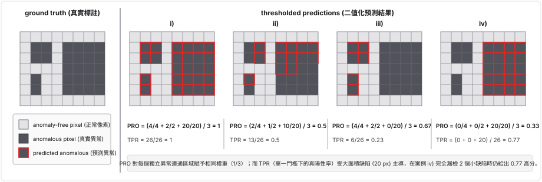

# MVTec AD 2 資料集與進階評估協定（$\text{AU-PRO}_{0.05}$、$F_1$ 與光照分佈偏移）

## 1. 概述與定位

**MVTec AD 2** 由 Heckler-Kram 等人於 2025 年提出（見單篇論文頁 [Heckler-Kram et al. (2025) — MVTec AD 2](../papers/hecklerkram2025-mvtec-ad-2.md)），是繼 2019 年 [MVTec AD](mvtec-ad.md) 後專為突破「既有工業異常檢測基準飽和（SOTA 模型差距小於 1 個百分點）」與「缺乏真實部署環境變異」所設計的新世代高難度工業異常檢測資料集與評估協定（出自 `hecklerkram2025-mvtec-ad-2.pdf` p. 1–2 Abstract & Sec. 1）：
1. **八大高難度真實工業場景（共 8,004 張高解析度影像）**：涵蓋散裝重疊且數量與位置隨機的物件（`Wall Plugs`、`Walnuts`、`Rice`）、正常狀態具高度變異的材質（`Fabric`、`Sheet Metal`）、高反光金屬表面（`Sheet Metal`、`Can`）、透明與半透明折射材質（`Vial`、`Fruit Jelly`）、背光（Back-light）與暗場（Dark-field）工業照明、大尺寸影像（**2.6** 至 **5** MP；原文如此，`Can` 實際較小，見 §3）中的極微小低對比缺陷，以及**直接位於影像邊界（Image borders）的缺陷**（出自 `hecklerkram2025-mvtec-ad-2.pdf` p. 4 Sec. 3.1、p. 5 Table 3、p. 6 Table 4）。
2. **首創真實非合成光照分佈偏移測試（`TESTpriv` vs. `TESTpriv,mix`）**：訓練集與驗證集僅含標準光照下的無異常影像；測試集則將私密評估集分為與訓練集同光照的 `TESTpriv` 以及隨機混合已知與未知光照條件（欠曝、過曝、附加聚光燈或不同角度環形光）的 `TESTpriv,mix`，直接量化模型抵抗真實產線光照偏移的強健性（出自 `hecklerkram2025-mvtec-ad-2.pdf` p. 4 Sec. 3.2–3.3、p. 6 Table 6）。
3. **收緊假陽性容忍度之 $\text{AU-PRO}_{0.05}$ 與有閾值 $F_1$ 雙軌評估**：將 `PRO` 曲線對假陽性率（FPR）的積分上限從傳統的 `0.30`（$\text{AU-PRO}_{0.30}$）收緊至 **`0.05`（$\text{AU-PRO}_{0.05}$）**，並結合基於無缺陷驗證集（$\mu_{\text{val}} + 3\sigma_{\text{val}}$）的像素級分割 $F_1$ 與影像級分類 $F_1$，以及保有私密 Ground Truth 的公開評估伺服器（`https://benchmark.mvtec.com/`），全面杜絕測試集調參（出自 `hecklerkram2025-mvtec-ad-2.pdf` p. 8–10 Sec. 4.2 & Sec. 5）。

---

## 2. 初學者版（AI 整理）

> **（AI 整理）**
> - **從 MVTec AD 1.0 到 MVTec AD 2：考題升級了哪三件事？**
>   1. **從「單顆擺拍」變成「散裝堆疊、透明反光與邊緣突襲」**：
>      在第一代 [MVTec AD](mvtec-ad.md) 中，多數物品是一顆一顆擺在畫面正中央拍清楚。但在 `MVTec AD 2` 中，核桃（`Walnuts`）、白米（`Rice`）、塑膠壁虎（`Wall Plugs`）是一大把隨機撒在桌面上互相重疊；小藥瓶（`Vial`）與果凍（`Fruit Jelly`）是透明會折射的；而且瑕疵不再乖乖待在畫面中間，而是會貼在照片最邊框（Fig. 2），讓習慣把邊緣切掉的模型無所遁形。
>   2. **從「恆溫恆光實驗室」變成「燈光隨時會變的真實工廠（`TESTpriv,mix`）」**：
>      模型訓練時只看過標準亮度的良品照片；但考試時除了考標準燈光（`TESTpriv`），還會考「曝光變亮、變暗、或旁邊多開幾盞聚光燈製造反光」的混合考卷（`TESTpriv,mix`），檢驗模型會不會因為燈光一變就把反光全部當成瑕疵。
>   3. **從「寬鬆計分（$\text{AU-PRO}_{0.30}$）」變成「嚴格計分（$\text{AU-PRO}_{0.05}$）＋實戰切門檻（$F_1$）」**：
>      在大張高清照片裡抓小瑕疵，如果容許 30% 的正常背景誤報（$\text{AU-PRO}_{0.30}$），整張圖滿滿都是假警報也能拿高分！因此 `MVTec AD 2` 把誤報容忍上限壓低 6 倍變成 **5%（$\text{AU-PRO}_{0.05}$）**，並且要求模型只靠正常驗證集自己算出一條「生死門檻」來考像素分割 $F_1$ 與良品／不良品分類 $F_1$。

---

## 3. 資料集規格與三大測試子集總覽（出自 `hecklerkram2025-mvtec-ad-2.pdf` Table 3, p. 5 & Table 4, p. 6）

- **場景總數與總影像數**：共 **8** 個工業檢測場景，總計 **8,004** 張高解析度影像（影像尺寸介於 **$1400 \times 1900$** 至 **$2448 \times 2048$** 及長寬比懸殊的 **$4224 \times 1056$**，相當於 **2.6** 至 **5** MP，出自論文 p. 4 Sec. 3.1、p. 6 Table 4）。**原文如此**：`Table 4` 實際最小者為 `Can` 2232×1024 ≈ 2.29 MP，低於正文所寫的 2.6 MP 下限（依原文數據計算）；上述「1400×1900 至 2448×2048」的範圍也未涵蓋 `Can`。
  - **訓練集（`# Train images`，僅標準光照無異常影像）**：共 **2,528** 張 *(AI 整理，依 Table 4 計算)*（單類介於 `Sheet Metal` **137** 張至 `Walnuts` **432** 張，出自論文 p. 6 Table 4）。
  - **驗證集（`# Val images`，僅無異常影像）**：共 **302** 張 *(AI 整理，依 Table 4 計算)*（單類介於 `Sheet Metal` **19** 張至 `Walnuts` **48** 張，出自論文 p. 6 Table 4）。
  - **測試集（`# Test images`，含無異常與有異常影像，分三子集）**：總計 **5,174** 張（無異常 **1,875** 張／有異常 **3,299** 張）*(AI 整理，依 Table 4 計算)*：
    1. **`TESTpub`（公開範例測試集，共 1,084 張：無異常 379／有異常 705）**：公開影像與所有光照條件下的像素級 Ground Truth，供本機端初步測試。
    2. **`TESTpriv`（私密同光照測試集，共 2,045 張：無異常 748／有異常 1,297）**：僅公開影像，Ground Truth 位於公開評估伺服器；光照條件與訓練集相同。
    3. **`TESTpriv,mix`（私密混合光照測試集，共 2,045 張：無異常 748／有異常 1,297）**：僅公開影像，Ground Truth 位於公開評估伺服器；拍攝與 `TESTpriv` 相同的場景，但每張測試影像隨機取自已知（Seen）與未知（Unseen）光照條件。

| 物件場景 (Object) | 色彩通道与照明設定（Sec. 3.1 & Table 3） | 訓練集 (`# Train`) | 驗證集 (`# Val`) | `TESTpub` (無異常/有異常) | `TESTpriv` (無異常/有異常) | `TESTpriv,mix` (無異常/有異常) | 測試集總計 `total` (無異常/有異常) | 影像尺寸 `image size (W×H)` |
| :--- | :--- | :---: | :---: | :---: | :---: | :---: | :---: | :---: |
| **Can** | RGB｜漫射明場前光（條形光 `B` + 測試聚光燈 `S1, S2`） | 412 | 46 | 162 (72/90) | 321 (145/176) | 321 (145/176) | 804 (362/442) | 2232×1024 |
| **Fabric** | RGB｜漫射明場前光（平面光 `F` + 測試聚光燈 `S1, S2`） | 387 | 43 | 156 (66/90) | 314 (133/181) | 314 (133/181) | 784 (332/452) | 2448×2048 |
| **Fruit Jelly** | RGB｜漫射明場背光 `F` + 前光 `S1`（測試加頂部 `S2`） | 263 | 37 | 80 (20/60) | 255 (71/184) | 255 (71/184) | 590 (162/428) | 2100×1520 |
| **Rice** | RGB｜散裝漫射明場前光（平面光 `F` + 測試聚光燈 `S1, S2`） | 313 | 35 | 132 (42/90) | 277 (96/181) | 277 (96/181) | 686 (234/452) | 2448×2048 |
| **Sheet Metal** | 灰階｜定向暗場前光（低角環形光 `R1` + 測試陡角環形光 `R2`） | 137 | 19 | 114 (24/90) | 142 (36/106) | 142 (36/106) | 398 (96/302) | 4224×1056 |
| **Vial** | 灰階｜漫射明場背光（平面光 `F` + 測試聚光燈 `S1, S2, S3`） | 291 | 41 | 140 (35/105) | 276 (78/198) | 276 (78/198) | 692 (191/501) | 1400×1900 |
| **Wall Plugs** | 灰階｜散裝漫射明場前光（平面光 `F` + 測試低角聚光燈 `S1, S2`） | 293 | 33 | 150 (60/90) | 232 (96/136) | 232 (96/136) | 614 (252/362) | 2448×2048 |
| **Walnuts** | RGB｜散裝漫射明場前光（平面光 `F` + 測試聚光燈 `S1, S2`） | 432 | 48 | 150 (60/90) | 228 (93/135) | 228 (93/135) | 606 (246/360) | 2448×2048 |
| **Total *(AI 整理)*** | **8 場景（5 RGB + 3 灰階）** | 2528 | 302 | 1084 (379/705) | 2045 (748/1297) | 2045 (748/1297) | 5174 (1875/3299) | **總計 8,004 張** |

*(各場景詳細缺陷類型、相機鏡頭型號 Table 5 與光源組合 Table 6 請參閱 [Heckler-Kram et al. (2025) — MVTec AD 2 §4.2–4.4](../papers/hecklerkram2025-mvtec-ad-2.md)。)*

---

## 4. 評估指標定義：$\text{AU-PRO}_{0.05}$ vs. $\text{AU-PRO}_{0.30}$ 與二值化 $F_1$（出自 `hecklerkram2025-mvtec-ad-2.pdf` Sec. 4.2, p. 8–9 & Supplemental Material B, p. 14）

1. **單區域重疊率（Per-Region-Overlap, PRO）**：
   $$\text{PRO} = \frac{1}{k} \sum_{i=1}^{|D_{\text{test}}|} \sum_{j=1}^{k_i} \frac{|P_{\text{ano}} \cap C_{i,j}|}{|C_{i,j}|} \tag{1}$$
   其中 $C_{i,j}$ 為測試影像 $i$ 中第 $j$ 個真實異常連通區域之像素集合，$P_{\text{ano}}$ 為給定閾值 $t$ 下預測為異常之像素集合（出自論文 p. 8 Eq. 1）。相較於受大面積缺陷主導的像素級 `AU-ROC`（衡量 TPR 對 FPR），`PRO` 對每個獨立連通缺陷區域賦予相等權重（見 `Fig. 4` 重繪示意圖）。

*示意圖，依論文 Fig. 4 (p. 8) 重繪：比較單區域重疊率（PRO）與真陽性率（TPR）在 4 種二值化預測結果下的表現。*

2. **兩種嚴格區分的 `AU-PRO` 積分上限（不可混用或直接比較）**：
   - **$\text{AU-PRO}_{0.30}$**（用於 `Table 1` 與補充教材 `Table 9`）：將 PRO 對 FPR 曲線積分至 $\text{FPR} = 0.30$。
   - **$\text{AU-PRO}_{0.05}$**（`MVTec AD 2` 主力指標，用於 `Table 7`、`Table 10` 與 `Table 11`）：將 PRO 對 FPR 曲線積分上限緊縮至 **$\text{FPR} = 0.05$**。這是因為在 500 萬像素（5 MP）大圖中面對 10 像素的微小缺陷時，即使 $\text{FPR} = 5\%$ 也會產生超過真實缺陷面積 $25,000$ 倍的錯誤分割區域（出自論文 p. 8 Sec. 4.2.1 & Fig. 5）。（原文寫 more than；屬數量級敘述，算式見[論文頁 §4.5 (A)](../papers/hecklerkram2025-mvtec-ad-2.md)）
3. **基於無缺陷驗證集之有閾值二值化指標（Segmentation $F_1$ 與 Classification $F_1$）**：
   - **分割閾值決定**：取無缺陷驗證集所有像素異常值的**平均值加上 3 倍標準差（$\mu_{\text{val}} + 3\sigma_{\text{val}}$）**作為二值化閾值（出自論文 p. 9 Sec. 4.2.2）。
   - **像素級分割 $F_1$（`Table 8`）**：二值化異常圖與 Ground Truth 遮罩之像素級 Precision 與 Recall 調和平均數。
   - **影像級分類 $F_1$（`Table 12`）**：以整張影像的最大像素異常值作為影像異常分數，只要**至少 1 個像素超過上述分割閾值**即判定整張影像為 `reject`（異常），據此計算影像級分類 $F_1$（出自論文 p. 9 Sec. 4.2.2、p. 14 Supplemental Material B.2）。

---

## 5. 七大 SOTA 方法於 MVTec AD 2 之基準表現總覽

> **指標與欄位順序注意事項**：
> - 下表嚴格區分 **$\text{AU-PRO}_{0.30}$**（出自 `Table 1`、`Table 9`）與 **$\text{AU-PRO}_{0.05}$**（出自 `Table 7`、`Table 10`、`Table 11`），不同指標分列於獨立欄位，絕不混排。
> - 凡標示 `(`TESTpriv / TESTpriv,mix`)` 之欄位，每格皆由斜線分隔「**同訓練集標準光照測試集 `TESTpriv` ／ 混合已知與未知光照測試集 `TESTpriv,mix`**」兩個數值（全 8 類別平均 `Mean`）。
> - 表中 **`RD` 即本 Wiki 既有之 `RD4AD`**（Reverse Distillation [17], Deng & Li, CVPR 2022）。

| 方法名稱 (Method) | 方法流派 | $256 \times 256$ `AU-PRO0.30` (%) (`TESTpriv / TESTpriv,mix`) [Table 1 & Table 9] | $256 \times 256$ `AU-PRO0.05` (%) (`TESTpriv / TESTpriv,mix`) [Table 7] | $512 \times 512$ `AU-PRO0.05` (%) (`TESTpriv / TESTpriv,mix`) [Table 10] | $1/2$ 原始寬高 `AU-PRO0.05` (%) (`TESTpriv / TESTpriv,mix`) [Table 11] | $256 \times 256$ 像素分割 `F1` (%) (`TESTpriv / TESTpriv,mix`) [Table 8] | $256 \times 256$ 影像分類 `F1` (%) (`TESTpriv / TESTpriv,mix`) [Table 12] |
| :--- | :--- | :---: | :---: | :---: | :---: | :---: | :---: |
| **[PatchCore](../papers/roth2022-patchcore.md)** | 預訓練特徵記憶庫（3 骨幹整合，關閉中心裁切） | 53.8 / 50.8 | 28.8 / 26.0 | 41.9 / 35.8 | 62.3 / 52.6 | 3.7 / 3.4 | 8.0 / 9.9 |
| **RD** *(即 RD4AD)* | 反向知識蒸餾（One-Class Embedding） | 53.0 / 50.3 | 26.4 / 25.0 | 37.3 / 34.0 | 53.7 / 49.5 | 18.1 / 16.7 | 70.8 / 72.9 |
| **RD++** | 改良反向知識蒸餾 | 54.3 / 50.4 | 27.1 / 25.2 | 39.5 / 36.4 | 55.3 / 46.8 | 19.2 / 16.7 | 70.5 / 73.0 |
| **EfficientAD** | 輕量師生網路 + 自編碼器（`EfficientAD-S`） | 58.7 / 44.1 | 30.8 / 19.2 | 40.0 / 25.3 | 50.8 / 33.5 | 15.4 / 8.0 | 76.8 / 77.8 |
| **MSFlow** | 多尺度正規化流（Multi-scale Flow） | 52.7 / 37.1 | 24.3 / 11.9 | 39.2 / 18.9 | 58.2 / 29.0 | 21.8 / 9.0 | 51.1 / 72.0 |
| **SimpleNet** | 預訓練特徵 + 特徵空間高斯異常合成 | 46.4 / 37.6 | 21.1 / 13.7 | 32.0 / 21.2 | 45.7 / 34.1 | 17.7 / 8.7 | 73.3 / 77.1 |
| **DSR** | 雙子空間重投影網路 | 49.0 / 45.2 | 20.3 / 17.4 | 25.0 / 18.8 | - *(僅 Rice: 16.0 / 13.5)* | 10.9 / 9.5 | 78.0 / 78.0 |
| **Mean** | **7 種受測方法平均** | 52.6 / - *(Table 1 僅報 TESTpriv)* | - | - | - | - | - |

*(全部 8 個物件場景於 Table 7–12 之逐類完整數據，請參閱單篇論文頁 [Heckler-Kram et al. (2025) — MVTec AD 2 §5.2–5.5](../papers/hecklerkram2025-mvtec-ad-2.md)。)*

---

## 6. 相關 Wiki 頁面連結

- **原始資料集論文**：
  - [Heckler-Kram et al. (2025) — MVTec AD 2](../papers/hecklerkram2025-mvtec-ad-2.md)
  - [Bergmann et al. (2019) — MVTec AD](../papers/bergmann2019-mvtec-ad.md)
- **前代資料集與指標頁**：
  - [MVTec AD 資料集與評估指標（ROC AUC & PRO）](mvtec-ad.md)
- **站內已收錄之相關異常檢測方法**：
  - [Zavrtanik et al. (2021) — RIAD](../papers/zavrtanik2021-riad.md)
  - [Roth et al. (2022) — PatchCore](../papers/roth2022-patchcore.md)
  - [Zhang et al. (2023/2025) — DiffusionAD](../papers/zhang2023-diffusionad.md)
  - [Lee & Kang (2026) — LAMBDA](../papers/lee2026-lambda.md)
- **跨論文流派比較与核心概念**：
  - [預訓練特徵嵌入 vs. 重建式異常檢測流派對比](../comparisons/embedding-vs-reconstruction.md)
  - [非監督式視覺異常檢測（Unsupervised Visual Anomaly Detection）](../concepts/unsupervised-anomaly-detection.md)
  - [局部特徵記憶庫與核心集下採樣（Patch-Level Memory Bank & Coreset Subsampling）](../concepts/memory-bank.md)
