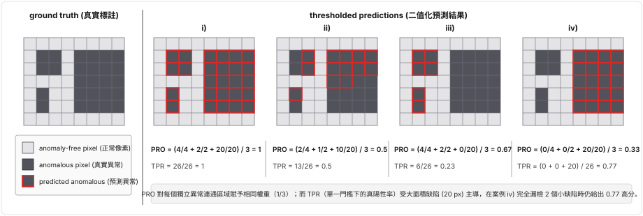

# The MVTec AD 2 Dataset: Advanced Scenarios for Unsupervised Anomaly Detection

## 1. 基本資訊

- **簡稱**：`MVTec AD 2`（出自論文 p. 1 Title & Abstract）
- **發表年份與出處**：`2025`（`arXiv:2503.21622v1 [cs.CV] 27 Mar 2025`，頁尾版權標記 `© 2025 IEEE`；正式期刊或會議名稱於 PDF 內未載明，記為「待確認」，出自論文 p. 1 頁側與頁尾）
- **作者**：Lars Heckler-Kram$^{1,2}$, Jan-Hendrik Neudeck$^1$, Ulla Scheler$^1$, Rebecca König$^1$, Carsten Steger$^1$（$^1$MVTec Software GmbH, Germany；$^2$Technical University of Munich, Germany，出自論文 p. 1 & p. 13）
- **主分類**：`資料集`
- **技術標籤**：`Dataset`、`Benchmark`、`Industrial AD`、`AU-PRO0.05`、`AU-PRO0.30`、`F1 Score`、`Distribution Shift`、`Unseen Lighting`、`Public Evaluation Server`
- **官方外部連結**：
  - 資料集下載與專案頁：`https://www.mvtec.com/company/research/datasets/mvtec-ad-2`（出自論文 p. 1 Abstract、p. 4 Sec. 3.2、p. 10 Footnote 1、p. 14 Supplemental Material A）
  - 公開評估伺服器（Evaluation Server）：`https://benchmark.mvtec.com/`（出自論文 p. 1 Abstract、p. 10 Sec. 5、p. 14 Supplemental Material A）
  - MVTec 資料集總覽頁：`https://www.mvtec.com/company/research/datasets`（出自論文 p. 14 Supplemental Material A）
  - 預印本（arXiv）：`arXiv:2503.21622v1`（出自論文 p. 1 頁側）
  - 授權條款（License）：`CC BY-NC-SA 4.0`（出自論文 p. 4 Sec. 3.2、p. 14 Supplemental Material A）
  - DOI / 官方 GitHub：待確認（PDF 內未載明；註：p. 11 Footnotes 1–2 之 `https://developer.nvidia.com/embedded/jetson-nano` 與 `https://hailo.ai/products/ai-accelerators/hailo-8-ai-accelerator` 為硬體產品參考網站）
- **重要術語與指標對照註記**：
  1. **方法名稱對照**：本篇論文中的 **`RD`（Reverse Distillation [17], Deng & Li, CVPR 2022）即本 Wiki 既有頁面中的 `RD4AD`**；論文中的 **`RD++` 為 Reverse Distillation Revisited [31]（Tien et al., CVPR 2023）**（出自論文 p. 7 Sec. 4.1、p. 12 References [17], [31]）。
  2. **兩種不同積分上限之 `AU-PRO` 指標**：本篇論文同時使用 **$\text{AU-PRO}_{0.30}$**（FPR 積分上限 `0.30`，用於 `Table 1` 與 `Table 9`）與更嚴格的 **$\text{AU-PRO}_{0.05}$**（FPR 積分上限 `0.05`，用於 `Table 7`、`Table 10` 與 `Table 11`）。兩者積分範圍不同，絕對不可混在同一欄或直接互相比較（出自論文 p. 8 Sec. 4.2.1、p. 14 Supplemental Material B.1）。
- **關聯 Wiki 頁面**：
  - 資料集與指標頁：[MVTec AD 2 資料集與進階評估協定（AU-PRO0.05 與光照偏移）](../datasets/mvtec-ad-2.md)、[MVTec AD 資料集與評估指標（ROC AUC & PRO）](../datasets/mvtec-ad.md)
  - 前代資料集論文：[Bergmann et al. (2019) — MVTec AD](bergmann2019-mvtec-ad.md)
  - 站內已收錄之受測／引用方法：[Roth et al. (2022) — PatchCore](roth2022-patchcore.md)、[Zhang et al. (2023/2025) — DiffusionAD](zhang2023-diffusionad.md)
  - 跨論文流派比較：[預訓練特徵嵌入 vs. 重建式異常檢測流派對比](../comparisons/embedding-vs-reconstruction.md)

---

## 2. 一句話總結（TL;DR）與核心貢獻

- **TL;DR**：針對既有異常檢測基準（`MVTec AD`、`VisA`）分割精度趨近飽和（SOTA 模型差距小於 1 個百分點）與缺乏真實環境變異之瓶頸，提出涵蓋 **8** 大高難度工業場景、共 **8,004** 張高解析度影像（**2.6** 至 **5** MP）的新世代資料集 **MVTec AD 2**，首次引入**多重光照條件造成之真實分佈偏移測試（`TESTpriv,mix`）**、嚴格限制假陽性的 **$\text{AU-PRO}_{0.05}$** 指標與**私密 Ground Truth 公開評估伺服器**，使在 `MVTec AD` 上超過 **90%** $\text{AU-PRO}_{0.30}$ 的頂尖方法在 `MVTec AD 2`（$256 \times 256$，`TESTpriv`）上最高僅達 **58.7%** $\text{AU-PRO}_{0.30}$ 與 **30.8%** $\text{AU-PRO}_{0.05}$（出自論文 p. 1–2 Abstract & Sec. 1、p. 2 Table 1、p. 4 Sec. 3.1、p. 10 Table 7）。
- **解決的核心痛點**：
  1. **既有基準表現飽和，難以區分真正方法創新與隨機訓練波動**：在 `MVTec AD`（最佳模型達 **97.8%** mean `AU-PRO` [13]）、`VisA` [14], [15] 以及 `Real-IAD`（在原始尺寸 $1/20$ 解析度下已達 **94.4%** $\text{AU-PRO}_{0.30}$ [16], [17]）上，各模型差距常小於 **1** 個百分點，落入深度學習隨機性與超參數選擇誤差範圍內（出自論文 p. 1 Sec. 1、p. 3 Sec. 2.1）。
  2. **評估設定不一致與測試集過度調參（Overfitting on Test Data）**：過往研究偶爾採用修改或近似版本的 `AU-PRO`，甚至普遍根據測試集表現微調超參數（如各類別專屬訓練 Epoch 數），違背非監督式異常檢測「測試前未知異常類型」的核心前提（出自論文 p. 1 Sec. 1、p. 7 Sec. 4.1、p. 10 Sec. 5）。
  3. **既有資料集忽略多項關鍵工業光學檢測場景**：包含散裝重疊且數量與位置隨機變化的物件（Bulk goods）、透明與高反光物件、正常訓練樣本本身具高度變異、背光（Back-light）與暗場（Dark-field）照明、高解析度大圖中的極微小低對比缺陷、緊貼影像邊界的缺陷（檢驗 Center Cropping 與 Padding 邊界假影），以及同一模型部署於不同機台或光源老化所引發的**光照分佈偏移（Distribution shift due to lighting changes）**（出自論文 p. 1–4 Sec. 1, Sec. 2.1, Sec. 3.1, Table 2）。
- **三大核心貢獻**（出自論文 p. 2 Sec. 1）：
  1. **提出高挑戰性工業異常檢測資料集 MVTec AD 2**：收錄 **8** 個源自真實工業應用的進階場景、共 **8,004** 張高解析度影像；在標準輸入 $256 \times 256$ 下，當前最佳模型（`EfficientAD`）於同光照測試集 `TESTpriv` 僅能達到 **58.7%** $\text{AU-PRO}_{0.30}$（Table 1、Table 9）與 **30.8%** $\text{AU-PRO}_{0.05}$（Table 7）。
  2. **首次支援真實非合成光照分佈偏移（Real-World Lighting Distribution Shift）評估**：每個場景皆在至少 **4** 種不同光照條件（正常曝光、欠曝、過曝與針對物件特性設計的附加聚光燈／不同角度環形光）下實景拍攝，透過對比 `TESTpriv`（同訓練集光照）與 `TESTpriv,mix`（隨機混合已知與未知光照），直接量化模型抵抗環境光照變化的強健性（出自論文 p. 2 Sec. 1、p. 4 Sec. 3.2–3.3）。
  3. **建置私密 Ground Truth 公開評估伺服器並全面評測 7 種 SOTA 方法**：將兩大主力測試集 `TESTpriv` 與 `TESTpriv,mix` 的像素級標註保留於公開評估伺服器（`https://benchmark.mvtec.com/`），防止在測試集上調參；並針對 7 種代表性方法（`PatchCore`、`RD`［即 `RD4AD`］、`RD++`、`EfficientAD`、`MSFlow`、`SimpleNet`、`DSR`），完整評測無閾值指標（$\text{AU-PRO}_{0.05}$、$\text{AU-PRO}_{0.30}$）、有閾值二值化指標（像素分割 $F_1$、影像分類 $F_1$）以及高解析度輸入下的推論時間與 GPU 記憶體消耗（出自論文 p. 2 Sec. 1、p. 7–11 Sec. 4–5）。

---

## 3. 初學者版（AI 整理）

> **（AI 整理）**
> - **為什麼已經有了 MVTec AD，還需要推出「MVTec AD 2」？（考題太簡單 vs. 真實工廠大魔王）**
>   1. **舊考卷（MVTec AD 1.0 與 VisA）已經被刷到滿分了**：
>      2019 年問世的 [MVTec AD](bergmann2019-mvtec-ad.md) 就像異常檢測界的「國中會考」，當年大家只考 60～80 分；但到了 2022–2025 年，[PatchCore](roth2022-patchcore.md)、[DiffusionAD](zhang2023-diffusionad.md) 等頂尖模型動輒考出 **98%～99.7%**！當第一名跟第五名只差 **0.2** 分時，根本分不出是誰的方法真正有突破，還是誰運氣好、針對考題偷偷調了參數。
>   2. **真實工廠的四大「大魔王考題」在舊資料集裡都沒有**：
>      - **大魔王一：散裝堆疊（Bulk Goods）**——產線上不會每次都把一顆核桃或一個塑膠壁虎（`Wall Plugs`）擺在畫面正中央拍沙龍照，而是「一大把核桃、白米或塑膠塞倒在輸送帶上」，彼此重疊、遮擋、數量跟位置每次都不一樣，甚至有一半被畫面邊緣切掉！
>      - **大魔王二：透明、反光與特殊打光**——玻璃小藥瓶（`Vial`）跟水果果凍（`Fruit Jelly`）是透明／半透明的，氣泡跟折射每次都不同，還得用「背光（Back-light）」才看得到裡面的透明塑膠碎片；金屬罐（`Can`）與金屬板（`Sheet Metal`）則會強烈反光，必須用低角度「暗場環形光（Dark-field）」抓微小刮痕。
>      - **大魔王三：瑕疵長在照片最邊緣**——舊資料集的瑕疵都在畫面中央（Fig. 2），害得有些模型直接「把照片邊框裁掉（Center Cropping）」也能拿高分；`MVTec AD 2` 故意把瑕疵放滿整張圖甚至貼著邊框，讓偷吃步的模型立刻破功！
>      - **大魔王四：工廠燈光變暗、變亮或換機台（光照分佈偏移）**——模型在 A 產線訓練好，搬到 B 產線時燈泡稍微老化變暗，或旁邊多了一盞反光燈（`TESTpriv,mix`），很多原本很準的模型（例如 `MSFlow` 或 `EfficientAD`）分數瞬間腰斬！
> - **為什麼要把指標從 $\text{AU-PRO}_{0.30}$ 改成更嚴格的 $\text{AU-PRO}_{0.05}$，還要看 $F_1$ 分數？**
>   - **假陽性容忍度（`0.30` vs. `0.05`）**：過去算 `AU-PRO` 時，允許模型把高達 **30%（`FPR = 0.30`）** 的正常背景誤判成瑕疵（$\text{AU-PRO}_{0.30}$）。但在一張 **500 萬像素（5 MP）** 的高解析度大圖裡，如果真正的瑕疵只是一顆 **10 像素** 的微小灰塵，就算只容許 **5%（`FPR = 0.05`）** 的正常像素誤報，誤報的假瑕疵面積也高達 **25 萬像素**——是真實瑕疵的 **25,000 倍大**（Fig. 5）！因此 `MVTec AD 2` 將標準緊縮至 **$\text{AU-PRO}_{0.05}$**，一舉揭露現有模型在大圖抓小瑕疵上的嚴重不足。
>   - **切一刀定生死的 $F_1$ 分數**：`AU-PRO` 是「不設門檻、綜合所有可能切法」的分數；但工廠實際運作時，機器必須**切下唯一一條分數門檻（Threshold）**決定「哪裡是瑕疵、這件產品要不要丟掉」。實驗發現：像 `PatchCore` 雖然 `AU-PRO` 排前段班，但用正常驗證集自動算門檻時，因為內部的全資料集標準化機制導致門檻設得太高，像素分割 $F_1$ 竟然只剩 **3.7%**！這證明「會排高低分」跟「能自動切出正確門檻」是兩件完全不同的事。

---

## 4. 資料集規格、取像設定與評估指標

### 4.1 跨資料集定性特徵比較（出自論文 Table 2, p. 3 & Sec. 2.1, p. 3）

論文於 `Table 2` 對比了 **7** 個具備像素級異常遮罩標註的代表性資料集。除下表所列之真實影像、正常樣本高變異性、邊界缺陷、單圖物件數量變化、不同光照條件與透明物件外，作者亦強調 `MVTec AD 2` 的另一大核心貢獻在於其**顯著高於既有基準的檢測難度（Table 1）**；此外，`MVTec AD 2` 專注於 2D 結構／表面異常檢測，不涵蓋邏輯異常（Logical anomalies）或 3D 點雲／深度資料（出自論文 p. 3 Table 2 Caption & Sec. 2.1）：

| 評估準則 (Criterion) | MVTec AD | MVTec LOCO AD | VisA | MVTec 3D AD | Eyecandies | Real-IAD | MVTec AD 2 (ours) |
| :--- | :---: | :---: | :---: | :---: | :---: | :---: | :---: |
| **Real images** | ✓ | ✓ | ✓ | ✓ | ✗ | ✓ | ✓ |
| **High Variability\*** | ✗ | ✓ | ✗ | ✓ | ✓ | ✗ | ✓ |
| **Defects at Image Borders** | ✗ | ✗ | ✗ | ✗ | ✗ | ✗ | ✓ |
| **Variation in #Objects/image\*** | ✗ | ✗ | ✗ | ✗ | ✗ | ✗ | ✓ |
| **Structural Defects** | ✓ | ✓ | ✓ | ✓ | ✓ | ✓ | ✓ |
| **Logical Defects** | ✗ | ✓ | ✗ | ✗ | ✗ | ✗ | ✗ |
| **2D Data** | ✓ | ✓ | ✓ | ✓ | ✓ | ✓ | ✓ |
| **3D Data** | ✗ | ✗ | ✗ | ✓ | ✓ | ✗ | ✗ |
| **Different Lighting Conditions** | ✗ | ✗ | ✗ | ✗ | ✓ | ✗ | ✓ |
| **Transparent Objects** | ✗ | ✗ | ✗ | ✗ | ✓ | ✗ | ✓ |

*\*Refers to the allowed variation in the normal data used during training and validation（指訓練與驗證階段之無異常正常資料所允許的變異程度，出自論文 p. 3 Table 2 註腳）。*

---

### 4.2 八大工業檢測場景、取像設定與挑戰明細（出自論文 Table 3, p. 5 & Sec. 3.1, p. 4）

`MVTec AD 2` 共包含 **8** 個工業異常檢測場景、總計 **8,004** 張高解析度影像（解析度介於 **2.6** 至 **5** Megapixels，長寬比依物件而異，見 `Table 4`）（**原文如此**：論文 Sec. 3.1 寫 2.6 至 5 MP，但同篇 `Table 4` 中 `Can` 為 2232×1024，低於此下限。依原文數據計算：2232 × 1024 = 2,285,568 像素，以十進位 MP 換算並四捨五入至小數第 2 位約 2.29 MP；2.29 是換算值，不是作者報告值）：
- **散裝物件場景（Bulk goods，3 類）**：`Wall Plugs`、`Walnuts`、`Rice`——包含彼此重疊、遮擋且空間排列與數量不受控的多實例物件。
- **高正常變異紋理／表面場景（Textured objects，2 類）**：`Fabric`、`Sheet Metal`——正常樣本本身即具備高度圖樣或表面紋理變化。
- **高反光金屬物件（Reflective metal objects，2 類）**：`Sheet Metal`、`Can`——引入鏡面反光與眩光挑戰。
- **透明與半透明物件（Transparent objects，2 類）**：`Vial`、`Fruit Jelly`——引入光線折射、扭曲與內部異物檢測挑戰。
- **色彩與照明模態**：除 RGB 彩色影像外，包含 **3** 個單通道灰階影像類別（`Sheet Metal`、`Vial`、`Wall Plugs`），並涵蓋既有資料集忽略的**背光照明（Back-light：`Vial`、`Fruit Jelly`）**與**暗場照明（Dark-field：`Sheet Metal`）**（出自論文 p. 4 Sec. 3.1）。
- **全圖與邊界缺陷分佈（Fig. 2, p. 4）**：不同於 `MVTec AD` 與 `VisA` 的缺陷標註高度集中於影像中心，`MVTec AD 2` 的缺陷分佈於整張影像的完整高度與寬度，並直接出現在**影像邊界（Image borders）**，可用於檢驗模型對邊界 Padding 假影（Padding artifacts）的強健性，並對依賴中心裁切（Center cropping）的模型構成挑戰（出自論文 p. 4 Sec. 3.1 & Fig. 2）。

以下完整抄錄論文 `Table 3`（p. 5）之各物件取像設定、缺陷描述與主要挑戰：

| Object | Acquisition Setting | Description of Occurring Defects | Main Challenges |
| :--- | :--- | :--- | :--- |
| **Can** | diffuse bright-field front light illumination of soda can | • print defects • scratches | • tiny defects on a textured surface • light reflections • high variability in the normal data due to rotation of the cans • images with large aspect ratio |
| **Fabric** | diffuse bright-field front light illumination for fabric inspection | • cuts and holes • color inconsistencies • loose threads and extra fabric pieces | • tiny defects with low contrast • high variability of the normal data due to varying pattern of the print |
| **Fruit Jelly** | diffuse bright-field back and front light illumination of jelly with pieces of fruit | • foreign object contamination of different texture and size • surface scratches | • high variability of the normal data due to varying appearance and amount of ingredients • semi-transparency • low-contrast defects |
| **Rice** | diffuse bright-field front light illumination of rice grains in bulk | • contamination by (semi-)transparent plastic • contamination by foreign objects | • very low contrast defects • transparent contaminants |
| **Sheet Metal** | directed dark-field front light illumination of pieces of sheet metal | • scratches, cuts, and holes • foreign objects | • random surface reflections • images with large aspect ratio • multiple defects of varying size per image |
| **Vial** | diffuse bright-field back light illumination of a single vial with clear sparkling liquid | • contamination by foreign objects • damaged or missing QR codes • fill level deviations • open or missing lids | • transparency of vials and defects • small defects with low contrast • high variability due to rotation of vials, air bubbles, and QR codes |
| **Wall Plugs** | diffuse bright-field front light illumination of multiple wall plugs | • scratches, cuts, and missing parts • contamination by foreign objects or broken pieces • incorrect size of wall plugs | • bulk items: touching, overlapping, and partially cut-off by the image frame • varying quantity and placement of plugs |
| **Walnuts** | diffuse bright-field front light illumination of multiple walnuts | • cracks and holes • contamination by foreign objects or incomplete walnuts | • bulk items: touching, overlapping, and partially cut-off by the image frame • high variability in size, shape, and structure of individual walnuts • varying quantity and placement of walnuts |

---

### 4.3 資料集統計規模與三大測試子集設計（出自論文 Table 4, p. 6 & Sec. 3.2, p. 4）

`MVTec AD 2` 嚴格遵循非監督式異常檢測設定：訓練集（Training set）與驗證集（Validation set）僅包含無異常正常影像，且訓練集僅在**標準光照（Regular lighting）**下拍攝。測試集則劃分為三個子集（出自論文 p. 4 Sec. 3.2、p. 6 Table 4）：
1. **`TESTpub`（公開範例測試集）**：包含少量正常與異常影像，並**公開所有光照條件下的像素級 Ground Truth 標註**，供研究者在本機端進行初步測試與效能估計。
2. **`TESTpriv`（私密同光照測試集）**：僅公開影像，**Ground Truth 保留於評估伺服器**；拍攝光照條件與訓練集完全相同。
3. **`TESTpriv,mix`（私密混合光照測試集）**：僅公開影像，**Ground Truth 保留於評估伺服器**；拍攝**與 `TESTpriv` 完全相同的物件場景**，但每張測試影像（含正常與異常）皆由**已知（Seen）與未知（Unseen）光照條件中隨機抽取**，用於直接比較模型在真實世界光照分佈偏移下的行為變化。

以下為程式由 PDF `Table 4`（p. 6）直接抽取並逐格驗證之統計總表（測試集每格格式為「`總張數 (無異常張數 / 有異常張數)`」）：

| 物件場景 (Object) | 訓練集張數 (`# Train images`) | 驗證集張數 (`# Val images`) | `TESTpub` (無異常/有異常) | `TESTpriv` (無異常/有異常) | `TESTpriv,mix` (無異常/有異常) | 測試集總計 `total` (無異常/有異常) | 影像尺寸 `image size (W×H)` |
| :--- | :---: | :---: | :---: | :---: | :---: | :---: | :---: |
| **Can** | 412 | 46 | 162 (72/90) | 321 (145/176) | 321 (145/176) | 804 (362/442) | 2232×1024 |
| **Fabric** | 387 | 43 | 156 (66/90) | 314 (133/181) | 314 (133/181) | 784 (332/452) | 2448×2048 |
| **Fruit Jelly** | 263 | 37 | 80 (20/60) | 255 (71/184) | 255 (71/184) | 590 (162/428) | 2100×1520 |
| **Rice** | 313 | 35 | 132 (42/90) | 277 (96/181) | 277 (96/181) | 686 (234/452) | 2448×2048 |
| **Sheet Metal** | 137 | 19 | 114 (24/90) | 142 (36/106) | 142 (36/106) | 398 (96/302) | 4224×1056 |
| **Vial** | 291 | 41 | 140 (35/105) | 276 (78/198) | 276 (78/198) | 692 (191/501) | 1400×1900 |
| **Wall Plugs** | 293 | 33 | 150 (60/90) | 232 (96/136) | 232 (96/136) | 614 (252/362) | 2448×2048 |
| **Walnuts** | 432 | 48 | 150 (60/90) | 228 (93/135) | 228 (93/135) | 606 (246/360) | 2448×2048 |
| **Total *(AI 整理，依 Table 4 計算)*** | 2528 | 302 | 1084 (379/705) | 2045 (748/1297) | 2045 (748/1297) | 5174 (1875/3299) | - *(總計 8004 張)* |

*註：`Table 4` 原表底部註記：`TESTpub`: images and corresponding ground truth available for all lighting conditions. `TESTpriv`: images available, ground truth only on evaluation server, same lighting as in the train set. `TESTpriv,mix`: images available, ground truth only on evaluation server, seen and unseen lighting conditions.（出自論文 p. 6 Table 4）。此外，依上表由程式加總全 8 類別可得訓練集 **2,528** 張、驗證集 **302** 張、測試集總計 **5,174** 張（含無異常 **1,875** 張、有異常 **3,299** 張），全資料集總計 **8,004** 張影像，與正文 p. 4 Sec. 3.1 所述之 `8,004` 張完全吻合（AI 整理，依 Table 4 計算）。*

---

### 4.4 取像硬體、各場景照明配置與標註品質控管（出自論文 Table 5 & Table 6, p. 6 & Sec. 3.3–3.5, p. 4–6）

#### (A) 相機與鏡頭硬體規格（出自論文 Table 5, p. 6）

| Object | Camera Model | Lens Model (focal length) |
| :--- | :--- | :--- |
| **Can** | IDS GV-5280CP-C-HQ | Tamron MA111F16VIR (16mm) |
| **Fabric** | IDS GV-5280CP-C-HQ | Tamron MA111F16VIR (16mm) |
| **Fruit Jelly** | IDS GV-5280CP-C-HQ | Tamron MA111F16VIR (16mm) |
| **Rice** | Daheng MER2-503-36U3M | Moritex ML-U1614MP9 (16mm) |
| **Sheet Metal** | SVS-Vistek exo834MTLGEC | Tamron MA111F16VIR (16mm) |
| **Vial** | Daheng MER2-503-36U3M | Moritex ML-U1614MP9 (16mm) |
| **Wall Plugs** | Daheng MER2-503-36U3M | Moritex ML-U1614MP9 (16mm) |
| **Walnuts** | IDS GV-5280CP-C-HQ | Computar M1214-MP2 (12mm) |

#### (B) 測試集各光照條件使用之光源配置（出自論文 Table 6, p. 6）
*註：針對每個物件，除了調整曝光時間產生欠曝（Underexposed）與過曝（Overexposed）影像外，亦搭配附加光源產生 `shift 1`～`shift 3` 光照偏移；對於 `Sheet Metal`，兩個環形光（`R1`、`R2`）各自皆採用 **3** 種不同的曝光時間（出自論文 p. 4 Sec. 3.3、p. 6 Table 6 Caption）。*

| Object | regular, under- and overexposed | additional light sources: `shift 1` | additional light sources: `shift 2` | additional light sources: `shift 3` |
| :--- | :---: | :---: | :---: | :---: |
| **Can** | B | B, S1 | B, S2 | B, S1, S2 |
| **Fabric** | F | F, S1 | F, S2 | F, S1, S2 |
| **Fruit Jelly** | F, S1 | F, S1, S2 | - | - |
| **Rice** | F | F, S1 | F, S2 | F, S1, S2 |
| **Sheet Metal** | R1 | R2 | R2 | R2 |
| **Vial** | F | F, S1 | F, S2 | F, S3 |
| **Wall Plugs** | F | F, S1 | F, S2 | F, S1, S2 |
| **Walnuts** | F | F, S1 | F, S2 | F, S1, S2 |

*縮寫說明：`B`: bar light（條形光）, `F`: flat light（平面光）, `R`: ring light（環形光）, `S`: spotlight（聚光燈）（出自論文 p. 6 Table 6 註腳）。*

#### (C) 各場景打光細節與像素級標註流程（出自論文 Sec. 3.4 & Sec. 3.5, p. 4–6 & Supplemental Material C, p. 16–18）
- **各場景打光設計**（出自論文 p. 5–6 Sec. 3.5 & p. 16–18 Figs. 7–14）：
  - **`Can`**：上方大型條形光（`B`）搭配後方白紙形成均勻漫射照明，罐身隨機旋轉且條碼處貼有閃光箔（Glitter foil，見 Fig. 7）增加正常變異；測試集加裝 **2** 盞聚光燈（`S1`, `S2`）在金屬表面與標籤上製造鏡面高光。
  - **`Fabric`**：上方平面光（`F`）照明；測試集加裝 **2** 盞聚光燈，第 1 盞以低角度斜射產生跨畫面亮度梯度，第 2 盞產生額外雜散光。
  - **`Fruit Jelly`**：結合平面光（`F`）背光（穿透半透明果凍凸顯內部異物）與聚光燈（`S1`）前光（凸顯正面刮痕）；塑膠杯置於聚甲基丙烯酸甲酯（PMMA）板上，杯底反射若可見缺陷亦予以標註（Fig. 11）；測試集於上方加裝第 2 盞 LED 聚光燈（`S2`）。
  - **`Rice`**：大型平面光（`F`）消除陰影；測試集加裝 **2** 盞聚光燈製造亮度梯度，缺陷包含與米粒形狀、大小、顏色極為相似的半透明塑膠片、異物與毛髮（Fig. 12）。
  - **`Sheet Metal`**：採用低入射角環形光（`R1`）形成暗場照明（Dark-field illumination），僅在表面不平整處將光線反射進相機以捕捉微小刮痕與孔洞；測試集除改變曝光時間外，另启用入射角更陡峭的第 2 顆環形光（`R2`）並同樣變化 3 種曝光時間，在金屬板輪廓處產生不同照明圖樣。
  - **`Vial`**：以平面光（`F`）作為背光照明以偵測透明塑膠薄膜等污染物；測試集加裝 **3** 盞 LED 聚光燈（上方 `S1` 製造不均勻頂部照明，側邊 `S2`, `S3` 在瓶身表面製造鏡面反光高光）。
  - **`Wall Plugs` 與 `Walnuts`**：上方大型平面光（`F`）照明散裝物件；測試集加裝 **2** 盞低入射角 LED 聚光燈製造強烈亮度梯度與不規則照明（其中 `Walnuts` 的異物污染包含混入榛果 Hazelnut，見 Fig. 9）。
- **高精確度像素級 Ground Truth 標註流程**（出自論文 p. 4–5 Sec. 3.4）：
  1. 取像現場先建立粗略標註（Coarse annotations），再由人工標註員依各物件專屬標註規範精修。
  2. 透過人工與自動化雙重檢查（含專用軟體工具偵測可能漏標或誤標的微小區域與孔洞），確保跨場景全域一致性。
  3. 若同一缺陷在不同光照條件下外觀顯著改變（例如反光遮蔽或顯現），標註亦隨該光照條件相應調整；所有訓練與驗證集正常影像皆經人工過濾確保零缺陷。

---

### 4.5 評估指標體系與公開評估伺服器協定（出自論文 Sec. 4.2 & Sec. 5, p. 8–10 & Supplemental Material B, p. 14）

#### (A) 無閾值指標（Threshold-Independent Metrics）：$\text{AU-PRO}_{0.05}$ 與 $\text{AU-PRO}_{0.30}$
- **單區域重疊率（Per-Region-Overlap, PRO）數學定義**（出自論文 p. 8 Eq. 1）：
  給定二值化閾值 $t$ 下預測為異常之像素集合 $P_{\text{ano}}$，以及測試集影像 $i \in \{1, \dots, |D_{\text{test}}|\}$ 中第 $j \in \{1, \dots, k_i\}$ 個真實異常連通區域（Connected component）之像素集合 $C_{i,j}$，PRO 定義為跨全體真實連通缺陷區域的平均重疊率：
  $$\text{PRO} = \frac{1}{k} \sum_{i=1}^{|D_{\text{test}}|} \sum_{j=1}^{k_i} \frac{|P_{\text{ano}} \cap C_{i,j}|}{|C_{i,j}|} \tag{1}$$
- **為何選擇 `AU-PRO` 而非像素級 `AU-ROC`（Fig. 4, p. 8）**：
  像素級 `AU-ROC` 衡量整體真陽性率（TPR）對假陽性率（FPR），當圖中同時存在大面積與小面積缺陷時，TPR 會被大面積缺陷主導，即使漏檢多數微小缺陷仍會高估定位品質；反之，`PRO` 對每個獨立連通缺陷區域賦予相等權重，符合工業品管「不論缺陷大小皆須檢出」的要求（出自論文 p. 8 Sec. 4.2.1 & Fig. 4）。

*示意圖，依論文 Fig. 4 (p. 8) 重繪：給定含 3 個異常連通區域（面積分別為 4、2、20 像素，共 26 個異常像素）之 Ground Truth，比較 4 種二值化預測結果下的 PRO 與 TPR。在情境 `iii)` 檢出 2 個小缺陷但漏檢大缺陷時，$\text{PRO} = 0.67$、$\text{TPR} = 0.23$；而在情境 `iv)` 僅檢出 1 個大缺陷卻完全漏檢 2 個小缺陷時，$\text{TPR}$ 高達 $0.77$，$\text{PRO}$ 則誠實反映為 $0.33$。*

- **將積分上限由 `0.30` 收緊至 `0.05`（$\text{AU-PRO}_{0.05}$ vs. $\text{AU-PRO}_{0.30}$，出自論文 p. 8 Sec. 4.2.1 & Fig. 5）**：
  - 傳統文獻通常將 PRO 對 FPR 曲線積分至 $\text{FPR} = 0.3$（記為 **$\text{AU-PRO}_{0.30}$**，並將曲線下面積正規化至 $[0, 1]$ 即百分比）。
  - 然而在現代工業檢測中，允許 30% 背景像素誤報的異常圖完全不具實用性（如 `Fig. 5` 中 `MSFlow` 在 `Rice` 上的預測，於 $\text{FPR} = 0.3$ 時分割出的區域遠大於真實缺陷）。尤其在 `MVTec AD 2` 的「高解析度大圖微小缺陷」場景中，**以一張 500 萬像素（5 MP）影像中僅占 10 個像素的微小缺陷為例，即使將積分上限設為 $\text{FPR} = 5\%$（`0.05`），誤報的錯誤分割面積仍超過該缺陷本身面積的 $25,000$ 倍**（出自論文 p. 8 Sec. 4.2.1）！（數量級說明，依原文數據計算：若影像恰為 5,000,000 像素，誤報面積約為 $0.05 \times (5{,}000{,}000 - 10) / 10 \approx 25{,}000$ 倍；以資料集最大影像 2448×2048 = 5,013,504 像素計約為 25,067 倍。原文寫 more than 25,000 times，屬數量級敘述，不是精確不等式。）
  - 因此，`MVTec AD 2` 確立以 **$\text{AU-PRO}_{0.05}$** 作為主力定位指標（見 `Table 7`、`Table 10`、`Table 11`），同時於 `Table 1` 與補充教材 `Table 9` 提供傳統 **$\text{AU-PRO}_{0.30}$** 數據以利對照。

#### (B) 有閾值指標（Threshold-Dependent Metrics）：像素級分割 $F_1$ 與影像級分類 $F_1$
- **無異常驗證集基準閾值決定法（$\mu_{\text{val}} + 3\sigma_{\text{val}}$）**（出自論文 p. 9 Sec. 4.2.2 & p. 14 Supplemental Material B.2）：
  在非監督式設定下無異常樣本可用於調閾值，故論文將二值化分割閾值設為**無缺陷驗證集（Defect-free validation images）所有像素異常值的平均值加上 3 倍標準差（Mean + $3 \times$ Standard Deviation）**。
- **像素級分割 $F_1$（Segmentation $F_1$，Table 8）**：以該閾值將測試集異常圖二值化後，與真實像素遮罩計算 Precision 與 Recall 的調和平均數（Harmonic mean $F_1$）。
- **影像級分類 $F_1$（Classification $F_1$，Table 12）**：基於「偵測到任何異常區域即判定產品不良（Reject / Bad）」的實務邏輯，直接將上述像素分割閾值同時作為影像分類閾值——等價於取整張影像的最大像素異常值作為影像異常分數（Image anomaly score），只要**至少有 1 個像素超過該分割閾值**，整張影像即分類為 `reject`（異常），據此計算測試集影像分類之 $F_1$ 分數（出自論文 p. 9 Sec. 4.2.2、p. 14 Supplemental Material B.2、p. 15 Table 12 Caption）。

#### (C) 推論時間、GPU 記憶體量測協定與公開評估伺服器（出自論文 Sec. 4.2.3 & Sec. 5, p. 9–10）
- **硬體與量測標準（Sec. 4.2.3, p. 9）**：
  - 統一於單張 **NVIDIA RTX 2080Ti** GPU 上以 `float32` 精度、`Batch size = 1` 量測。
  - **推論時間（Inference runtime）**：先執行 **1,000** 次前向傳播暖機（Warm-up），再取接下來 **1,000** 次前向傳播之平均值；使用 Python `time` 模組，計時起點為**將資料集樣本傳送至 GPU 之前**，終點為**異常圖傳回 CPU 可用之後**。（註：`PatchCore` 因推論時間取決於由訓練集張數決定的記憶庫大小，故合併 `TESTpub` 與 `TESTpriv`，於暖機後對約 **200** 個樣本取平均。）
  - **峰值 GPU 記憶體（Peak memory usage）**：使用 PyTorch 官方 `torch.cuda.memory_stats()['reserved_bytes.all.peak']` 量測。
- **公開評估伺服器提交 6 步驟（Sec. 5, p. 10）**：
  1. 在無異常訓練集訓練模型。
  2. 使用無缺陷驗證集決定訓練時間或二值化分割閾值等超參數（可選用 `TESTpub` 作初步效能估計）。
  3. 對 `TESTpriv` 及／或 `TESTpriv,mix` 執行推論，將連續異常圖存為 `TIFF` 檔並依規定目錄結構存放：`/mvtec_ad_2/{object_name}/{private,private_mixed}/anomaly_images/test/{good,bad}/{image_name}.tiff`（亦可一併提交二值化分割閾值）。
  4. 執行官方提供的本機端資料結構檢查腳本並自動壓縮為 `.zip` 檔。
  5. 上傳至 `https://benchmark.mvtec.com/`（登錄排行榜時須公開所使用的輸入影像尺寸作為計算成本代理指標，見 p. 9 Sec. 4.3.3）。
  6. 接收伺服器回傳之各項評估結果。

---

## 5. 基準方法設定與實驗結果

### 5.1 受測之 7 種 SOTA 方法與實作參數（出自論文 Sec. 4.1, p. 7–8）

所有受測方法皆採用原論文官方實作與其在 `MVTec AD` 上的預設超參數，**嚴禁針對個別場景微調訓練時長（Training duration）等超參數**；若無特別說明，輸入影像統一縮放至 **$256 \times 256$** 像素：
1. **Reverse Distillation (`RD`，即本 Wiki 收錄之 `RD4AD`) [17]**：因網路架構要求輸入邊長必須為 **32** 的倍數，當高解析度實驗（如 `Table 11` 原始影像 $1/2$ 寬高）非 32 倍數時，分別將高與寬取下一個最接近的 32 倍數較小邊長。`Table 1` 中的 `MVTec AD` 數據引自原論文 [17]，`VisA` 則以相同參數重跑（出自論文 p. 7 Sec. 4.1）。
2. **Reverse Distillation Revisited (`RD++`) [31]**：基於 `RD` 框架，採用與 `RD` 相同的 32 倍數縮放規則。`Table 1` 中的 `MVTec AD` 數據引自原論文 [31]，`VisA` 以相同參數重跑（出自論文 p. 7 Sec. 4.1）。
3. **`EfficientAD` [14]**：在 `MVTec AD 2` 的所有評估中選用延遲較低且表現相當的 **`EfficientAD-S`** 架構；但在 `Table 1` 的 `MVTec AD` 與 `VisA` 欄位中則採用較大的 **`EfficientAD-M`** 以展示該方法的最佳整體表現（出自論文 p. 7 Sec. 4.1）。
4. **[`PatchCore`](roth2022-patchcore.md) [22]**：採用官方預設的 **3 骨幹整合（Ensemble）設定**——即同時使用 `WideResNet-101`、`ResNeXT-101` 與 `DenseNet-201` 作為特徵擷取器，近似貪婪核心集下採樣比例（Sampling ratio）設為 **`0.01%`**，最終聚合嵌入維度為 **`384`**；此外，**明確關閉中心裁切（Disable center cropping）**以偵測出現在影像邊界的缺陷（出自論文 p. 7 Sec. 4.1）。
5. **`MSFlow` [28]**：為與其他方法公平比較，在 `Table 1` 及標準評估中使用 **$256 \times 256$** 訓練與推論尺寸（而非原論文的 $512 \times 512$）（出自論文 p. 7–8 Sec. 4.1）。
6. **`SimpleNet` [36]**：使用 `WideResNet50` 特徵擷取器，遵循 [14] 的作法不針對個別場景調整訓練長短，統一固定訓練 **160** 個 Epochs（出自論文 p. 8 Sec. 4.1）。
7. **Dual Subspace Re-Projection (`DSR`) [35]**：採用官方實作；由於訓練耗時極長，在最大輸入尺寸（`Table 11`，原始影像寬高之 $1/2$）下**僅針對 `Rice` 單一物件進行訓練與評估**（出自論文 p. 8 Sec. 4.1、p. 15 Table 11 Caption）。

---

### 5.2 跨資料集分割表現對比：Table 1（指標：$\text{AU-PRO}_{0.30}$，出自論文 Table 1, p. 2）

*重要說明：本表指標為 **$\text{AU-PRO}_{0.30}$（%，FPR 積分上限 `0.30`）**，輸入尺寸為 $256 \times 256$；`MVTec AD 2 (ours)` 欄位之數值對應同光照私密測試集 `TESTpriv` 之平均表現（與 `Table 9` `Mean` 列之 `TESTpriv` 值完全一致）。表中 `RD` 即本 Wiki 既有之 `RD4AD`。此處 `MVTec AD` 與 `VisA` 的數據係本篇論文作者於統一無場景調參協定下彙整／重評測之 $\text{AU-PRO}_{0.30}$ 結果（見 §5.1），與其他論文原表報告之 PRO 實驗設定（如是否裁切、模型變體或訓練 Epoch）不同（出自論文 p. 2 Table 1、p. 7–8 Sec. 4.1、p. 15 Table 9）。*

| 方法 (Method) | MVTec AD `AU-PRO0.30` (%) | VisA `AU-PRO0.30` (%) | MVTec AD 2 (ours, `TESTpriv`) `AU-PRO0.30` (%) |
| :--- | :---: | :---: | :---: |
| **PatchCore** | 92.7 | 79.7 | 53.8 |
| **RD** *(即 RD4AD)* | 93.9 | 89.0 | 53.0 |
| **RD++** | 95.0 | 89.3 | 54.3 |
| **EfficientAD** | 93.5 | 94.0 | 58.7 |
| **MSFlow** | 91.2 | 88.4 | 52.7 |
| **SimpleNet** | 89.6 | 68.9 | 46.4 |
| **DSR** | 90.8 | 68.1 | 49.0 |
| **Mean** | 92.4 | 82.4 | 52.6 |

---

### 5.3 MVTec AD 2 標準解析度（$256 \times 256$）無閾值分割結果：Table 7（$\text{AU-PRO}_{0.05}$）與 Table 9（$\text{AU-PRO}_{0.30}$）

> **指標與欄位順序嚴格區分說明**：
> - **`Table 7`（p. 10）** 採用嚴格假陽性積分上限之 **$\text{AU-PRO}_{0.05}$（%）**；**`Table 9`（p. 15 補充教材）** 採用傳統積分上限之 **$\text{AU-PRO}_{0.30}$（%）**。兩表指標定義不同，不可混為一談。
> - 兩表輸入影像尺寸皆為 **$256 \times 256$**，每格皆包含兩個數值，順序固定為 **`TESTpriv / TESTpriv,mix`**（前者為與訓練集相同之標準光照，後者為隨機混合已知與未知光照條件）。

#### (A) 主力嚴格指標：$\text{AU-PRO}_{0.05}$（%，輸入 $256 \times 256$，每格為 `TESTpriv / TESTpriv,mix`，出自論文 Table 7, p. 10）

| 物件場景 (Object) | PatchCore `AU-PRO0.05` (`TESTpriv / TESTpriv,mix`) | RD *(RD4AD)* `AU-PRO0.05` (`TESTpriv / TESTpriv,mix`) | RD++ `AU-PRO0.05` (`TESTpriv / TESTpriv,mix`) | EfficientAD `AU-PRO0.05` (`TESTpriv / TESTpriv,mix`) | MSFlow `AU-PRO0.05` (`TESTpriv / TESTpriv,mix`) | SimpleNet `AU-PRO0.05` (`TESTpriv / TESTpriv,mix`) | DSR `AU-PRO0.05` (`TESTpriv / TESTpriv,mix`) |
| :--- | :---: | :---: | :---: | :---: | :---: | :---: | :---: |
| **Can** | 4.7 / 4.6 | 7.0 / 7.5 | 7.7 / 7.0 | 9.6 / 1.3 | 6.7 / 0.8 | 8.4 / 1.9 | 13.9 / 3.5 |
| **Fabric** | 11.0 / 12.0 | 3.5 / 3.6 | 4.8 / 5.3 | 22.2 / 13.0 | 14.1 / 14.3 | 6.6 / 7.3 | 6.8 / 5.3 |
| **Fruit Jelly** | 46.7 / 46.7 | 48.2 / 48.2 | 54.4 / 54.4 | 50.5 / 47.6 | 49.4 / 38.3 | 39.8 / 38.5 | 36.0 / 34.2 |
| **Rice** | 25.6 / 18.5 | 11.2 / 11.4 | 12.2 / 10.2 | 27.6 / 4.3 | 21.5 / 12.2 | 8.7 / 4.2 | 7.8 / 8.3 |
| **Sheet Metal** | 15.2 / 13.0 | 9.5 / 8.8 | 9.3 / 8.9 | 11.8 / 5.3 | 11.6 / 7.7 | 12.0 / 9.1 | 18.0 / 16.1 |
| **Vial** | 62.2 / 59.1 | 62.1 / 60.3 | 63.0 / 57.0 | 55.6 / 47.7 | 38.0 / 4.0 | 47.8 / 23.3 | 50.0 / 48.1 |
| **Wall Plugs** | 12.8 / 9.9 | 19.7 / 12.2 | 15.4 / 10.1 | 20.3 / 1.2 | 12.6 / 0.2 | 5.7 / 1.9 | 3.9 / 6.5 |
| **Walnuts** | 51.8 / 44.5 | 50.2 / 48.3 | 49.7 / 48.9 | 48.8 / 33.0 | 40.4 / 18.1 | 40.0 / 23.4 | 25.7 / 17.1 |
| **Mean** | 28.8 / 26.0 | 26.4 / 25.0 | 27.1 / 25.2 | 30.8 / 19.2 | 24.3 / 11.9 | 21.1 / 13.7 | 20.3 / 17.4 |

#### (B) 傳統寬鬆指標對照：$\text{AU-PRO}_{0.30}$（%，輸入 $256 \times 256$，每格為 `TESTpriv / TESTpriv,mix`，出自論文 Table 9, p. 15）

| 物件場景 (Object) | PatchCore `AU-PRO0.30` (`TESTpriv / TESTpriv,mix`) | RD *(RD4AD)* `AU-PRO0.30` (`TESTpriv / TESTpriv,mix`) | RD++ `AU-PRO0.30` (`TESTpriv / TESTpriv,mix`) | EfficientAD `AU-PRO0.30` (`TESTpriv / TESTpriv,mix`) | MSFlow `AU-PRO0.30` (`TESTpriv / TESTpriv,mix`) | SimpleNet `AU-PRO0.30` (`TESTpriv / TESTpriv,mix`) | DSR `AU-PRO0.30` (`TESTpriv / TESTpriv,mix`) |
| :--- | :---: | :---: | :---: | :---: | :---: | :---: | :---: |
| **Can** | 21.6 / 18.1 | 42.9 / 30.1 | 44.7 / 29.4 | 38.1 / 24.4 | 33.4 / 15.8 | 36.3 / 20.7 | 50.0 / 26.3 |
| **Fabric** | 34.6 / 35.3 | 22.3 / 25.6 | 26.2 / 29.5 | 46.8 / 41.3 | 38.2 / 38.4 | 25.7 / 26.0 | 23.7 / 25.6 |
| **Fruit Jelly** | 74.0 / 74.0 | 78.9 / 79.0 | 80.4 / 80.3 | 79.5 / 78.0 | 78.8 / 73.5 | 71.8 / 70.3 | 70.1 / 69.8 |
| **Rice** | 50.9 / 43.1 | 30.2 / 31.3 | 34.2 / 32.9 | 52.1 / 19.1 | 48.5 / 38.8 | 25.5 / 24.3 | 28.4 / 28.0 |
| **Sheet Metal** | 39.8 / 34.2 | 26.6 / 25.1 | 27.6 / 25.1 | 36.1 / 24.5 | 35.8 / 29.0 | 32.3 / 22.9 | 46.9 / 45.2 |
| **Vial** | 90.5 / 89.2 | 91.3 / 90.0 | 91.5 / 87.3 | 88.7 / 85.2 | 79.1 / 39.7 | 82.5 / 67.5 | 88.1 / 85.2 |
| **Wall Plugs** | 37.4 / 34.8 | 51.0 / 41.9 | 51.0 / 40.5 | 51.5 / 17.9 | 35.5 / 9.7 | 27.4 / 12.9 | 23.6 / 26.8 |
| **Walnuts** | 81.7 / 77.4 | 81.2 / 79.6 | 78.9 / 78.0 | 76.5 / 62.3 | 72.1 / 51.8 | 69.4 / 56.1 | 60.8 / 54.5 |
| **Mean** | 53.8 / 50.8 | 53.0 / 50.3 | 54.3 / 50.4 | 58.7 / 44.1 | 52.7 / 37.1 | 46.4 / 37.6 | 49.0 / 45.2 |

- **無閾值分割與光照強健性關鍵發現（出自論文 Sec. 4.3.1, p. 9）**：
  1. **整體定位表現仍有巨大改進空間**：在標準光照 `TESTpriv`（$256 \times 256$）下，所有受測方法的平均 $\text{AU-PRO}_{0.05}$ 皆低於 **31%**，其中以 `EfficientAD` 的 **30.8%** 最高，依序為 `PatchCore`（**28.8%**）、`RD++`（**27.1%**）、`RD`（**26.4%**）、`MSFlow`（**24.3%**）、`SimpleNet`（**21.1%**）與 `DSR`（**20.3%**）；其中 `Can` 對所有模型而言皆極具挑戰性（`TESTpriv` $\text{AU-PRO}_{0.05}$ 僅 **4.7%～13.9%**）。
  2. **不同架構對真實光照偏移（`TESTpriv` $\to$ `TESTpriv,mix`）的強健性差異懸殊**：在 `Table 7`（$\text{AU-PRO}_{0.05}$）中，`RD`（`RD4AD`）展現極強的光照不變性，從 `TESTpriv` 的 **26.4%** 到 `TESTpriv,mix` 的 **25.0%** 僅微幅下降 **1.4** 個百分點（`RD++` 亦僅下降 **1.9** 個百分點，`27.1%` $\to$ `25.2%`）；反觀基於 Normalizing Flow 的 `MSFlow` 則從 **24.3%** 暴跌 **12.4** 個百分點至 **11.9%**，`EfficientAD` 亦從 **30.8%** 大幅滑落至 **19.2%**（下降 **11.6** 個百分點）。

---

### 5.4 MVTec AD 2 標準解析度（$256 \times 256$）有閾值二值化結果：Table 8（像素分割 $F_1$）與 Table 12（影像分類 $F_1$）

*說明：以下兩表輸入尺寸皆為 **$256 \times 256$**，二值化閾值皆由無缺陷驗證集按 $\mu_{\text{val}} + 3\sigma_{\text{val}}$ 自動決定，每格數值順序固定為 **`TESTpriv / TESTpriv,mix`**（出自論文 p. 9 Sec. 4.2.2、p. 10 Table 8、p. 14 Supplemental Material B.2、p. 15 Table 12）。*

#### (A) 像素級二值化分割 $F_1$ 分數（Segmentation $F_1$ in %，輸入 $256 \times 256$，每格為 `TESTpriv / TESTpriv,mix`，出自論文 Table 8, p. 10）

| 物件場景 (Object) | PatchCore `Seg-F1` (`TESTpriv / TESTpriv,mix`) | RD *(RD4AD)* `Seg-F1` (`TESTpriv / TESTpriv,mix`) | RD++ `Seg-F1` (`TESTpriv / TESTpriv,mix`) | EfficientAD `Seg-F1` (`TESTpriv / TESTpriv,mix`) | MSFlow `Seg-F1` (`TESTpriv / TESTpriv,mix`) | SimpleNet `Seg-F1` (`TESTpriv / TESTpriv,mix`) | DSR `Seg-F1` (`TESTpriv / TESTpriv,mix`) |
| :--- | :---: | :---: | :---: | :---: | :---: | :---: | :---: |
| **Can** | 0.3 / 0.1 | 0.1 / 0.1 | 0.1 / 0.1 | 0.8 / 0.1 | 5.0 / 0.1 | 0.6 / 0.1 | 0.4 / 0.1 |
| **Fabric** | 11.5 / 9.8 | 2.6 / 2.2 | 2.9 / 2.3 | 7.6 / 1.0 | 22.0 / 4.1 | 21.6 / 10.2 | 7.9 / 5.0 |
| **Fruit Jelly** | 8.7 / 8.2 | 22.5 / 22.7 | 26.9 / 26.7 | 20.8 / 18.2 | 47.6 / 38.1 | 25.1 / 23.0 | 17.9 / 17.2 |
| **Rice** | 3.8 / 4.2 | 7.0 / 3.9 | 9.5 / 2.9 | 15.0 / 0.5 | 19.1 / 1.8 | 11.6 / 1.0 | 1.5 / 1.4 |
| **Sheet Metal** | 1.8 / 1.1 | 41.3 / 39.2 | 40.9 / 37.7 | 9.3 / 3.8 | 13.0 / 7.6 | 14.6 / 2.8 | 13.9 / 14.4 |
| **Vial** | 2.3 / 2.2 | 28.0 / 28.3 | 28.2 / 22.8 | 30.5 / 26.5 | 23.3 / 6.2 | 31.9 / 17.5 | 28.2 / 27.9 |
| **Wall Plugs** | 0.0 / 0.0 | 1.9 / 0.8 | 1.3 / 0.9 | 4.4 / 0.3 | 0.1 / 0.2 | 1.0 / 0.3 | 0.4 / 0.4 |
| **Walnuts** | 1.2 / 1.3 | 41.2 / 36.7 | 44.1 / 40.5 | 34.6 / 13.3 | 44.5 / 14.3 | 35.2 / 14.3 | 17.0 / 9.6 |
| **Mean** | 3.7 / 3.4 | 18.1 / 16.7 | 19.2 / 16.7 | 15.4 / 8.0 | 21.8 / 9.0 | 17.7 / 8.7 | 10.9 / 9.5 |

#### (B) 影像級二值化分類 $F_1$ 分數（Classification $F_1$ in %，輸入 $256 \times 256$，每格為 `TESTpriv / TESTpriv,mix`，出自論文 Table 12, p. 15）

| 物件場景 (Object) | PatchCore `Cls-F1` (`TESTpriv / TESTpriv,mix`) | RD *(RD4AD)* `Cls-F1` (`TESTpriv / TESTpriv,mix`) | RD++ `Cls-F1` (`TESTpriv / TESTpriv,mix`) | EfficientAD `Cls-F1` (`TESTpriv / TESTpriv,mix`) | MSFlow `Cls-F1` (`TESTpriv / TESTpriv,mix`) | SimpleNet `Cls-F1` (`TESTpriv / TESTpriv,mix`) | DSR `Cls-F1` (`TESTpriv / TESTpriv,mix`) |
| :--- | :---: | :---: | :---: | :---: | :---: | :---: | :---: |
| **Can** | 41.4 / 57.8 | 50.9 / 66.5 | 51.1 / 65.9 | 57.5 / 67.1 | 15.0 / 64.4 | 48.2 / 67.0 | 70.8 / 70.8 |
| **Fabric** | 1.1 / 1.1 | 74.0 / 74.4 | 78.0 / 76.9 | 73.4 / 73.3 | 55.8 / 68.9 | 65.4 / 72.9 | 73.1 / 73.1 |
| **Fruit Jelly** | 9.3 / 8.3 | 84.1 / 84.1 | 85.8 / 85.2 | 84.2 / 84.2 | 64.1 / 78.6 | 84.6 / 84.3 | 83.8 / 83.8 |
| **Rice** | 2.2 / 2.2 | 78.8 / 78.8 | 78.0 / 78.5 | 79.2 / 79.2 | 53.5 / 77.5 | 69.8 / 76.3 | 79.0 / 79.0 |
| **Sheet Metal** | 1.9 / 1.9 | 43.4 / 44.4 | 35.8 / 43.2 | 86.4 / 85.1 | 65.1 / 74.9 | 82.0 / 83.4 | 85.5 / 85.5 |
| **Vial** | 4.0 / 4.0 | 83.3 / 83.5 | 83.7 / 83.5 | 83.5 / 83.5 | 75.6 / 81.8 | 84.8 / 83.7 | 83.5 / 83.5 |
| **Wall Plugs** | 1.4 / 0.0 | 73.9 / 73.9 | 72.2 / 73.4 | 74.0 / 73.6 | 4.2 / 53.4 | 69.1 / 73.4 | 74.1 / 73.9 |
| **Walnuts** | 2.9 / 4.3 | 78.2 / 77.3 | 79.5 / 77.2 | 76.1 / 76.1 | 75.6 / 76.6 | 82.6 / 76.3 | 74.4 / 74.4 |
| **Mean** | 8.0 / 9.9 | 70.8 / 72.9 | 70.5 / 73.0 | 76.8 / 77.8 | 51.1 / 72.0 | 73.3 / 77.1 | 78.0 / 78.0 |

- **有閾值評估與 `PatchCore` 標準化失效分析（出自論文 Sec. 4.3.2, p. 9 & Supplemental Material B.2, p. 14）**：
  1. **無閾值指標與有閾值表現並不一致**：在 `Table 8` 像素級分割 $F_1$（`TESTpriv`）中，`MSFlow` 以 **21.8%** 居冠（但在 `TESTpriv,mix` 光照變化下掉到 **9.0%**），`RD++`（**19.2% / 16.7%**）與 `RD`（**18.1% / 16.7%**）則在光照變化下維持最穩定的像素分割 $F_1$。而在 `Table 12` 影像級分類 $F_1$ 中，`DSR`（**78.0% / 78.0%**）與 `EfficientAD`（**76.8% / 77.8%**）表現最高。
  2. **為何 `PatchCore` 在 `AU-PRO` 排第 2 名，但像素分割 $F_1$（`3.7% / 3.4%`）與影像分類 $F_1$（`8.0% / 9.9%`）卻遠低於所有其他方法？**
     作者於補充教材 `Sec. B.2`（p. 14）明確指出：這源自 `PatchCore` 官方實作預設的**異常圖標準化程序（Normalization procedure）**——為了組合 Ensemble 中多個骨幹網路的輸出，`PatchCore` 預設會將異常圖**跨整個輸入測試資料集（Across the entire input dataset）正規化至 $[0, 1]$ 區間**。當推論階段把正常與異常影像一起處理時，這種正規化運作良好；然而在估計分割閾值時，輸入**只有無缺陷驗證集影像**，將純正常驗證集硬性正規化至 $[0, 1]$ 會導致 $\mu_{\text{val}} + 3\sigma_{\text{val}}$ 推導出一個**極度過高的閾值（Excessively high threshold）**，進而在測試集二值化時漏檢絕大多數異常，導致像素與影像級 $F_1$ 雙雙崩潰。這證明異常檢測方法設計必須與閾值估計機制一併考量（出自論文 p. 9 Sec. 4.3.2、p. 14 Supplemental Material B.2）。

---

### 5.5 提高輸入影像解析度之消融與效率權衡：Table 10（$512 \times 512$）、Table 11（$1/2$ 原始寬高）與 Fig. 6

由於 `MVTec AD 2` 包含許多大圖中的微小低對比缺陷，作者假設部分細小異常在預處理縮放至 $256 \times 256$ 時即已消失，因此進一步測試將輸入解析度提升至 **$512 \times 512$（Table 10）**與**原始影像寬高的一半（Half original width and height，Table 11）**，並統一以嚴格指標 **$\text{AU-PRO}_{0.05}$（%）** 評估（出自論文 p. 9 Sec. 4.3.3、p. 14 Supplemental Material B.1、p. 15 Tables 10–11）：

#### (A) 輸入影像尺寸 $512 \times 512$ 之分割表現：$\text{AU-PRO}_{0.05}$（%，每格為 `TESTpriv / TESTpriv,mix`，出自論文 Table 10, p. 15）

| 物件場景 (Object) | PatchCore `AU-PRO0.05` (`TESTpriv / TESTpriv,mix`) | RD *(RD4AD)* `AU-PRO0.05` (`TESTpriv / TESTpriv,mix`) | RD++ `AU-PRO0.05` (`TESTpriv / TESTpriv,mix`) | EfficientAD `AU-PRO0.05` (`TESTpriv / TESTpriv,mix`) | MSFlow `AU-PRO0.05` (`TESTpriv / TESTpriv,mix`) | SimpleNet `AU-PRO0.05` (`TESTpriv / TESTpriv,mix`) | DSR `AU-PRO0.05` (`TESTpriv / TESTpriv,mix`) |
| :--- | :---: | :---: | :---: | :---: | :---: | :---: | :---: |
| **Can** | 8.4 / 7.0 | 10.5 / 10.7 | 13.1 / 12.6 | 14.2 / 2.4 | 24.2 / 1.3 | 19.0 / 2.3 | 19.8 / 3.3 |
| **Fabric** | 23.7 / 23.5 | 36.8 / 39.6 | 41.2 / 43.0 | 44.5 / 28.3 | 31.7 / 28.2 | 22.5 / 23.6 | 30.3 / 28.7 |
| **Fruit Jelly** | 64.9 / 64.8 | 50.6 / 50.4 | 58.4 / 58.4 | 55.4 / 53.5 | 63.7 / 52.3 | 54.9 / 51.7 | 45.8 / 42.9 |
| **Rice** | 33.6 / 15.5 | 13.1 / 12.0 | 16.0 / 14.4 | 29.9 / 3.1 | 27.2 / 19.0 | 10.1 / 6.1 | 20.5 / 15.9 |
| **Sheet Metal** | 27.3 / 24.1 | 20.0 / 20.1 | 24.3 / 22.0 | 21.7 / 12.4 | 23.4 / 9.5 | 19.0 / 14.1 | 10.1 / 8.4 |
| **Vial** | 72.6 / 68.4 | 67.6 / 64.7 | 71.9 / 69.1 | 60.4 / 55.3 | 53.2 / 4.6 | 56.7 / 32.5 | 23.2 / 14.1 |
| **Wall Plugs** | 34.0 / 21.3 | 43.9 / 21.3 | 35.5 / 19.2 | 33.2 / 2.3 | 31.4 / 0.3 | 24.8 / 6.9 | 6.3 / 7.3 |
| **Walnuts** | 70.5 / 61.4 | 55.8 / 53.5 | 55.5 / 52.4 | 60.8 / 45.4 | 59.0 / 35.7 | 49.3 / 32.6 | 44.1 / 30.2 |
| **Mean** | 41.9 / 35.8 | 37.3 / 34.0 | 39.5 / 36.4 | 40.0 / 25.3 | 39.2 / 18.9 | 32.0 / 21.2 | 25.0 / 18.8 |

#### (B) 輸入影像尺寸為原始影像寬高 $1/2$ 之分割表現：$\text{AU-PRO}_{0.05}$（%，每格為 `TESTpriv / TESTpriv,mix`，出自論文 Table 11, p. 15）
*註：因訓練時間過長，`DSR` 在此解析度下僅針對 `Rice` 進行訓練與評估，其餘物件記為 `-`（出自論文 p. 8 Sec. 4.1、p. 15 Table 11 Caption）。*

| 物件場景 (Object) | PatchCore `AU-PRO0.05` (`TESTpriv / TESTpriv,mix`) | RD *(RD4AD)* `AU-PRO0.05` (`TESTpriv / TESTpriv,mix`) | RD++ `AU-PRO0.05` (`TESTpriv / TESTpriv,mix`) | EfficientAD `AU-PRO0.05` (`TESTpriv / TESTpriv,mix`) | MSFlow `AU-PRO0.05` (`TESTpriv / TESTpriv,mix`) | SimpleNet `AU-PRO0.05` (`TESTpriv / TESTpriv,mix`) | DSR `AU-PRO0.05` (`TESTpriv / TESTpriv,mix`) |
| :--- | :---: | :---: | :---: | :---: | :---: | :---: | :---: |
| **Can** | 12.8 / 10.2 | 15.0 / 13.7 | 18.2 / 15.8 | 20.8 / 3.3 | 26.6 / 2.5 | 21.9 / 3.2 | - |
| **Fabric** | 69.0 / 59.1 | 81.1 / 77.9 | 82.1 / 77.8 | 72.5 / 45.4 | 82.9 / 60.6 | 66.0 / 55.6 | - |
| **Fruit Jelly** | 71.5 / 70.8 | 54.9 / 54.7 | 63.3 / 62.8 | 54.5 / 52.9 | 72.8 / 67.6 | 64.9 / 63.0 | - |
| **Rice** | 47.8 / 28.9 | 27.4 / 26.2 | 31.2 / 28.5 | 37.7 / 5.4 | 47.1 / 32.7 | 21.9 / 12.3 | 16.0 / 13.5 |
| **Sheet Metal** | 72.4 / 54.0 | 54.2 / 51.4 | 57.9 / 46.8 | 52.0 / 37.2 | 42.2 / 11.9 | 46.8 / 34.1 | - |
| **Vial** | 75.8 / 72.2 | 69.9 / 67.7 | 73.2 / 58.8 | 61.4 / 56.4 | 56.1 / 1.7 | 56.1 / 38.8 | - |
| **Wall Plugs** | 68.4 / 53.7 | 55.1 / 39.5 | 52.8 / 24.7 | 42.2 / 12.4 | 65.1 / 1.1 | 25.6 / 10.5 | - |
| **Walnuts** | 80.4 / 71.6 | 71.7 / 64.6 | 64.1 / 59.1 | 65.0 / 54.9 | 72.6 / 53.8 | 62.7 / 55.7 | - |
| **Mean** | 62.3 / 52.6 | 53.7 / 49.5 | 55.3 / 46.8 | 50.8 / 33.5 | 58.2 / 29.0 | 45.7 / 34.1 | - |

- **高解析度擴展性與計算成本權衡結論（出自論文 Sec. 4.3.3, p. 9、Fig. 6, p. 11 & Supplemental Material B.1, p. 14）**：
  1. **提升解析度能顯著拉升定位精度，但仍遠未飽和**：將輸入由 $256 \times 256$（Table 7）放大至 $512 \times 512$（Table 10）再到 $1/2$ 原始寬高（Table 11）時，`PatchCore` 在 `TESTpriv` 的平均 $\text{AU-PRO}_{0.05}$ 從 **28.8%** $\to$ **41.9%** $\to$ **62.3%**（提升超過 2 倍），`MSFlow` 從 **24.3%** $\to$ **39.2%** $\to$ **58.2%**，`RD++` 從 **27.1%** $\to$ **39.5%** $\to$ **55.3%**，`RD` 從 **26.4%** $\to$ **37.3%** $\to$ **53.7%**，`EfficientAD` 從 **30.8%** $\to$ **40.0%** $\to$ **50.8%**，`SimpleNet` 從 **21.1%** $\to$ **32.0%** $\to$ **45.7%**。即便在最大測試解析度下，最高平均表現仍僅 **62.3%**（`TESTpriv,mix` 更僅 **52.6%**），留下龐大研究空間。
  2. **推論延遲與記憶體暴增超過一個數量級（Fig. 6, p. 11）**：在 `Rice` 物件上（$256 \times 256 \to 512 \times 512 \to 1224 \times 1024$），雖然 `PatchCore` 與 `MSFlow` 的 $\text{AU-PRO}_{0.05}$ 翻倍，但推論時間與峰值 GPU 記憶體急遽攀升——`PatchCore` 雖拿下最高 $\text{AU-PRO}_{0.05}$，但在最大尺寸下**單張影像推論耗時長達 2 秒（2,000 ms）**；`SimpleNet` 在最大尺寸（$1224 \times 1024$）下更直接**超出可用 GPU 記憶體上限（Out of Memory）**；相較之下，`MSFlow` 在達到相近定位精度的同時展現了明顯更佳的計算擴展效率（出自論文 p. 9 Sec. 4.3.3 & p. 11 Fig. 6）。

---

## 6. 論文限制與未來工作（Limitations & Future Work）

### 6.1 論文明確記載之限制與未來方向（出自論文 Sec. 6, p. 11）
1. **擴充基準評測模型廣度**：目前論文僅先對 **7** 種具代表性的 SOTA 模型建立基準，作者預計未來在公開評估伺服器上持續納入更多方法的評測結果。
2. **二值化閾值估計方法的改進與免閾值設計**：本篇實驗採用的基準閾值估計法（驗證集 $\mu_{\text{val}} + 3\sigma_{\text{val}}$）相當基礎，作者指出若採用更精巧的閾值估計方法，應能改善無閾值指標（`AU-PRO`）與有閾值指標（$F_1$）之間的相關性；更長遠來看，如何設計出完全消除手動／啟發式閾值選擇需求的新型異常檢測機制，是極具潛力的研究方向。
3. **光照變化下的資料擴增（Data Augmentation）雙面刃探討**：針對在標準曝光（`TESTpriv`）與變化光照（`TESTpriv,mix`）間表現落差極大的方法，未來應探討透過亮度變化等標準資料擴增技術是否足以彌合差距，或必須引入進階擴增策略；同時也必須檢驗這類擴增是否會反過來損害模型在標準光照測試集（`TESTpriv`）上的表現。
4. **大尺寸高解析度影像的高效處理策略**：針對動輒數百萬像素的工業影像，單純放大輸入會導致延遲與記憶體爆炸，未來需深入研究切塊處理（Tiling）或多尺度（Multi-scale）等高效推論架構。
5. **建立標準化邊緣硬體評估伺服器**：為了更真實反映工業產線的硬體限制，作者提議未來建置包含嵌入式與邊緣 AI 加速器的公開硬體基準測試環境，例如僅有 **4 GB** 記憶體的 `NVIDIA Jetson Nano` 或採用 `int8` 量化運算的 `Hailo-8 AI Accelerator`。

### 6.2 延伸洞見與在知識庫脈絡中的定位（AI 整理）
- **（AI 整理）打破「MVTec AD 1.0 刷榜時代」的三大迷思**：
  1. **迷思一：「$256 \times 256$ 下採樣已足夠應付工業檢測」**——在 `MVTec AD`（2019）與 `VisA`（2022）上，將影像統一縮放至 $256 \times 256$ 幾乎成為所有論文（含 `PatchCore`、`DiffusionAD`、`LAMBDA`）的預設慣例。然而 `MVTec AD 2` 的 `Table 7` vs. `Table 11` 證明：當面對 `Sheet Metal`（$4224 \times 1056$）或 `Fabric`（$2448 \times 2048$）上的細微低對比刮痕與破洞時，$256 \times 256$ 下採樣會讓 `Fabric` 的 $\text{AU-PRO}_{0.05}$ 被壓抑在 **3.5%～22.2%**，一旦放大至 $1/2$ 原始寬高便躍升至 **66.0%～82.9%**！這直接挑戰了所有像素空間與固定潛在空間擴散模型的解析度擴展能力。
  2. **迷思二：「預訓練特徵或 Normalizing Flow 天然具備環境強健性」**——`Table 7` 的 `TESTpriv` vs. `TESTpriv,mix` 實驗揭露：`MSFlow` 與 `EfficientAD` 雖然在固定光照下表現優異，但只要遭遇未見過的聚光燈反光或曝光偏移，$\text{AU-PRO}_{0.05}$ 便暴跌超過 **11～12** 個百分點；反而是反向知識蒸餾架構（`RD` / `RD4AD` 與 `RD++`）透過「以預訓練 Teacher 多尺度語意表徵約束 Bottleneck Student 重建」的設計，過濾了底層像素亮度偏移，將掉點控制在 **1.4～1.9** 個百分點以內。
  3. **迷思三：「高 AUROC / AU-PRO 等於產線可用」**——`Table 8` 與 `Table 12` 顯示，若缺乏跨單張影像一致的分數校準（Score calibration），即便如 `PatchCore` 擁有頂尖的排序能力（高 `AU-PRO`），也會因測試集批次正規化與單純無異常驗證集統計量的落差而在二值化決策（$F_1$）上徹底失效。

---

## 7. 相關 Wiki 頁面連結

- **資料集與評估指標**：
  - [MVTec AD 2 資料集與進階評估協定（AU-PRO0.05 與光照偏移）](../datasets/mvtec-ad-2.md)
  - [MVTec AD 資料集與評估指標（ROC AUC & PRO）](../datasets/mvtec-ad.md)
- **前代基準與站內已收錄方法論文**：
  - [Bergmann et al. (2019) — MVTec AD](bergmann2019-mvtec-ad.md)
  - [Ho et al. (2020) — DDPM](ho2020-ddpm.md)
  - [Zavrtanik et al. (2021) — RIAD](zavrtanik2021-riad.md)
  - [Roth et al. (2022) — PatchCore](roth2022-patchcore.md)
  - [Zhang et al. (2023/2025) — DiffusionAD](zhang2023-diffusionad.md)
  - [Lee & Kang (2026) — LAMBDA](lee2026-lambda.md)
- **核心概念**：
  - [非監督式視覺異常檢測（Unsupervised Visual Anomaly Detection）](../concepts/unsupervised-anomaly-detection.md)
  - [局部特徵記憶庫與核心集下採樣（Patch-Level Memory Bank & Coreset Subsampling）](../concepts/memory-bank.md)
  - [規範引導一步去噪與合成異常分割（Norm-Guided One-Step Denoising & Anomaly Synthesis）](../concepts/norm-guided-one-step-denoising.md)
  - [潛在空間記憶庫引導去噪與引導尺度圖（Latent Diffusion with MBG & GSM）](../concepts/memory-bank-guided-latent-diffusion.md)
- **跨論文流派比較**：
  - [預訓練特徵嵌入 vs. 重建式異常檢測流派對比](../comparisons/embedding-vs-reconstruction.md)
