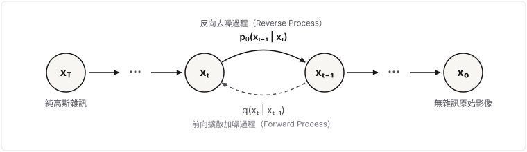

# Denoising Diffusion Probabilistic Models (DDPM)

## 1. 基本資訊

- **簡稱**：`DDPM`
- **發表年份與出處**：`NeurIPS 2020`（34th Conference on Neural Information Processing Systems, Vancouver, Canada，出自論文 p. 1 頁尾）
- **作者**：Jonathan Ho, Ajay Jain, Pieter Abbeel（UC Berkeley，出自論文 p. 1）
- **主分類**：`基礎方法`
- **技術標籤**：`Diffusion`、`Generative Model`、`Denoising Score Matching`、`Langevin Dynamics`、`U-Net`、`Progressive Decoding`
- **官方外部連結**：
  - arXiv：`https://arxiv.org/abs/2006.11239`（`arXiv:2006.11239v2 [cs.LG] 16 Dec 2020`，出自論文 p. 1 左側邊欄）
  - 官方 GitHub：`https://github.com/hojonathanho/diffusion`（出自論文 p. 1 Abstract）
  - DOI：待確認（PDF 內未載明）
- **關聯 Wiki 頁面**：
  - 核心概念頁：[去噪擴散機率模型（Denoising Diffusion Probabilistic Models）](../concepts/denoising-diffusion-probabilistic-models.md)
  - 核心概念頁：[非監督式視覺異常檢測（Unsupervised Visual Anomaly Detection）](../concepts/unsupervised-anomaly-detection.md)

---

## 2. 一句話總結（TL;DR）與核心貢獻

- **TL;DR**：建立擴散機率模型（Diffusion Probabilistic Models）與多尺度去噪分數匹配（Denoising Score Matching）及退火朗之萬動力學（Annealed Langevin Dynamics）之間的數學等價關聯，提出預測高斯雜訊 $\boldsymbol{\epsilon}$ 的參數化方式與簡化版加權變分下界損失 $L_{\text{simple}}$，首次證明擴散模型能生成媲美甚至超越頂尖 GAN 的高品質影像（於無條件 `CIFAR10` 取得 **9.46** Inception Score 與 **3.17** FID，出自論文 p. 1 Abstract、p. 5 Table 1）。
- **解決的核心痛點**：
  1. **早期擴散模型生成品質不佳**：Sohl-Dickstein 等人於 **2015** 年提出的原始擴散模型雖定義清晰且易於訓練，但從未證明能產出高品質自然影像（出自論文 p. 2 Sec. 1、p. 12 Ref. [53]）。
  2. **直接預測後驗平均數或學習逆過程變異數導致訓練不穩定**：實驗證明若直接以無權重均方誤差預測前向過程後驗平均數 $\tilde{\boldsymbol{\mu}}_t$，或將逆過程共變異數 $\boldsymbol{\Sigma}_\theta(\mathbf{x}_t, t)$ 設為可學習對角矩陣，皆會導致訓練不穩定且生成品質極差（出自論文 p. 5 Table 2、p. 6 Sec. 4.2）。
- **核心貢獻**（出自論文 p. 1 Abstract、p. 2 Sec. 1、p. 3–5 Sec. 3）：
  1. **雜訊預測參數化（$\boldsymbol{\epsilon}$-Prediction）與分數匹配等價性**：將逆過程高斯轉移的平均數 $\boldsymbol{\mu}_\theta(\mathbf{x}_t, t)$ 重新參數化為預測每步加入的標準高斯雜訊 $\boldsymbol{\epsilon}_\theta(\mathbf{x}_t, t)$，證明其變分下界在訓練時等價於多雜訊尺度之 Denoising Score Matching，在取樣時則等價於 Annealed Langevin Dynamics（出自論文 p. 3–4 Sec. 3.2）。
  2. **簡化加權訓練目標 $L_{\text{simple}}$**：捨棄標準變分下界中對極小雜訊步（小 $t$）給予過高權重的係數，改採無權重雜訊均方誤差 $L_{\text{simple}}$，讓網路專注於較困難的大 $t$ 去噪任務，大幅提升生成品質（出自論文 p. 4–5 Sec. 3.4、p. 5 Table 2）。
  3. **漸進式有損壓縮與由粗到細生成特性（Progressive Decoding）**：揭示擴散取樣過程本質上是一種「先生成大尺度高階結構、後補齊細微局部細節」的漸進式解碼（出自論文 p. 6–7 Sec. 4.3、p. 15 Appendix D）。**（AI 整理）** 此特性成為後續異常檢測利用「部分步數加噪再重建」修復異常的核心理論基礎。

---

## 3. 初學者版（AI 整理）

> **（AI 整理）**
> - **什麼是擴散模型（DDPM）？（滴墨水與倒帶還原的比喻）**：
>   想像在一杯清水中滴入一滴墨水（**前向擴散過程 Forward Process**）：隨著時間一秒一秒過去（$t = 1 \to 1000$），墨水逐漸擴散，原本清晰的圖案一點一點模糊，最後整杯水變成均勻的混沌灰水（純高斯雜訊 $\mathbf{x}_T$）。這個「把照片塗成雪花雜訊」的過程完全不需要 AI，只要照固定比例加雜訊即可。
>   DDPM 的核心則是訓練一個 AI 學會**「把影片倒帶（逆向去噪過程 Reverse Process）」**：給 AI 看一張沾了雜訊的圖 $\mathbf{x}_t$，不叫它一次變出完美原圖，而是問它：「**這張圖裡面混進去的雜訊 $\boldsymbol{\epsilon}$ 長什麼樣？**」只要 AI 能猜出雜訊並把它減掉一小步（$\mathbf{x}_t \to \mathbf{x}_{t-1}$），連做多次就能從純雪花雜訊一步步「雕刻」出超逼真的高清影像！
> - **為什麼異常檢測特別喜歡用 DDPM？（由粗到細的修復魔法）**：
>   傳統 Autoencoder 把圖片硬壓進一個小瓶頸再放大，就像把圖片縮小成縮圖再拉大，連正常的螺紋細節都會糊掉。
>   而 DDPM 有一個神奇特性：如果我們**不要把圖片加噪到第 1000 步（完全毀掉）**，而是只加噪到中間某一步（例如第 **250** 或 **500** 步），此時圖片的**大輪廓與正常擺放姿勢都還在**，但表面微小的刮痕或污漬已經被雜訊淹沒了！接著再讓只看過正常良品的 DDPM 倒帶去噪，它就會順著保留下來的大輪廓，長出高清又銳利的正常表面——既不會像 Autoencoder 一樣整張圖變糊，又能把瑕疵完美修掉！

---

## 4. 方法架構與核心設計

### 4.1 有向圖模型與前向／逆向過程

*示意圖，依論文 Fig. 2 重繪（出自論文 p. 2 Fig. 2）。*

1. **前向擴散過程（Forward / Diffusion Process）**（出自論文 p. 2 Sec. 2 Eq. 2 & Eq. 4）：
   - 給定真實資料 $\mathbf{x}_0 \sim q(\mathbf{x}_0)$，前向過程為一固定無可學習參數的馬可夫鏈（Markov chain），依預設變異數排程 $\beta_1, \dots, \beta_T$（實驗設 $T = 1000$，$\beta_1 = 10^{-4}$ 線性遞增至 $\beta_T = 0.02$，出自論文 p. 5 Sec. 4）逐步加入高斯雜訊：
     $$
     \begin{gathered}
     q(\mathbf{x}_{1:T} | \mathbf{x}_0) := \prod_{t=1}^{T} q(\mathbf{x}_t | \mathbf{x}_{t-1}) \\
     q(\mathbf{x}_t | \mathbf{x}_{t-1}) := \mathcal{N}\left(\mathbf{x}_t; \sqrt{1 - \beta_t}\mathbf{x}_{t-1}, \beta_t \mathbf{I}\right)
     \end{gathered}
     $$
   - **任意時間步 $t$ 之閉式解取樣（Closed-form sampling）**：定義 $\alpha_t := 1 - \beta_t$ 與累積乘積 $\bar{\alpha}_t := \prod_{s=1}^t \alpha_s$，無須逐步遞迴即可直接由 $\mathbf{x}_0$ 取樣任意步數 $t$ 的含噪影像 $\mathbf{x}_t$：
     $$
     \begin{gathered}
     q(\mathbf{x}_t | \mathbf{x}_0) = \mathcal{N}\left(\mathbf{x}_t; \sqrt{\bar{\alpha}_t}\mathbf{x}_0, (1 - \bar{\alpha}_t)\mathbf{I}\right) \\
     \mathbf{x}_t(\mathbf{x}_0, \boldsymbol{\epsilon}) = \sqrt{\bar{\alpha}_t}\mathbf{x}_0 + \sqrt{1 - \bar{\alpha}_t}\boldsymbol{\epsilon}, \quad \boldsymbol{\epsilon} \sim \mathcal{N}(\mathbf{0}, \mathbf{I})
     \end{gathered}
     $$
2. **逆向去噪過程（Reverse Process）**（出自論文 p. 2 Sec. 2 Eq. 1、p. 3 Sec. 3.2）：
   - 從標準常態先驗 $p(\mathbf{x}_T) = \mathcal{N}(\mathbf{x}_T; \mathbf{0}, \mathbf{I})$ 出發，透過具參數 $\theta$ 的高斯轉移逐步還原：
     $$
     \begin{gathered}
     p_\theta(\mathbf{x}_{0:T}) := p(\mathbf{x}_T) \prod_{t=1}^{T} p_\theta(\mathbf{x}_{t-1} | \mathbf{x}_t) \\
     p_\theta(\mathbf{x}_{t-1} | \mathbf{x}_t) := \mathcal{N}\left(\mathbf{x}_{t-1}; \boldsymbol{\mu}_\theta(\mathbf{x}_t, t), \boldsymbol{\Sigma}_\theta(\mathbf{x}_t, t)\right)
     \end{gathered}
     $$
   - DDPM 將共變異數固定為不可學習的時間常數 $\boldsymbol{\Sigma}_\theta(\mathbf{x}_t, t) = \sigma_t^2 \mathbf{I}$，實驗發現設為 $\sigma_t^2 = \beta_t$ 或前向後驗變異數 $\sigma_t^2 = \tilde{\beta}_t = \frac{1 - \bar{\alpha}_{t-1}}{1 - \bar{\alpha}_t}\beta_t$ 兩者效果相近（出自論文 p. 3 Sec. 3.2）。

### 4.2 變分下界拆解、$\boldsymbol{\epsilon}$-Prediction 與簡化損失 $L_{\text{simple}}$
1. **以條件前向後驗拆解變分下界**（出自論文 p. 3 Sec. 2 Eq. 5–7）：
   - 負對數概似值之變分下界 $L$ 可改寫為高斯分佈之間的閉式 KL 散度總和：
     $$
     L = \mathbb{E}_q \left[ \underbrace{D_{\text{KL}}(q(\mathbf{x}_T | \mathbf{x}_0) \parallel p(\mathbf{x}_T))}_{L_T} + \sum_{t > 1} \underbrace{D_{\text{KL}}(q(\mathbf{x}_{t-1} | \mathbf{x}_t, \mathbf{x}_0) \parallel p_\theta(\mathbf{x}_{t-1} | \mathbf{x}_t))}_{L_{t-1}} \underbrace{- \log p_\theta(\mathbf{x}_0 | \mathbf{x}_1)}_{L_0} \right]
     $$
   - 其中前向過程在給定 $\mathbf{x}_0$ 條件下的後驗分佈 $q(\mathbf{x}_{t-1} | \mathbf{x}_t, \mathbf{x}_0) = \mathcal{N}(\mathbf{x}_{t-1}; \tilde{\boldsymbol{\mu}}_t(\mathbf{x}_t, \mathbf{x}_0), \tilde{\beta}_t \mathbf{I})$ 具有精確閉式解：
     $$
     \begin{gathered}
     \tilde{\boldsymbol{\mu}}_t(\mathbf{x}_t, \mathbf{x}_0) := \frac{\sqrt{\bar{\alpha}_{t-1}}\beta_t}{1 - \bar{\alpha}_t}\mathbf{x}_0 + \frac{\sqrt{\alpha_t}(1 - \bar{\alpha}_{t-1})}{1 - \bar{\alpha}_t}\mathbf{x}_t \\
     \tilde{\beta}_t := \frac{1 - \bar{\alpha}_{t-1}}{1 - \bar{\alpha}_t}\beta_t
     \end{gathered}
     $$
2. **雜訊預測參數化（$\boldsymbol{\epsilon}$-Prediction）與取樣公式**（出自論文 p. 3–4 Sec. 3.2 Eq. 10–12 & Algorithm 2）：
   - 將 $\mathbf{x}_0 = \frac{1}{\sqrt{\bar{\alpha}_t}}(\mathbf{x}_t - \sqrt{1 - \bar{\alpha}_t}\boldsymbol{\epsilon})$ 代入 $\tilde{\boldsymbol{\mu}}_t$，可將 $\boldsymbol{\mu}_\theta(\mathbf{x}_t, t)$ 參數化為透過神經網路 $\boldsymbol{\epsilon}_\theta(\mathbf{x}_t, t)$ 預測雜訊 $\boldsymbol{\epsilon}$：
     $$
     \boldsymbol{\mu}_\theta(\mathbf{x}_t, t) = \frac{1}{\sqrt{\alpha_t}} \left( \mathbf{x}_t - \frac{\beta_t}{\sqrt{1 - \bar{\alpha}_t}} \boldsymbol{\epsilon}_\theta(\mathbf{x}_t, t) \right)
     $$
   - 逆向單步取樣公式（Algorithm 2，對 $t = T, \dots, 1$ 迭代，當 $t > 1$ 時 $\mathbf{z} \sim \mathcal{N}(\mathbf{0}, \mathbf{I})$，當 $t = 1$ 時 $\mathbf{z} = \mathbf{0}$）：
     $$
     \mathbf{x}_{t-1} = \frac{1}{\sqrt{\alpha_t}} \left( \mathbf{x}_t - \frac{1 - \alpha_t}{\sqrt{1 - \bar{\alpha}_t}} \boldsymbol{\epsilon}_\theta(\mathbf{x}_t, t) \right) + \sigma_t \mathbf{z}
     $$
   - 任意時間步 $t$ 亦可直接執行**單步確定性估計（One-step reconstruction estimate）**還原 $\hat{\mathbf{x}}_0$（出自論文 p. 7 Sec. 4.3 Eq. 15）：
     $$
     \mathbf{x}_0 \approx \hat{\mathbf{x}}_0 = \frac{\mathbf{x}_t - \sqrt{1 - \bar{\alpha}_t}\boldsymbol{\epsilon}_\theta(\mathbf{x}_t, t)}{\sqrt{\bar{\alpha}_t}}
     $$
3. **簡化訓練損失函數 $L_{\text{simple}}$**（出自論文 p. 4 Algorithm 1、p. 5 Sec. 3.4 Eq. 14）：
   - 原始變分下界項 $L_{t-1}$ 的權重係數為 $\frac{\beta_t^2}{2\sigma_t^2 \alpha_t (1 - \bar{\alpha}_t)}$（Eq. 12）。DDPM 捨棄此權重係數，改為對均勻取樣的 $t \sim \text{Uniform}(\{1, \dots, T\})$ 直接最小化無權重雜訊預測均方誤差：
     $$
     L_{\text{simple}}(\theta) := \mathbb{E}_{t, \mathbf{x}_0, \boldsymbol{\epsilon}} \left[ \left\| \boldsymbol{\epsilon} - \boldsymbol{\epsilon}_\theta\left(\sqrt{\bar{\alpha}_t}\mathbf{x}_0 + \sqrt{1 - \bar{\alpha}_t}\boldsymbol{\epsilon}, t\right) \right\|^2 \right]
     $$
   - **重加權物理意義**：捨棄權重相當於降低了小 $t$（微量雜訊）損失項的比重，使網路資源集中學習較大 $t$（高雜訊、高難度結構重建）的去噪任務（出自論文 p. 5 Sec. 3.4）。

---

## 5. 在異常檢測中怎麼被使用（與關鍵實驗特性）

*(依 `AGENTS.md` §3.3 基礎方法頁規範，本節重點整理 DDPM 被後續視覺異常檢測方法引用的核心機制，並附原論文關鍵設定與消融實證。)*

### 5.1 異常檢測如何利用 DDPM 進行無缺陷重建
1. **部分擴散加噪與語意保留重建（Partial Diffusion & Reconstruction）**：
   - 在原論文 Sec. 4.3（p. 7 Fig. 7）與 Appendix D（p. 15–16 Fig. 9）中，作者實證了固定中間時間步潛在變數 $\mathbf{x}_t$（如 $t \in \{1000, 750, 500, 250\}$）並執行逆向去噪的特性：當 $t = 1000$ 時原始影像資訊完全消失，生成出全新樣本；當 $t$ 處於中段（如 $t = 500$ 或 $t = 750$）時，高階語意與大尺度結構（如姿態、整體輪廓）被保留；當 $t$ 較小（如 $t = 250$）時，除細微局部細節外的所有結構皆被保留。
   - **（AI 整理）在異常檢測中的直接應用**：後續基於擴散模型的異常檢測方法（如 [Zhang et al. (2023/2025) — DiffusionAD](zhang2023-diffusionad.md) 與 [Lee & Kang (2026) — LAMBDA](lee2026-lambda.md)）正是利用此特性——在測試階段**不從純雜訊 $\mathbf{x}_T$ 開始生成**，而是對測試影像 $\mathbf{x}_0$（或預訓練 `VAE` 潛在表徵 $L_0$）僅施加前向加噪至中間步數 $t < T$（如 $t_s=200$），利用高斯雜訊抹除局部異常特徵並保留物件正常全域結構，再透過僅在正常樣本上訓練過的逆向網路預測無雜訊表徵（如利用 Eq. 15 執行規範引導一步去噪 [NOD](../concepts/norm-guided-one-step-denoising.md) 或記憶庫引導去噪 [MBG & GSM](../concepts/memory-bank-guided-latent-diffusion.md)），最後比對輸入與重建結果的差異即可精確分割出異常區域。
2. **單步直接估計 $\hat{\mathbf{x}}_0$ 克服多步取樣延遲**：
   - 原論文指出完整執行 $T = 1000$ 步逆向取樣耗時較長（在 TPU v3-8 上取樣一批 **256** 張 $32 \times 32$ 影像需 **17** 秒，取樣一批 **128** 張 $256 \times 256$ 影像需 **300** 秒，出自論文 p. 14 Appendix B）。
   - 然而原論文 Eq. 15（p. 7 Sec. 4.3）展示了在任意時間步 $t$ 皆可直接由 $\mathbf{x}_t$ 與預測雜訊 $\boldsymbol{\epsilon}_\theta(\mathbf{x}_t, t)$ 一步推算 $\hat{\mathbf{x}}_0 = (\mathbf{x}_t - \sqrt{1 - \bar{\alpha}_t}\boldsymbol{\epsilon}_\theta(\mathbf{x}_t, t)) / \sqrt{\bar{\alpha}_t}$。此單步無雜訊估計機制為 [DiffusionAD](zhang2023-diffusionad.md)（`23.5 FPS`，出自 `zhang2023-diffusionad.pdf` Table V）與潛在空間的 [LAMBDA](lee2026-lambda.md)（`42.3 FPS`，出自 `lee2026-lambda.pdf` Table 1）實現高速一步去噪重建提供了核心數學基礎。

### 5.2 原論文標準架構與關鍵消融數據（供異常檢測實作參考）
- **標準擴散超參數設定**（出自論文 p. 4 Sec. 3.3、p. 5 Sec. 4、p. 14–15 Appendix B）：
  - 像素值由整數 $\{0, 1, \dots, 255\}$ 線性縮放至 $[-1, 1]$。
  - 總步數 $T = 1000$；前向變異數採線性排程，自 $\beta_1 = 10^{-4}$ 遞增至 $\beta_T = 0.02$（此時終點 KL 散度 $L_T \approx 10^{-5}$ bits/dim）。
  - 網路架構：基於 Wide ResNet 的 `U-Net`（$32 \times 32$ 模型使用 **4** 個特徵圖解析度層級、共 **35.7M** 參數；$256 \times 256$ 模型使用 **6** 個解析度層級、共 **114M** 參數，大型版 LSUN Bedroom 為約 **256M** 參數），每個解析度層級含 **2** 個殘差捲積塊，於 $16 \times 16$ 解析度處加入 Self-Attention，並以 Transformer 正弦位置編碼（Sinusoidal position embedding）注入時間步 $t$；全程使用 Group Normalization 與 EMA（衰減率 **0.9999**）。
- **關鍵消融實驗（出自論文 Table 2, p. 5，無條件 CIFAR10）**：
  - 證明「預測 $\boldsymbol{\epsilon}$ 搭配簡化目標 $L_{\text{simple}}$」顯著優於「預測 $\tilde{\boldsymbol{\mu}}$」或「學習對角共變異數 $\boldsymbol{\Sigma}_\theta$」：

| 逆過程參數化與訓練目標 (Objective) | Inception Score (IS ↑) | FID (↓) | 訓練穩定性與結論（出自論文 p. 5 Table 2 & p. 6 Sec. 4.2） |
| :--- | :---: | :---: | :--- |
| **$\tilde{\boldsymbol{\mu}}$ prediction**（$L$, learned diagonal $\boldsymbol{\Sigma}$） | $7.28 \pm 0.10$ | $23.69$ | 學習變異數導致訓練不穩、樣本品質較差 |
| **$\tilde{\boldsymbol{\mu}}$ prediction**（$L$, fixed isotropic $\boldsymbol{\Sigma}$） | $8.06 \pm 0.09$ | $13.22$ | 固定變異數並以標準變分下界 $L$ 訓練可正常收斂 |
| **$\tilde{\boldsymbol{\mu}}$ prediction**（$\|\tilde{\boldsymbol{\mu}} - \tilde{\boldsymbol{\mu}}_\theta\|^2$ 簡化無權重 MSE） | `–` | `–` | 訓練極度不穩定，產出分數超出範圍之劣質樣本 |
| **$\boldsymbol{\epsilon}$ prediction**（$L$, learned diagonal $\boldsymbol{\Sigma}$） | `–` | `–` | 訓練極度不穩定 |
| **$\boldsymbol{\epsilon}$ prediction**（$L$, fixed isotropic $\boldsymbol{\Sigma}$） | $7.67 \pm 0.13$ | $13.51$ | 與固定變異數下預測 $\tilde{\boldsymbol{\mu}}$ 表現相近（Test NLL $\le 3.70$ bits/dim，出自 Table 1, p. 5） |
| **$\boldsymbol{\epsilon}$ prediction**（$\|\boldsymbol{\epsilon} - \boldsymbol{\epsilon}_\theta\|^2, L_{\text{simple}}$） | **$9.46 \pm 0.11$** | **$3.17$** | **表現最佳**（對測試集計算之 FID 為 **5.24**，Test NLL $\le 3.75$ bits/dim，出自 Table 1 & Sec. 4.1, p. 5） |

---

## 6. 論文限制（Limitations）與延伸筆記

### 6.1 論文明確指出的限制
1. **無損對數概似值（Log-likelihood / Lossless Codelength）不具優勢**：儘管生成樣本視覺品質極高，DDPM 的無損編碼長度（CIFAR10 測試集 $\le 3.70$ 或 $\le 3.75$ bits/dim，出自論文 p. 5 Table 1）仍不如 Sparse Transformer（**2.80** bits/dim）或 Gated PixelCNN（**3.03** bits/dim）等自迴歸概似模型。作者分析發現模型將超過一半的無損位元率消耗在人眼無法察覺的微觀失真上（Rate **1.78** bits/dim、Distortion **1.97** bits/dim，對應 $[0, 255]$ 尺度下 RMSE 僅 **0.95**，出自論文 p. 2 Sec. 1、p. 6 Sec. 4.3、p. 13 Table 4）。
2. **完整逆向序列取樣速度較慢**：由於生成過程需依序執行 $T = 1000$ 次神經網路前向評估，取樣耗時明顯高於單次前向傳播的生成模型（出自論文 p. 5 Sec. 4、p. 14 Appendix B）。
3. **直接預測 $\mathbf{x}_0$ 早期實驗表現不佳**：作者在 Sec. 3.2（p. 4）指出，除了預測 $\tilde{\boldsymbol{\mu}}_t$ 與預測 $\boldsymbol{\epsilon}$ 外，雖亦可直接訓練網路預測 $\mathbf{x}_0$，但在早期實驗中發現直接預測 $\mathbf{x}_0$ 會導致較差的樣本品質。

### 6.2 延伸筆記（AI 整理）
- **（AI 整理）為何 DDPM 的「有損壓縮偏置（Lossy Compression Inductive Bias）」反而成為異常檢測的優勢**：
  原論文 Sec. 4.3 指出 DDPM 把絕大多數的模型容量用來精確捕捉「人眼可感知的結構與語意資訊」，而非過度擬合高頻雜訊位元。在視覺異常檢測中，這項帰納偏置（Inductive bias）正好解決了傳統 Autoencoder 的兩難：Autoencoder 若容量太小會模糊（見 [Bergmann et al. (2019)](bergmann2019-mvtec-ad.md)），容量太大又會把異常一起完美複製（Identity Mapping）；而 DDPM 透過前向加噪抹去異常區域後，逆向去噪能產生細節清晰且嚴格貼合正常樣本流形（Manifold）的重建影像。

---

## 7. 相關 Wiki 頁面連結

- **基於 DDPM 之異常檢測方法論文**：
  - [Zhang et al. (2023/2025) — DiffusionAD](zhang2023-diffusionad.md)
  - [Lee & Kang (2026) — LAMBDA](lee2026-lambda.md)
- **核心概念**：
  - [去噪擴散機率模型（Denoising Diffusion Probabilistic Models）](../concepts/denoising-diffusion-probabilistic-models.md)
  - [規範引導一步去噪與合成異常分割（Norm-Guided One-Step Denoising & Anomaly Synthesis）](../concepts/norm-guided-one-step-denoising.md)
  - [潛在空間記憶庫引導去噪與引導尺度圖（Latent Diffusion with MBG & GSM）](../concepts/memory-bank-guided-latent-diffusion.md)
  - [非監督式視覺異常檢測（Unsupervised Visual Anomaly Detection）](../concepts/unsupervised-anomaly-detection.md)
- **跨論文流派比較**：
  - [預訓練特徵嵌入 vs. 重建式異常檢測流派對比](../comparisons/embedding-vs-reconstruction.md)
- **基準資料集**：
  - [MVTec AD 資料集與評估指標](../datasets/mvtec-ad.md)
  - [MVTec AD 2 資料集與進階評估協定（AU-PRO0.05、F1 與光照分佈偏移）](../datasets/mvtec-ad-2.md)
  - [Heckler-Kram et al. (2025) — MVTec AD 2](hecklerkram2025-mvtec-ad-2.md)
