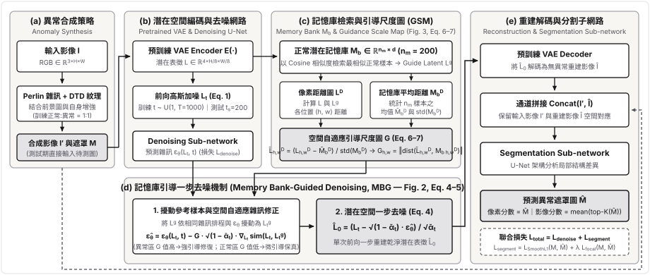

# LAMBDA：輕量化記憶庫引導潛在擴散模型之視覺異常檢測（Lee & Kang, 2026）

## 1. 基本資訊

- **論文標題**：Memory bank-guided diffusion model for lightweight anomaly detection
- **簡稱**：`LAMBDA`
- **作者**：Woojun Lee、Pilsung Kang（通訊作者）（Department of Industrial Engineering, Seoul National University, Seoul, Republic of Korea）
- **發表年份／出處**：*Applied Soft Computing*, Volume 186 (2026), Article 114215（2024 年 12 月 25 日投稿，2025 年 9 月 20 日修訂，2025 年 11 月 9 日接受，2025 年 11 月 15 日線上發表；出自論文 p. 1）
- **主分類**：`異常檢測方法`（預訓練 VAE 潛在空間一步去噪擴散重建 + 記憶庫空間自適應引導 + 判別式 U-Net 分割流派）
- **官方外部連結**：
  - **DOI**：https://doi.org/10.1016/j.asoc.2025.114215 （出自論文 p. 1）
  - **期刊主頁**：https://www.elsevier.com/locate/asoc （出自論文 p. 1）
  - **arXiv / GitHub 程式碼**：待確認（PDF 內未載明；論文 p. 14 `Data availability` 註明 *"The authors do not have permission to share data."*）

---

## 2. 一句話總結（TL;DR）與核心貢獻

- **一句話總結（TL;DR）**：`LAMBDA` 將擴散式異常檢測由高維像素空間移至預訓練 `VAE` 壓縮之低維潛在空間（Latent Space，$64\times$ 空間降維），並提出**記憶庫引導去噪（Memory Bank-Guided Denoising, `MBG`）**與**空間自適應引導尺度圖（Guidance Scale Map, `GSM`）**取代 [DiffusionAD](zhang2023-diffusionad.md) 的雙尺度規範引導去噪，在維持與 `DiffusionAD` 統計上無顯著差異之頂尖檢測精度下，將訓練與推論 GPU 記憶體用量分別大幅降低 **80.8%**（`48.4 GB → 9.3 GB`）與 **53.2%**（`12.4 GB → 5.8 GB`），並實現 **2.3×** 訓練加速與最高 **3.9×**（對比 `DiffusionAD`）至 **4.4×**（對比 `D3AD`）推論加速（達 `42.3 FPS`、延遲僅 `23.6 ms/image`）（出自論文 p. 1 Abstract & Highlights、p. 7–8 Sec. 5.4 & Table 1、p. 9 Table 3）。

### 解決痛點與核心貢獻

1. **克服現有擴散式異常檢測的高記憶體消耗與推論延遲瓶頸**：
   - 現有擴散重建模型（如 [DiffusionAD](zhang2023-diffusionad.md)、`DDAD`、`D3AD`）雖具備優異的正常分佈建模與異常重建修復能力，但在像素空間迭代或執行雙尺度去噪需耗費龐大 GPU 記憶體（如 `DiffusionAD` 訓練需 `48.4 GB`、總訓練時間達 `58h 10m`），或如單階段模型（`DDAD`、`D3AD`）需在評估前額外執行耗時的特徵擷取器微調（Feature Extractor Tuning），限制了在資源受限工業產線上的即時部署（出自論文 Sec. 1 & 2.1.4, p. 1–2；Sec. 5.4, p. 7–8, Table 1）。
2. **突破現有擴散條件引導策略（CFG / SDG / NOD）於異常檢測的結構性限制**：
   - **無分類器引導（Classifier-Free Guidance, `CFG`）**：(1) 抽象的「正常」類別條件無法指示應重建哪一種具體正常圖樣；(2) 訓練時須同時學習條件與無條件分佈（訓練複雜度加倍），推論時每步須計算兩次雜訊預測（推論開銷加倍）（出自論文 Sec. 3.5, p. 4）。
   - **語意擴散引導（Semantic Diffusion Guidance, `SDG`）**：雖引入具體參考樣本，但對整個潛在空間套用**均一標量引導強度（Uniform Guidance Strength $G$）**，忽略了異常檢測的空間異質性（正常區域與參考樣本高度相似僅需微弱引導，異常區域偏離嚴重則需強力引導），易造成正常變異過度修正或異常修正不足（出自論文 Sec. 3.5 & 4.5, p. 4–5）。
   - **雙尺度規範引導（`NOD` in [DiffusionAD](zhang2023-diffusionad.md)）**：需將時間步切分為大小兩區間並執行兩次去噪前向傳播，增加記憶體與運算負擔（出自論文 Sec. 5.8.2, p. 10–11）。
3. **提出「記憶庫引導去噪（Memory Bank-Guided Denoising, `MBG`）」單次前向一步重建機制**：
   - 透過 `Stable Diffusion v1.4` 預訓練 `VAE` 將輸入影像壓縮為潛在表徵 $L \in \mathbb{R}^{4 \times H/8 \times W/8}$，並預先隨機抽樣 $n_m = 200$ 張正常訓練影像之潛在表徵存入記憶庫 $\mathcal{M}_b \in \mathbb{R}^{n_m \times d}$；在訓練與推論時以餘弦相似度（Cosine Similarity）檢索最相似正常參考樣本 $L^g$，僅需在固定時間步（推論 $t_s = 200$）執行**單次前向一步去噪（Single-pass One-step Denoising）**即可引導重建，消除了雙尺度去噪開銷（出自論文 Sec. 3.1, 4.4 & 5.2, p. 3, 5, 7, Fig. 1–2）。
4. **提出「引導尺度圖（Guidance Scale Map, `GSM`）」空間自適應動態引導機制**：
   - 計算輸入潛在表徵 $L$ 與參考潛在表徵 $L^g$ 的像素級距離圖 $L^D$，並利用記憶庫內 $n_m$ 個正常樣本的平均像素距離統計量 $M_b^D$ 進行標準化與縮放，生成空間自適應引導圖 $G$（異常區域呈現高值強引導、正常區域呈現低值弱引導），顯著降低正常區域誤報並提升像素級邊界定位精度（於 `VisA` 使 `AUPRO` 由 `90.2%` 提升至 `94.2%`［內文 Sec. 5.8.3 記為 `93.9%`］、`Pixel AUROC` 由 `96.4%` 提升至 `98.6%`［內文記為 `98.5%`］）（出自論文 Sec. 4.5 & 5.8.3, p. 5–6, 10–11, Fig. 3, Table 4）。
5. **跨工業（MVTec AD、VisA）與醫療（BMAD）基準達成高效率與高精準度雙贏**：
   - 在 `VisA` 達 **`98.1%` Image AUROC / `98.6%` Pixel AUROC / `94.2%` AUPRO**（無 VAE 變體達 **`99.0%` Image AUROC / `99.2%` Pixel AUROC / `95.4%` AUPRO**），在 [MVTec AD](../datasets/mvtec-ad.md) 達 **`98.2%` Image AUROC / `99.1%` Image AP / `97.5%` Pixel AUROC / `69.1%` Pixel AP / `94.9%` AUPRO**，更在 `BMAD` 醫療影像基準全面奪冠（**`87.1%` Image AUROC / `90.3%` Pixel AUROC / `75.5%` mAD**），且跨 30 個類別之成對 Wilcoxon 符號等級檢定證實其像素級精度與 `DiffusionAD` 無統計顯著差異（$p = 0.812, 0.436$），同時顯著優於 `DRAEM`、`DDAD` 與 `D3AD`（$p < 0.05$）（出自論文 Sec. 5.3–5.7, p. 7–9, Tables 1–3, Tables A.1–A.3）。

---

## 3. 初學者版（AI 整理）

> **本節為初學者導讀（AI 整理）**：以下痛點動機、生活化比喻與直覺說明由 AI 依據論文內容轉譯整理，旨在幫助初學者建立直覺，與下方第 4、5 節之論文原始公式及實驗數據嚴格區分。

### 為什麼 DiffusionAD 已經「一步到位」了，工廠電腦還是跑不動？（AI 整理）

在前一篇 [DiffusionAD](zhang2023-diffusionad.md) 中，研究人員利用「一步去噪（One-step Denoising）」加上「大小雙尺度規範引導（`NOD`）」，成功把擴散模型的速度提升到每秒 20 幾張圖（AI 整理）。但當工程師想把它裝進工廠產線的一般電腦或邊緣設備時，卻踢到了兩塊大鐵板（AI 整理）：

1. **在「原圖像素空間」直接修圖太吃記憶體**（AI 整理）：
   `DiffusionAD` 直接在高清原圖尺寸上跑擴散模型，訓練時居然要吃掉 **48.4 GB** 的顯示卡記憶體（VRAM），連一張高階消費級顯卡（24 GB）都裝不下，還得連跑 58 個小時才能訓練完（AI 整理）！
2. **為了抓大瑕疵而「撒兩次沙子（雙尺度去噪）」太費工**（AI 整理）：
   `DiffusionAD` 為了同時修好大塊瑕疵並保留正常細節，每張圖都必須撒「薄沙子（$t_s=200$）」跟「厚沙子（$t_b=400$）」，讓擴散模型算兩次，這讓記憶體和推論時間都增加了一倍（AI 整理）。

### LAMBDA 的三大輕量化秘訣：把 [PatchCore](roth2022-patchcore.md) 的「記憶相簿」借給擴散模型當導航！（AI 整理）

`LAMBDA` 巧妙地把生成模型界的「潛在擴散（Latent Diffusion）」與異常檢測界的「正常記憶庫（[Memory Bank](../concepts/memory-bank.md)）」結合起來，用三招實現大瘦身（AI 整理）：

1. **第一招：先縮小成「潛在縮圖（VAE Latent）」再修圖，面積瞬間縮小 64 倍！**（AI 整理）
   - 與其在巨大的原始畫布（$H \times W$）上掃沙子，`LAMBDA` 先請一位現成壓縮專家（`Stable Diffusion` 預訓練好的 `VAE` 編碼器），把長寬各縮小 8 倍（面積縮小 $8 \times 8 = 64$ 倍），變成精煉的「潛在特徵縮圖 $L$」（AI 整理）。
   - 在這張小縮圖上做一步去噪，修好後再請 `VAE` 解碼器放大回原圖 $\hat{I}$——光靠這招加上單次去噪，訓練記憶體就直接從 **48.4 GB 暴降 80.8% 變成 9.3 GB**，一般顯卡也能輕鬆訓練（AI 整理）！
2. **第二招：記憶庫引導去噪（`MBG`）——不用自己畫草稿，直接翻相簿找「最像的雙胞胎良品」當範本！**（AI 整理）
   - `DiffusionAD` 為什麼要跑第二次大尺度去噪（$t_b=400$）？因為它需要一張「沒有大瑕疵的正常草稿（Norm）」來引導小尺度去噪（AI 整理）。
   - `LAMBDA` 心想：「我手邊本來就有幾百張正常良品的訓練照片，何必每次花時間重畫草稿？」於是它預先把 **200 張正常良品**壓成潛在縮圖，存進一個小巧的**「記憶相簿（Memory Bank $\mathcal{M}_b$）」**（AI 整理）。
   - 測試時拿到一張待測圖片，只要花極短的時間去相簿裡找出**「長得最像的那張正常範本 $L^g$」**，直接拿這張現成的正常範本來引導 $t_s=200$ 的一步去噪！這樣完全省去了第二趟去噪，推論速度衝上 **42.3 FPS（每張圖只要 23.6 毫秒）**（AI 整理）！
3. **第三招：引導尺度圖（`GSM`）——「哪裡長得怪，哪裡才用力修」的智慧導航地圖！**（AI 整理）
   - 從相簿挑出來的正常範本 $L^g$ 雖然跟待測圖片很像，但零件擺放位置或細微紋理可能還是有一點點自然差異。如果整張圖都用同樣的力道強迫它照著範本改（傳統語意引導 `SDG`），正常的微小差異也會被改壞（AI 整理）。
   - 因此 `LAMBDA` 設計了**「引導尺度圖（Guidance Scale Map, `GSM`）」**：先比對待測圖 $L$ 跟範本 $L^g$ 每個位置的差距，再拿去跟「相簿裡 200 張良品彼此之間的正常差距平均值 $M_b^D$」做比較（標準化）（AI 整理）：
     - 如果某個位置的差距「在正常良品合理的誤差範圍內」，`GSM` 地圖上就是**暗色（低數值）**，代表**「這裡很正常，輕輕引導就好，別動它」**（AI 整理）。
     - 如果某個位置的差距「遠超過正常良品的變異範圍」，`GSM` 地圖上就會亮起**亮色（高數值）**，代表**「這裡有鬼！請開最大力道照著正常範本 $L^g$ 把瑕疵抹掉」**（AI 整理）！

---

## 4. 方法架構與核心設計

`LAMBDA` 採用由**潛在空間去噪階段（Denoising Stage）**與**像素級重建分割階段（Reconstruction / Segmentation Stage）**組成的兩階段序列式架構，共包含五個核心組件 `Fig. 1(a)–(e)`（出自論文 Sec. 4.1, p. 4–5, Fig. 1）。

*示意圖，依論文 Fig. 1、Fig. 2 與 Fig. 3 重繪：LAMBDA 整體訓練與推論架構。(a) 結合 Perlin 雜訊與 DTD 紋理生成合成異常影像 $I'$ 與遮罩 $M$；(b) 透過預訓練 VAE 將影像編碼至壓縮潛在表徵 $L$，加噪為 $L_t$ 後由去噪子網路預測雜訊 $\epsilon_\theta$；(c) 於正常潛在記憶庫 $\mathcal{M}_b$ 檢索最相似參考樣本 $L^g$，計算像素距離並以記憶庫平均距離統計量 $M_b^D$ 標準化生成空間自適應引導尺度圖 $G$（`GSM`）；(d) 結合 $L_t^g$ 與 $G$ 執行記憶庫引導一步去噪（`MBG`）獲得去噪潛在表徵 $\hat{L}_0$；(e) 經預訓練 VAE 解碼為重建影像 $\hat{I}$，與輸入影像 $I'$ 通道拼接送入分割子網路預測異常遮罩圖 $\hat{M}$。*

### 4.1 預備知識：潛在空間壓縮、一步去噪與語意擴散引導（Preliminaries）

1. **預訓練 VAE 潛在空間壓縮（Latent Space Compression，出自論文 Sec. 2.2.2 & 3.1, p. 3）**：
   - 給定高解析度輸入 RGB 影像 $I \in \mathbb{R}^{3 \times H \times W}$，`LAMBDA` 使用預訓練 `VAE` 編碼器 $E(\cdot)$（取自 `Stable Diffusion v1.4`）將其映射至緊湊的潛在表徵：
     $$L = E(I) \in \mathbb{R}^{4 \times H/8 \times W/8}$$
   - 此操作將空間解析度降採樣 $8 \times 8$ 倍（面積縮減 $64\times$，搭配 $4$ 個潛在通道，整體張量維度較 $3 \times H \times W$ 像素空間降低達 $48\times$），在保留關鍵結構與語意特徵的同時大幅降低記憶體與計算需求。
2. **潛在空間前向加噪、逆向去噪與訓練目標（Diffusion Process，出自論文 Sec. 3.2, p. 3, Eq. 1–3）**：
   - 給定初始潛在表徵 $L_0$，前向過程於 $T$ 個時間步內依預設線性雜訊排程 $\beta_t$（$\alpha_t = 1 - \beta_t$，$\bar{\alpha}_t = \prod_{i=1}^t \alpha_i$）逐步加入標準高斯雜訊，逆向過程則由參數化去噪網路 $\epsilon_\theta(L_t, t)$ 預測雜訊並以簡化目標 $\mathcal{L}_{\text{simple}}$ 訓練（出自論文 Sec. 3.2, p. 3, Eq. 1–3）：

$$
\begin{gathered}
L_t = \sqrt{\bar{\alpha}_t}\, L_0 + \sqrt{1 - \bar{\alpha}_t}\, \epsilon_t, \quad \epsilon_t \sim \mathcal{N}(\mathbf{0}, \mathbf{I}) \tag{1} \\
L_{t-1} = \frac{1}{\sqrt{\alpha_t}}\left(L_t - \frac{1 - \alpha_t}{\sqrt{1 - \bar{\alpha}_t}}\epsilon_\theta(L_t, t)\right) + \sigma_t z_t, \quad z_t \sim \mathcal{N}(\mathbf{0}, \mathbf{I}) \tag{2} \\
\mathcal{L}_{\text{simple}} = \mathbb{E}_{t, L_0, \epsilon_t}\left[\left\|\epsilon_t - \epsilon_\theta(L_t, t)\right\|^2\right] \tag{3}
\end{gathered}
$$

3. **潛在空間一步去噪（One-Step Denoising，出自論文 Sec. 3.3, p. 3–4, Eq. 4）**：
   - 為消除傳統多步迭代去噪的推論延遲，直接由加噪潛在表徵 $L_t$ 與預測雜訊 $\epsilon_\theta(L_t, t)$ 在單一步驟內重建乾淨潛在表徵 $\hat{L}_0$：

$$
\hat{L}_0 = \frac{1}{\sqrt{\bar{\alpha}_t}}\left(L_t - \sqrt{1 - \bar{\alpha}_t}\,\epsilon_\theta(L_t, t)\right) \tag{4}
$$

4. **語意擴散引導（Semantic Diffusion Guidance，出自論文 Sec. 3.4, p. 4, Eq. 5）**：
   - 延伸自條件分類器引導（Classifier Guidance），利用時間步 $t$ 的具體參考樣本（Guide Sample）$L_t^g$ 與輸入 $L_t$ 之 $L_2$ 距離平方相似度 $\text{sim}(L_t, L_t^g) = \|L_t - L_t^g\|_2^2$ 修正雜訊預測（其中 $G$ 為控制引導信號強度的引導尺度）：

$$
\epsilon_\theta(L_t, t, L_t^g) = \epsilon_\theta(L_t, t) - G\sqrt{1 - \bar{\alpha}_t}\,\nabla_{L_t}\text{sim}(L_t, L_t^g) \tag{5}
$$

### 4.2 異常合成策略（Anomaly Synthesis Strategy，出自論文 Sec. 4.2, p. 4–5, Fig. 1a）

- 基於 `DRAEM`、`MemSeg`、`PRN` 與 [DiffusionAD](zhang2023-diffusionad.md) 的異常合成機制，首先將 Perlin 雜訊與輸入影像之前景遮罩（Foreground Map）結合，產生定義異常植入區域的真實遮罩圖 $M$。
- 接著使用自身增強技術（Self-augmentation）與取樣自 `DTD`（Describable Textures Dataset）的紋理圖樣生成合成異常，並嵌入遮罩區域 $M$ 中，合成模擬真實缺陷的異常訓練影像 $I'$。
- **1:1 平衡混合訓練**：在訓練階段，合成異常樣本與正常樣本以 **`1:1` 比例**混合，為分割子網路提供成對的輸入與重建樣本 $(I', \hat{I})$ 及已知異常遮罩 $M$，使其學習辨識輸入與重建之間的結構差異。

### 4.3 潛在去噪子網路與記憶庫引導去噪（Denoising Sub-network & MBG，出自論文 Sec. 4.3–4.4, p. 5, Fig. 1b, 1d & Fig. 2）

1. **正常潛在記憶庫建構（Memory Bank Construction）**：
   - 為避免無引導去噪時誤改正常區域（導致 False Positives）或未能徹底抹除異常區域（導致 False Negatives），`LAMBDA` 從正常訓練集 $D_{\text{train}}$ 中隨機抽樣 $n_m$ 張正常影像（預設 $n_m = 200$），經預訓練 `VAE` 編碼後建立記憶庫 $\mathcal{M}_b \in \mathbb{R}^{n_m \times d}$（其中 $d$ 為潛在表徵維度）（出自論文 Sec. 4.4 & Algorithm 1, p. 5–6）。
2. **最近鄰參考潛在表徵檢索與擾動（Guide Retrieval & Perturbation）**：
   - 在訓練與推論期間，將輸入潛在表徵與記憶庫 $\mathcal{M}_b$ 中的 $n_m$ 個條目計算**餘弦相似度（Cosine Similarity）**，檢索出最相似的正常潛在表徵作為參考引導樣本（Guide Latent）$L^g$（出自論文 Sec. 4.4, p. 5）。
   - 將檢索出的 $L^g$ 依相同雜訊排程與預測雜訊 $\epsilon_\theta$ 進行擾動（Perturbation），使其匹配 $L_t$ 在時間步 $t$ 的雜訊強度，得到 $L_t^g$（出自論文 Sec. 4.4 & Fig. 2, p. 5）。
3. **記憶庫引導一步去噪（MBG One-Step Denoising）**：
   - 將語意引導公式（Eq. 5）中的均一標量引導尺度替換為空間自適應的**引導尺度圖 $G$**（見 §4.4），如論文 Fig. 2 所示計算引導後之預測雜訊 $\hat{\epsilon}_\theta = \epsilon_\theta(L_t, t) - (L_t - L_t^g) \cdot G \cdot \sqrt{1 - \bar{\alpha}_t}$，再代入一步去噪公式（Eq. 4）直接產出最終去噪潛在表徵 $\hat{L}_0$（出自論文 Sec. 4.4 & Fig. 2, p. 5）。

### 4.4 引導尺度圖（Guidance Scale Map, `GSM`，出自論文 Sec. 4.5, p. 5–6, Fig. 1c, Fig. 3, Eq. 6–7）

由於從記憶庫檢索出的參考樣本 $L^g$ 與輸入潛在表徵 $L$ 未必在所有空間位置完美對齊，`GSM` 透過局部相似度動態調節每個空間座標 $(h, w)$ 的引導強度：

1. **像素級距離計算與記憶庫統計標準化（Eq. 6）**：
   - 首先計算輸入潛在表徵 $L$ 與參考潛在表徵 $L^g$ 之間的像素級距離圖（Pixel-wise Distance Map）$L^D$。
   - 接著利用記憶庫 $\mathcal{M}_b$ 中所有 $n_m$ 個正常樣本計算出的平均像素級距離圖 $M_b^D$（其平均值記為 $\bar{M}_b^D$、標準差記為 $\text{std}(M_b^D)$）對 $L^D$ 進行標準化，以校準資料集內正常圖樣的固有變異性（出自論文 Sec. 4.5, p. 5–6, Eq. 6）：

$$
\tilde{L}_{h,w}^D = \frac{L_{h,w}^D - \bar{M}_b^D}{\text{std}(M_b^D)}, \quad \text{where } h \in [1, H],\; w \in [1, W] \tag{6}
$$

2. **轉換為空間引導尺度圖 $G$（Eq. 7）**：
   - 計算標準化距離圖 $\tilde{L}_{h,w}^D$ 與記憶庫統計圖 $M_{b\, h,w}^D$ 之間的 $L_2$ 距離度量 $\text{dist}(\cdot, \cdot)$，生成最終引導尺度圖 $G$（出自論文 Sec. 4.5, p. 6, Eq. 7）：

$$
G_{h,w} = \left\|\text{dist}\left(\tilde{L}_{h,w}^D, M_{b\, h,w}^D\right)\right\|, \quad \text{where } h \in [1, H],\; w \in [1, W] \tag{7}
$$

   - **空間自適應物理意義**：在熱力圖 $G$（見論文 Fig. 3）中，數值較高的亮區代表顯著偏離正常分佈的異常區域，會觸發來自 $L^g$ 的強力引導以確保異常被徹底重建為正常圖樣；數值較低的暗區代表與參考樣本高度吻合的正常區域，僅施加極小引導干預以保留原圖正常細節（出自論文 Sec. 4.5, p. 6）。

### 4.5 重建（分割）子網路與三階段訓練／評估演算法（出自論文 Sec. 4.6–4.7, p. 6–7, Fig. 1e, Algorithm 1, Eq. 8–9）

1. **分割子網路架構與損失函數（Eq. 8–9）**：
   - 去噪潛在表徵 $\hat{L}_0$ 經預訓練 `VAE` 解碼為重建影像 $\hat{I}$ 後，與輸入影像 $I'$ 進行**通道維度拼接（Channel-wise Concatenation）**送入 U-Net 分割子網路，直接預測像素級異常遮罩圖 $\hat{M}$。
   - 分割損失 $\mathcal{L}_{\text{segmentation}}$ 結合提供平滑梯度的 Smooth $L_1$ 損失與處理前景／背景嚴重類別不平衡的 Focal Loss（權重因子 $\lambda$ 預設為 $1$），並與去噪損失 $\mathcal{L}_{\text{denoise}}$（即 Eq. 3 之 $\mathcal{L}_{\text{simple}}$）相加為總損失 $\mathcal{L}_{\text{total}}$ 聯合最佳化兩個子網路（出自論文 Sec. 4.6–4.7, p. 6–7, Eq. 8–9）：

$$
\begin{gathered}
\mathcal{L}_{\text{segmentation}} = \mathcal{L}_{\text{SmoothL1}}(M, \hat{M}) + \lambda \mathcal{L}_{\text{focal}}(M, \hat{M}) \tag{8} \\
\mathcal{L}_{\text{total}} = \mathcal{L}_{\text{denoise}} + \mathcal{L}_{\text{segmentation}} \tag{9}
\end{gathered}
$$

2. **Algorithm 1：LAMBDA 三階段完整流程（出自論文 Sec. 4.7, p. 6, Algorithm 1）**：
   - **超參數設定**：記憶庫大小 $n_m = 200$，訓練總擴散步數 $T = 1000$，評估固定時間步 $t_s = 200$，Top-$K$ 像素數 $K = 50$，Focal Loss 權重 $\lambda = 1$。
   - **Phase 1（記憶庫建構 Memory Bank Construction）**：自正常訓練集 $D_{\text{train}}$ 隨機抽樣 $n_m$ 張正常影像，經 `VAE` 編碼為潛在表徵建構記憶庫 $\mathcal{M}_b \in \mathbb{R}^{n_m \times d}$。
   - **Phase 2（訓練階段 Training，共 3000 Epochs）**：
     1. 使用 Perlin 雜訊與 `DTD` 紋理合成異常影像 $I'$ 與遮罩 $M$；
     2. 隨機取樣時間步 $t \sim \text{Uniform}(1, T)$ 並對潛在表徵施加高斯雜訊；
     3. 以雜訊預測損失 $\mathcal{L}_{\text{denoise}}$ 訓練去噪子網路；
     4. 從 $\mathcal{M}_b$ 檢索參考樣本並搭配 `GSM` 執行 `MBG` 一步去噪重建；
     5. 以 $\mathcal{L}_{\text{segment}} = \mathcal{L}_{\text{SmoothL1}} + \lambda \mathcal{L}_{\text{focal}}$ 訓練分割子網路；
     6. 以總損失 $\mathcal{L}_{\text{total}} = \mathcal{L}_{\text{denoise}} + \mathcal{L}_{\text{segment}}$ 聯合更新兩個子網路。
   - **Phase 3（評估推論階段 Evaluation）**：
     對每張測試影像 $I_{\text{test}} \in D_{\text{test}}$：(1) 經 `VAE` 編碼並在**固定時間步 $t_s = 200$** 加噪；(2) 自 $\mathcal{M}_b$ 檢索最近鄰參考樣本 $L^g$ 並計算 `GSM`；(3) 執行 `MBG` 一步去噪並解碼重建影像 $\hat{I}$；(4) 通過分割子網路生成預測異常圖 $\hat{M}$；(5) **像素級異常分數**直接取 $\hat{M}$，**影像級異常分數**取 $\hat{M}$ 中前 $K = 50$ 個最高值之平均 $\text{mean}(\text{top-}K(\hat{M}))$。

---

## 5. 實驗與應用表現

### 5.1 實驗設定、資料集與評估指標（出自論文 Sec. 5.1–5.2, p. 7）

- **實作與訓練超參數**（出自論文 Sec. 5.2, p. 7）：
  - **擴散與潛在空間配置**：採用線性雜訊排程（Linear Noise Schedule），訓練總步數 $T = 1000$，推論評估固定步數 $t_s = 200$；潛在空間壓縮使用 `Stable Diffusion v1.4` 的預訓練 `VAE`；記憶庫大小 $n_m = 200$；影像級分數取 Top $K = 50$；分割損失權重 $\lambda = 1$。
  - **最佳化與硬體環境**：使用 `AdamW` 最佳化器，學習率 $1 \times 10^{-4}$（$\beta_1 = 0.9, \beta_2 = 0.999$），Batch Size 為 `8`，訓練 `3000` 個 Epochs，全數於 **NVIDIA A100 GPU** 上執行。
  - **論文未記載的測試條件**（2026-11-15 以 PDF 全文檢索核對，關鍵字 `resolution`、`resize`、`256`、`512`、`batch`、`timing`、`measured`、`latency`）：全文**未記載輸入影像解析度**、**評估（推論）階段的 Batch Size**，以及 **FPS 與 Detection Latency 的計時範圍**（是否含資料讀取、VAE 編解碼等）。Batch Size `8` 僅明載於訓練設定（出自論文 Sec. 5.2, p. 7）。因此本 wiki 的 GPU 記憶體與 FPS 數字只代表論文在 A100 上的量測，不可直接推論其他硬體或解析度下的表現。
- **三大跨領域評測資料集**（出自論文 Sec. 5.1, p. 7）：
  1. **[MVTec AD](../datasets/mvtec-ad.md)**：15 個工業類別（5 類紋理、10 類物件）。
  2. **`VisA`（Visual Anomaly Dataset）**：12 個具複雜幾何結構與多實例之工業物件類別。
  3. **`BMAD`（Benchmarks for Medical Anomaly Detection）**：選取具影像級與像素級雙重標註的 **3 個醫學影像解剖類別（`Brain` 腦部、`Liver` 肝臟、`Retinal` 視網膜）**，驗證模型跨工業與醫療領域的泛化能力。
- **對照 Baseline 方法**（皆使用原作者官方實作，出自論文 Sec. 5.1, p. 7）：
  - 傳統自編碼器重建 + 分割方法：`DRAEM` (ICCV 2021)。
  - 擴散模型異常檢測方法：[DiffusionAD](zhang2023-diffusionad.md) (2023)、`DDAD` (*Anomaly detection with conditioned denoising diffusion models*, 2023)、`D3AD` (*Dynamic addition of noise in a diffusion model for anomaly detection*, CVPR 2024)。
- **評估指標**（出自論文 Sec. 5.1, 5.3 & 5.4, p. 7–8）：
  - **異常檢測與定位指標**：影像級 `AUROC` 與 `AP`；像素級 `AUROC`、`AP` 與 `AUPRO`（Area Under the Per-Region Overlap curve）；以及五項指標之綜合平均分數 **`mAD`（mean Anomaly Detection score）**。
  - **計算效率指標**：訓練與評估階段之 **GPU 記憶體消耗（GB）**、**處理速度（FPS）**、**單張影像檢測延遲（Detection Latency, ms/image）** 與 **總訓練時間（Training Time）**。

### 5.2 工業異常檢測與計算效率綜合分析：VisA 基準與統計顯著性檢定（出自論文 Table 1、Table 3 & Fig. 4）

#### (A) VisA 資料集檢測精度與計算效率綜合比較（出自論文 Table 1, p. 8）

*註：粗體表示最佳結果（論文原表亦以底線標示次佳結果）；異常檢測指標單位為 `%`（註：論文 Sec. 5.3 p. 7 內文誤將 `Table 1` 寫為 `Table 3`，且內文將 `LAMBDA` 之 Pixel AUROC 與 AUPRO 寫為 `98.5%` 與 `93.9%`，而 `Table 1`、`Table 4`、`Table A.1`、`Table A.4` 與 `Sec. 6` 皆為 `98.6%` 與 `94.2%`）。*

| Model | Image AUROC | Image AP | Pixel AUROC | Pixel AP | Pixel AUPRO | mAD | GPU Mem (Train) | GPU Mem (Eval) | FPS (Train) | FPS (Eval) | Detection Latency | Training Time |
| :--- | :---: | :---: | :---: | :---: | :---: | :---: | :---: | :---: | :---: | :---: | :---: | :---: |
| **DiffusionAD** | **99.0** | **99.0** | 99.1 | 54.0 | **96.2** | **89.4** | 48.4 GB | 12.4 GB | 11.2 | 10.9 | 91.7 ms | 58h 10m |
| **DRAEM** | 97.0 | 97.8 | 97.7 | 49.1 | 90.0 | 85.4 | 11.6 GB | **4.0** GB | 23.4 | 30.8 | 32.5 ms | 29h 54m |
| **DDAD** | 94.8 | 94.4 | 96.3 | 29.5 | 76.8 | 78.4 | 12.8 GB | 9.4 GB | 54.2 | 12.2 | 82.0 ms | 15h 34m |
| **D3AD** | 94.9 | 96.0 | 98.1 | 35.9 | 74.2 | 79.8 | 16.2 GB | 7.0 GB | **61.1** | 9.7 | 103.1 ms | **13h 19m** |
| **LAMBDA** | 98.1 | 98.1 | 98.6 | 50.2 | 94.2 | 87.8 | **9.3** GB | 5.8 GB | 25.3 | **42.3** | **23.6** ms | 27h 57m |
| **LAMBDA w/o VAE** | **99.0** | 98.9 | **99.2** | **54.4** | 95.4 | **89.4** | 33.8 GB | 9.2 GB | 14.4 | 28.4 | 35.2 ms | 50h 43m |

- **關鍵計算效率與精度發現（出自論文 Sec. 5.3–5.5, p. 7–9, Fig. 4）**：
  1. **GPU 記憶體大幅節省**：訓練階段 `LAMBDA` 僅需 **`9.3 GB`**，較同為兩階段架構的 [DiffusionAD](zhang2023-diffusionad.md)（`48.4 GB`）減少 **`80.8%`**，較單階段擴散模型 `DDAD`（`12.8 GB`）減少 **`27.3%`**；推論階段僅需 **`5.8 GB`**，較 `DiffusionAD`（`12.4 GB`）與 `DDAD`（`9.4 GB`）分別減少 **`53.2%`** 與 **`38.3%`**（出自論文 Sec. 5.4, p. 7）。
  2. **訓練與推論速度全面領先兩階段擴散模型**：相較於 `DiffusionAD`（訓練 `11.2 FPS`、推論 `10.9 FPS`、延遲 `91.7 ms`），`LAMBDA` 達成 **`2.3×` 訓練加速（`25.3 FPS`）** 與 **`3.9×` 推論加速（`42.3 FPS`、延遲僅 `23.6 ms/image`）**；對比單階段擴散模型 `DDAD`（推論 `12.2 FPS`）與 `D3AD`（推論 `9.7 FPS`），推論速度分別快上 **`3.5×`** 與 **`4.4×`**（出自論文 Sec. 5.4, p. 7–8）。
  3. **免除單階段模型額外特徵擷取器微調（Feature Extractor Tuning）成本**：雖然單階段模型 `D3AD`（`13h 19m`）與 `DDAD`（`15h 34m`）表面報告的去噪網路訓練時間較短，但它們在評估前**必須額外執行數小時的特徵擷取器微調**（未計入報告時間內）；而 `LAMBDA`（`27h 57m`，較 `DiffusionAD` 的 `58h 10m` 節省逾一半時間）訓練完成後即可直接部署推論（出自論文 Sec. 5.4, p. 7–8）。
  4. **像素級 ROC 與 PR 曲線分析（Fig. 4, p. 8）**：在正常像素佔比超過 `95%` 的極端類別不平衡下，所有方法之像素級 `AP` 皆落在 `50%～54%` 區間，而 `LAMBDA` 在工業界最關鍵的低假陽性率區間（`0–0.2 FPR`）與 `DiffusionAD` 緊密重疊（皆逼近 `99%` Pixel AUROC）（出自論文 Sec. 5.5, p. 8–9）。

#### (B) 跨 30 個獨立類別之成對 Wilcoxon 符號等級統計檢定（出自論文 Sec. 5.7 & Table 3, p. 9）

為驗證性能差異具統計顯著性，論文將 `MVTec AD`（15 類）、`VisA`（12 類）與 `BMAD`（3 類）共 **30 個獨立類別**視為成對觀測值，進行成對 Wilcoxon 符號等級檢定（Paired Wilcoxon signed-rank test，顯著水準 $\alpha = 0.05$）：

| Method Comparison | Pixel AUROC p-value | Pixel AP p-value |
| :--- | :---: | :---: |
| **LAMBDA vs. DiffusionAD** | 0.812 | 0.436 |
| **LAMBDA vs. DRAEM** | 0.023* | 0.041* |
| **LAMBDA vs. DDAD** | 0.021* | 0.009* |
| **LAMBDA vs. D3AD** | 0.004* | 0.012* |

- **統計檢定結論**：`LAMBDA` 與最強基準 [DiffusionAD](zhang2023-diffusionad.md) 在像素級 `AUROC`（$p = 0.812$）與 `AP`（$p = 0.436$）上**無統計顯著差異**（$p > 0.05$），證實其在大幅降低 `80.8%` 訓練記憶體並加速 `3.9×` 推論的同時，完整保留了 SOTA 等級的檢測精度；相對地，`LAMBDA` 對 `DRAEM`、`DDAD` 與 `D3AD` 的所有 $p$ 值皆小於 `0.05`（帶 `*` 號），具備統計顯著的精度提升（出自論文 Sec. 5.7, p. 9）。

---

### 5.3 醫療影像異常檢測結果：BMAD 基準（出自論文 Sec. 5.6、Table 2 & Table A.3）

#### (A) BMAD 醫療資料集整體表現對比（出自論文 Table 2, p. 9，單位：%）

| Model | Image AUROC | Image AP | Pixel AUROC | Pixel AP | Pixel AUPRO | mAD |
| :--- | :---: | :---: | :---: | :---: | :---: | :---: |
| **DiffusionAD** | 83.4 | 85.9 | 86.9 | 39.9 | 68.2 | 72.9 |
| **DRAEM** | 79.8 | 85.5 | 76.7 | 25.8 | 60.6 | 65.7 |
| **DDAD** | 84.9 | 83.3 | 89.0 | 30.1 | 70.1 | 71.5 |
| **D3AD** | 74.8 | 76.0 | 90.1 | 33.7 | 65.0 | 67.9 |
| **LAMBDA** | **87.1** | **88.1** | **90.3** | **41.8** | **70.2** | **75.5** |

#### (B) BMAD 3 大醫學解剖類別（Brain、Liver、Retinal）詳細數據（出自論文 Table A.3, p. 13，單位：%）

*註：每個類別單元格格式為 `Image AUROC/Image AP Pixel AUROC/Pixel AP/Pixel AUPRO`，粗體代表最佳結果。*

| Category | DiffusionAD | DRAEM | DDAD | D3AD | Ours (LAMBDA) |
| :--- | :---: | :---: | :---: | :---: | :---: |
| **Brain** | 72.3/91.9 67.8/3.0/21.0 | 67.4/89.7 37.5/2.1/9.5 | **91.1**/**97.6** 78.8/20.3/**45.3** | 76.3/92.1 **81.2**/**24.3**/33.3 | 81.8/95.1 76.6/11.5/35.9 |
| **Liver** | 86.4/75.5 98.8/**64.7**/**96.3** | 78.6/75.6 97.6/21.4/91.9 | **87.5**/**79.2** 94.5/50.8/75.9 | 64.0/56.5 96.9/37.9/89.4 | 85.6/76.1 **99.3**/59.5/95.4 |
| **Retinal** | 91.6/90.4 94.0/52.1/87.2 | 93.3/91.3 **94.9**/53.8/80.5 | 76.1/73.0 93.8/19.0/**89.1** | 84.0/79.5 92.3/39.1/72.3 | **93.8**/**93.1** **94.9**/**54.4**/79.3 |
| **Average** | 83.4/85.9 86.9/39.9/68.2 | 79.8/85.5 76.7/25.8/60.6 | 84.9/83.3 89.0/30.1/70.1 | 74.8/76.0 90.1/33.7/65.0 | **87.1**/**88.1** **90.3**/**41.8**/**70.2** |

- **跨領域泛化分析（出自論文 Sec. 5.6, p. 9）**：`LAMBDA` 在 `BMAD` 醫療基準的所有綜合指標上全面奪冠（影像級 `87.1%` AUROC / `88.1%` AP，像素級 `90.3%` AUROC / `41.8%` AP / `70.2%` AUPRO，綜合 `mAD` 達 **`75.5%`**），在 `Image AUROC` 上領先 `DiffusionAD`（`83.4%`）達 `+3.7%`、領先 `DDAD`（`84.9%`）達 `+2.2%`，證明記憶庫引導與局部統計校準機制能穩健泛化至非工業之醫療異常檢測領域。

---

### 5.4 VisA 與 MVTec AD 逐類別完整數據（出自論文 Appendix A Table A.1 & Table A.2）

#### (A) VisA 12 類別逐類表現：`Image AUROC/AP Pixel AUROC/AP/AUPRO`（出自論文 Table A.1, p. 13，單位：%）

| Category | DiffusionAD | DRAEM | DDAD | D3AD | Ours (LAMBDA) |
| :--- | :---: | :---: | :---: | :---: | :---: |
| **Candle** | **98.8**/**98.8** **99.6**/**55.5**/**97.7** | 95.0/95.7 94.1/39.1/93.5 | 90.8/88.8 97.3/17.3/89.2 | 90.7/91.7 96.1/19.9/76.3 | 98.3/98.1 99.2/50.8/96.8 |
| **Capsules** | 98.2/98.8 99.7/56.8/**98.6** | 90.3/94.4 99.6/66.5/92.5 | **99.0**/**99.3** **99.7**/**64.7**/90.4 | 90.0/94.2 99.5/60.6/84.2 | 98.0/98.7 99.2/54.9/98.1 |
| **Cashew** | 98.3/99.2 **99.0**/**67.0**/**94.4** | 97.8/98.7 94.9/42.6/82.6 | 92.4/92.2 92.2/16.5/44.6 | 93.9/97.3 98.6/53.1/66.5 | **99.1**/**99.4** 98.2/53.0/93.6 |
| **Chewinggum** | 99.9/**100.0** **99.1**/45.0/**91.7** | 98.6/99.4 98.3/**72.1**/80.8 | **100.0**/**100.0** 93.5/34.9/60.2 | 99.8/99.9 98.4/18.2/66.5 | **100.0**/**100.0** 98.8/43.7/87.8 |
| **Fryum** | 98.5/99.6 97.1/57.5/95.7 | 95.6/97.9 95.5/45.1/95.5 | 99.7/**99.9** 95.0/49.1/78.7 | 95.7/98.0 96.5/59.6/70.4 | **99.8**/**99.9** **99.8**/**59.9**/95.2 |
| **Macaroni1** | **99.9**/**99.9** 99.5/**61.8**/**99.0** | 98.7/98.6 **99.7**/59.9/96.1 | 95.6/95.8 98.5/15.3/90.2 | 89.5/90.5 98.2/18.5/62.9 | 99.8/99.6 99.5/59.5/98.1 |
| **Macaroni2** | **99.1**/**99.0** **99.9**/**54.6**/**99.3** | 97.2/97.9 99.8/53.6/97.2 | 96.1/94.7 99.6/12.2/97.4 | 90.8/92.4 98.3/18.7/67.1 | 96.8/97.3 99.7/46.5/98.2 |
| **Pcb1** | **98.0**/**97.1** 99.1/39.1/**97.3** | 95.1/94.4 99.1/**69.6**/89.5 | 92.5/88.4 94.1/10.0/75.0 | 96.5/95.5 **99.3**/60.5/85.5 | 94.0/93.7 96.9/46.8/91.2 |
| **Pcb2** | **99.5**/**99.4** **99.1**/**34.5**/**94.9** | 98.9/99.0 96.6/18.9/79.9 | 86.5/82.1 96.1/29.4/74.5 | 98.7/98.8 98.0/10.9/82.4 | 97.6/97.5 97.6/33.4/90.1 |
| **Pcb3** | **98.4**/**98.0** **99.5**/**58.4**/**96.0** | 98.3/98.4 99.1/43.1/92.8 | 97.8/97.8 97.6/9.3/83.7 | 96.5/96.4 98.4/12.9/77.3 | 97.2/96.1 97.4/41.3/94.1 |
| **Pcb4** | 98.8/98.7 97.9/42.4/**93.1** | **99.0**/**98.8** 98.5/**51.8**/88.8 | **100.0**/**100.0** 97.6/44.0/87.2 | 99.5/99.5 96.8/41.5/76.1 | 97.4/96.8 97.1/41.7/91.1 |
| **Pipe_fryum** | **100.0**/**100.0** **99.5**/**74.8**/**96.1** | 99.8/99.9 97.3/26.3/90.8 | 87.3/93.4 94.7/51.5/50.6 | 96.8/98.4 98.6/56.2/75.1 | 99.7/**100.0** 99.3/70.9/95.6 |
| **Average** | **99.0**/**99.0** **99.1**/**54.0**/**96.2** | 97.0/97.8 97.7/49.1/90.0 | 94.8/94.4 96.3/29.5/76.8 | 94.9/96.0 98.1/35.9/74.2 | 98.1/98.1 98.6/50.2/94.2 |

#### (B) MVTec AD 15 類別逐類表現：`Image AUROC/AP Pixel AUROC/AP/AUPRO`（出自論文 Table A.2, p. 13，單位：%）

| Category | DiffusionAD | DRAEM* | DDAD | D3AD | Ours (LAMBDA) |
| :--- | :---: | :---: | :---: | :---: | :---: |
| **Carpet** | **99.5**/**99.9** **99.4**/**81.1**/**97.3** | 95.0/98.0 98.2/71.5/94.5 | 79.4/95.2 85.5/24.0/51.0 | 72.3/85.3 93.9/40.3/83.2 | 97.9/99.2 98.9/72.6/98.9 |
| **Grid** | **100.0**/**100.0** 99.7/72.7/**99.0** | **100.0**/**100.0** 99.7/55.0/98.8 | **100.0**/**100.0** 99.3/43.0/96.6 | 99.9/**100.0** 99.2/55.5/96.9 | **100.0**/**100.0** 99.1/45.4/99.1 |
| **Leather** | **100.0**/**100.0** **99.8**/73.6/99.0 | **100.0**/**100.0** 99.2/**74.2**/98.8 | 99.8/99.9 99.3/44.8/96.2 | 93.3/96.7 98.9/51.3/97.4 | **100.0**/**100.0** **99.8**/69.0/**99.8** |
| **Tile** | **100.0**/**100.0** 99.7/**97.5**/98.8 | **100.0**/**100.0** 99.6/96.9/98.4 | 92.2/96.4 88.8/67.9/58.1 | 79.6/90.4 88.5/27.7/91.6 | **100.0**/**100.0** **100.0**/94.9/98.3 |
| **Wood** | 99.8/99.9 98.7/86.3/96.0 | **100.0**/**100.0** 96.0/75.5/89.3 | 99.3/**100.0** 94.0/61.0/82.9 | 99.7/99.9 93.9/46.7/88.0 | **100.0**/**100.0** **98.6**/**85.2**/**96.3** |
| **Texture Avg.** | **99.9**/**100.0** 99.5/82.2/98.0 | 99.0/99.6 98.5/74.6/96.0 | 94.1/98.3 93.4/48.2/77.0 | 89.0/94.5 94.9/44.3/91.4 | 99.6/99.8 **99.3**/**73.4**/**98.5** |
| **Bottle** | 99.4/99.8 99.3/90.0/97.0 | 99.8/99.9 98.8/**90.1**/96.7 | **100.0**/**100.0** 98.8/83.1/92.5 | 99.8/96.5 98.6/78.6/95.4 | 99.1/99.7 **99.2**/88.6/**96.6** |
| **Cable** | **99.0**/99.3 **97.6**/**68.7**/**93.4** | 95.8/97.6 95.9/50.2/84.5 | 99.8/**99.9** 96.8/64.7/82.2 | 96.4/97.9 94.5/45.2/87.2 | 92.4/95.2 93.4/50.1/87.2 |
| **Capsule** | 97.2/99.4 98.6/**60.3**/93.4 | 98.3/**99.7** 96.0/45.8/90.0 | 98.4/**99.7** 96.9/35.4/91.9 | 94.2/98.4 97.4/40.9/90.0 | **98.8**/99.8 **98.5**/59.2/**93.8** |
| **Hazelnut** | 99.9/**100.0** 99.6/89.0/96.8 | **100.0**/**100.0** 98.0/88.3/99.1 | **100.0**/**100.0** 98.2/51.3/87.5 | 98.9/99.4 98.6/69.7/91.2 | **100.0**/**100.0** **99.7**/**87.3**/**98.5** |
| **Metalnut** | **100.0**/**100.0** 99.8/98.0/98.7 | **100.0**/**100.0** 99.5/**96.8**/**98.3** | 99.7/99.9 97.8/83.2/88.3 | 97.6/99.5 97.0/76.7/85.5 | **100.0**/**100.0** **99.4**/96.0/96.9 |
| **Pill** | 98.6/99.7 **99.7**/94.4/98.2 | 97.4/99.5 97.8/63.6/90.5 | **99.7**/**99.9** 98.7/80.2/94.9 | 95.5/99.2 98.0/71.9/94.4 | 98.1/99.7 98.6/**83.1**/**96.8** |
| **Screw** | **99.3**/99.7 99.2/**64.3**/93.8 | 96.3/97.1 98.0/50.8/87.0 | 97.4/98.9 **99.4**/33.4/**97.2** | 73.0/90.1 98.0/38.0/91.7 | 91.1/**97.9** 98.2/51.9/91.5 |
| **Toothbrush** | **100.0**/**100.0** 98.7/67.0/**96.5** | **100.0**/**100.0** 97.9/47.8/89.7 | **100.0**/**100.0** 98.6/39.9/93.2 | **100.0**/**100.0** 98.7/52.4/94.7 | **100.0**/**100.0** **99.0**/**57.5**/95.7 |
| **Transistor** | 99.7/99.5 86.9/52.1/86.1 | 96.5/94.9 89.8/46.9/83.1 | **100.0**/**100.0** **94.6**/**58.5**/**90.0** | 95.8/94.5 96.0/65.5/84.5 | 96.2/95.1 81.5/38.0/79.2 |
| **Zipper** | **100.0**/**100.0** 99.1/74.2/96.7 | 99.1/**100.0** 96.4/**80.2**/96.1 | 99.5/99.9 98.3/60.2/92.6 | 99.7/98.8 96.1/51.9/88.4 | **100.0**/**100.0** **98.9**/57.9/**94.5** |
| **Object Avg.** | **99.3**/**99.8** **97.9**/**75.8**/**95.1** | 98.3/98.9 96.8/66.1/92.5 | 99.4/**99.8** 97.8/59.0/91.0 | 95.3/97.4 97.3/59.1/90.3 | 97.6/98.7 96.6/67.0/93.1 |
| **Average** | **99.5**/**99.8** **98.4**/**77.9**/**96.0** | 98.5/99.1 97.4/69.0/93.7 | 97.7/99.3 96.3/55.4/86.3 | 93.1/96.4 96.5/54.2/90.7 | 98.2/99.1 97.5/69.1/94.9 |

---

### 5.5 消融實驗與超參數敏感度分析（Ablation Studies，出自論文 Sec. 5.8、Tables 4–6 & Tables A.4–A.6）

#### (A) 核心組件消融（VAE 潛在壓縮、MBG 記憶庫引導、GSM 引導尺度圖）（出自論文 Sec. 5.8.1–5.8.4、Table 4、Fig. 5–6 & Table A.4）

1. **VisA 整體檢測表現與計算效率消融（出自論文 Table 4, p. 10）**：
   *註：`w/o MBG` 變體改採用 [DiffusionAD](zhang2023-diffusionad.md) 的雙尺度 `Norm Guide`；括號內數值代表相對於完整模型 `Ours` 的變化量。*

| Model | Image AUROC | Image AP | Pixel AUROC | Pixel AP | Pixel AUPRO | mAD | GPU Mem (Train) | GPU Mem (Eval) | FPS (Train) | FPS (Eval) |
| :--- | :---: | :---: | :---: | :---: | :---: | :---: | :---: | :---: | :---: | :---: |
| **Ours** | 98.1 | 98.1 | 98.6 | 50.2 | 94.2 | 87.8 | **9.3 GB** | **5.8 GB** | 25.3 | 42.3 |
| **w/o GSM** | 95.5 (-2.6) | 96.3 (-1.8) | 96.4 (-2.2) | 44.5 (-5.7) | 90.2 (-4.0) | 84.6 (-3.2) | **9.3 GB** (+0.0%) | **5.8 GB** (+0.0%) | **25.5** (+0.7%) | **42.4** (+0.2%) |
| **w/o MBG** | 95.0 (-3.1) | 95.3 (-2.8) | 97.4 (-1.2) | 47.0 (-3.2) | 92.5 (-1.7) | 85.4 (-2.4) | 11.2 GB (+20.4%) | **5.8 GB** (+0.0%) | 18.8 (-25.7%) | 32.7 (-22.7%) |
| **w/o VAE** | **99.0** (+0.8) | **98.9** (+0.8) | **99.2** (+0.5) | **54.4** (+4.2) | **95.4** (+1.2) | **89.4** (+1.6) | 33.8 GB (+263.4%) | 9.2 GB (+58.6%) | 14.4 (-43.1%) | 28.4 (-32.9%) |

2. **VisA 12 類別逐類消融詳細數據：`Image AUROC/AP Pixel AUROC/AP/AUPRO`（出自論文 Table A.4, p. 13，單位：%）**：

| Category | Ours | w/o GSM | w/o MBG | w/o VAE |
| :--- | :---: | :---: | :---: | :---: |
| **Candle** | 98.3/**98.3** 99.2/50.8/96.8 | 98.0/98.0 98.2/45.0/96.3 | 96.6/97.1 99.0/47.4/**96.9** | **98.3**/98.1 **99.3**/**52.9**/**97.0** |
| **Capsules** | 98.0/98.7 99.2/54.9/**98.1** | 93.5/95.5 97.7/46.7/97.3 | 96.9/97.4 97.5/51.2/97.3 | **99.1**/**99.3** **99.4**/**62.0**/**98.1** |
| **Cashew** | 98.9/99.4 98.2/53.0/93.6 | 97.9/98.8 88.3/23.0/73.0 | **99.0**/**99.5** 97.3/47.8/92.3 | **99.1**/**99.5** **99.0**/**70.0**/**95.2** |
| **Chewinggum** | **100.0**/**100.0** 98.8/43.7/87.8 | 98.8/99.5 99.0/42.2/84.7 | 99.8/99.9 **99.1**/43.5/**88.7** | 99.9/99.9 99.0/**45.6**/87.8 |
| **Fryum** | **99.8**/**99.9** **99.8**/59.9/95.0 | 97.3/98.7 98.1/57.5/93.9 | **99.8**/**99.9** 98.8/**66.0**/94.1 | **99.8**/**99.9** 99.0/61.3/**95.7** |
| **Macaroni1** | 99.5/99.6 99.5/59.5/98.1 | 98.8/99.0 99.4/56.8/97.3 | 99.4/99.5 **99.7**/57.8/98.0 | **100.0**/**100.0** 99.4/**65.6**/**98.5** |
| **Macaroni2** | 96.8/97.3 99.7/46.5/98.2 | 97.0/97.3 **99.8**/48.7/**98.6** | **98.6**/**98.4** **99.8**/47.9/97.6 | 98.2/98.2 **99.9**/**50.6**/**98.6** |
| **Pcb1** | 93.8/93.7 96.9/**46.8**/89.9 | 91.7/89.5 92.0/36.7/76.5 | 86.4/87.7 94.7/38.8/80.9 | **98.9**/**98.8** **98.4**/43.4/**96.5** |
| **Pcb2** | 97.6/97.5 97.6/**33.4**/90.1 | 83.1/88.9 94.9/29.2/87.2 | 78.5/82.1 94.4/28.1/86.1 | **98.5**/**98.4** **99.8**/**33.4**/**92.9** |
| **Pcb3** | 97.2/96.1 97.4/41.3/94.1 | 94.4/94.1 96.0/38.9/93.1 | 88.8/86.3 96.0/39.0/92.4 | **96.9**/**98.1** **99.2**/**52.8**/**96.8** |
| **Pcb4** | 97.4/96.8 97.1/41.7/**91.1** | **97.7**/**97.2** 94.2/36.8/89.6 | **97.7**/96.8 93.3/31.7/90.1 | **99.1**/**96.9** **98.9**/**44.4**/91.8 |
| **Pipe_fryum** | 99.7/**100.0** 99.3/70.9/95.6 | 98.3/99.2 **99.4**/**72.9**/94.9 | 98.8/99.3 99.1/64.4/95.1 | **99.8**/99.9 **99.4**/71.0/**95.5** |
| **Average** | 98.1/98.1 98.6/50.2/94.2 | 95.5/96.3 96.4/44.5/90.2 | 95.0/95.3 97.4/47.0/92.5 | **99.0**/**98.9** **99.2**/**54.4**/**95.4** |

3. **各組件貢獻與收斂效率關鍵結論（出自論文 Sec. 5.8.1–5.8.4, p. 9–11, Fig. 5–6）**：
   - **VAE 潛在壓縮之效應（`Ours` vs. `w/o VAE`，Sec. 5.8.1）**：移除 `VAE` 直接在原始像素空間運作雖可微幅提升檢測指標（`Pixel AUROC` `98.6% → 99.2%`、`AUPRO` `94.2% → 95.4%`），但訓練記憶體從 `9.3 GB` 暴增 **`+263.4%`** 至 `33.8 GB`，訓練速度從 `25.3 FPS` 下降 **`43.1%`** 至 `14.4 FPS`，且收斂所需訓練時間增加約 **`3×`**（Fig. 6），證實 `VAE` 壓縮是兼顧精度與部署可行性的關鍵。
   - **記憶庫引導去噪之效應（`Ours` vs. `w/o MBG`，Sec. 5.8.2）**：以單次前向之 `MBG` 取代 `DiffusionAD` 雙尺度 `Norm Guide`，不僅使 `VisA` 之 `Image AUROC` 提升 `+3.1%`（`95.0% → 98.1%`）、`mAD` 提升 `+2.4%`（`85.4% → 87.8%`），同時將訓練記憶體由 `11.2 GB`（若對比完整像素空間 `Norm Guide` 則為 `48.4 GB`）降至 `9.3 GB`（推論 `5.8 GB`），並減少正常區域的假陽性誤報（Fig. 5）。
   - **空間自適應引導尺度圖之效應（`Ours` vs. `w/o GSM`，Sec. 5.8.3）**：移除 `GSM` 改用全圖均一引導強度會導致正常區域產生大量假陽性雜訊（Fig. 5），加入 `GSM` 後在幾乎不增加額外運算開銷（訓練 `25.5 → 25.3 FPS`、推論 `42.4 → 42.3 FPS`）的前提下，將 `VisA` 之 `Pixel AUROC` 從 `96.4%` 提升至 `98.6%`（`+2.2%`）、`Pixel AP` 從 `44.5%` 提升至 `50.2%`（`+5.7%`）、`AUPRO` 從 `90.2%` 提升至 `94.2%`（`+4.0%`）。
   - **訓練收斂速度（Fig. 6, Sec. 5.8.4）**：完整 `LAMBDA` 模型於 **`100,000` 秒**內即可收斂至目標精度，而移除 `GSM` 或 `MBG` 的變體則出現收斂受限或震盪，移除 `VAE` 則需約 `3` 倍運行時間。

#### (B) 記憶庫大小 $n_m$ 消融實驗（出自論文 Sec. 5.8.5、Table 5 & Table A.5）

1. **MVTec AD 不同記憶庫容量 $n_m \in \{50, 100, 150, 200, 250\}$ 平均表現（出自論文 Table 5, p. 10，單位：%）**：

| n_m | Image AUROC | Image AP | Pixel AUROC | Pixel AP | Pixel AUPRO | mAD |
| :--- | :---: | :---: | :---: | :---: | :---: | :---: |
| **50** | 97.9 | 98.7 | 97.0 | 67.0 | 93.5 | 90.8 |
| **100** | 97.8 | 98.7 | 97.3 | 68.0 | 93.6 | 91.1 |
| **150** | 97.9 | 99.0 | 97.3 | 68.5 | 94.0 | 91.3 |
| **200** | **98.2** | **99.1** | **97.5** | **69.1** | **94.9** | **91.8** |
| **250** | 98.2 | 99.0 | **97.5** | 68.7 | 94.4 | 91.5 |

2. **MVTec AD 15 類別於不同記憶庫容量 $n_m$ 之逐類表現：`Image AUROC/AP Pixel AUROC/AP/AUPRO`（出自論文 Table A.5, p. 14，單位：%）**：

| Category | n_m=50 | n_m=100 | n_m=150 | n_m=200 | n_m=250 |
| :--- | :---: | :---: | :---: | :---: | :---: |
| **Carpet** | 97.1/98.5 **99.2**/66.0/88.0 | 97.4/97.3 98.7/66.3/85.0 | 97.5/**99.3** 98.9/73.4/88.6 | **97.9**/99.2 98.9/72.6/**98.9** | 97.4/98.5 98.6/**74.6**/91.6 |
| **Grid** | **100.0**/**100.0** **99.2**/**46.4**/96.6 | **100.0**/**100.0** **99.2**/46.3/96.2 | **100.0**/**100.0** 99.1/44.3/96.1 | **100.0**/**100.0** 99.1/45.4/**99.1** | **100.0**/**100.0** 99.1/42.3/96.1 |
| **Leather** | **100.0**/**100.0** **99.8**/66.7/99.3 | **100.0**/**100.0** **99.8**/65.3/99.2 | **100.0**/**100.0** **99.8**/68.0/99.3 | **100.0**/**100.0** **99.8**/**69.0**/**99.8** | **100.0**/**100.0** 99.7/65.1/99.1 |
| **Tile** | **100.0**/**100.0** 99.8/93.7/97.6 | **100.0**/**100.0** 99.9/93.7/97.7 | **100.0**/**100.0** **100.0**/93.9/97.7 | **100.0**/**100.0** **100.0**/**94.9**/**98.3** | **100.0**/**100.0** **100.0**/94.3/98.2 |
| **Wood** | **100.0**/**100.0** 98.4/84.7/95.4 | **100.0**/**100.0** 98.4/84.8/95.8 | **100.0**/**100.0** **98.7**/84.9/96.0 | **100.0**/**100.0** 98.6/**85.2**/**96.3** | **100.0**/**100.0** 98.6/**85.2**/96.0 |
| **Texture Avg.** | 99.4/99.7 99.3/71.5/95.4 | 99.5/99.5 99.2/71.3/94.8 | 99.5/**99.9** 99.3/72.9/95.5 | **99.6**/99.8 99.3/**73.4**/**98.5** | 99.5/99.7 99.2/72.3/96.2 |
| **Bottle** | 98.7/99.6 99.2/87.7/96.4 | 98.0/99.6 99.0/88.3/**96.6** | 98.8/99.6 **99.3**/89.0/96.4 | **99.1**/**99.7** 99.2/88.6/**96.6** | 98.7/99.5 99.2/**88.7**/96.5 |
| **Cable** | 86.9/91.8 93.0/44.4/88.0 | 87.1/93.3 **95.7**/52.8/89.5 | 87.1/93.7 94.5/51.7/87.7 | **92.4**/**95.2** 93.4/50.1/87.2 | 89.4/94.9 94.2/**53.0**/**89.4** |
| **Capsule** | 98.2/99.6 96.6/56.3/92.1 | **99.4**/**99.9** 98.0/56.9/**94.2** | 98.5/99.7 97.3/54.5/94.0 | 98.8/99.8 **98.5**/**59.2**/93.8 | 99.0/99.8 98.1/57.0/94.1 |
| **Hazelnut** | **100.0**/**100.0** **99.7**/85.9/**98.5** | **100.0**/**100.0** **99.7**/86.5/**98.5** | **100.0**/**100.0** **99.7**/**88.0**/**98.5** | **100.0**/**100.0** **99.7**/87.3/**98.5** | **100.0**/**100.0** **99.7**/86.1/98.4 |
| **Metalnut** | **100.0**/**100.0** **99.5**/94.8/**97.9** | **100.0**/**100.0** 99.4/95.8/96.8 | **100.0**/**100.0** 99.3/95.6/96.2 | **100.0**/**100.0** 99.4/**96.0**/96.9 | **100.0**/**100.0** 99.4/95.0/97.2 |
| **Pill** | 98.3/99.7 98.6/79.7/**97.2** | 98.0/99.6 98.4/77.5/96.5 | 98.0/99.7 98.3/80.4/96.0 | 98.1/99.7 98.6/**83.1**/96.8 | **98.4**/**99.9** **98.9**/81.7/**97.2** |
| **Screw** | **94.0**/96.9 98.1/49.7/87.9 | 91.4/97.3 98.0/51.8/90.8 | 92.7/97.6 **98.2**/50.7/90.9 | 91.1/**97.9** **98.2**/**51.9**/**91.5** | 91.4/97.3 **98.2**/52.2/91.8 |
| **Toothbrush** | **100.0**/**100.0** **99.2**/54.0/95.7 | **100.0**/**100.0** 99.1/53.9/95.4 | **100.0**/**100.0** 99.1/55.3/95.7 | **100.0**/**100.0** 99.0/**57.5**/95.7 | **100.0**/**100.0** 99.0/55.7/95.2 |
| **Transistor** | 95.6/**95.2** 76.4/36.1/77.1 | 94.9/93.8 77.2/37.2/77.0 | **96.5**/96.0 78.2/38.2/**81.0** | 96.2/95.1 **81.5**/38.0/79.2 | 96.0/95.3 **81.5**/**41.1**/79.1 |
| **Zipper** | **100.0**/**100.0** 98.5/58.9/95.2 | **100.0**/**100.0** 98.7/**62.5**/95.4 | **100.0**/**100.0** 98.6/59.9/**95.5** | **100.0**/**100.0** **98.9**/57.9/94.5 | **100.0**/**100.0** 98.3/60.3/95.4 |
| **Object Avg.** | 97.2/98.3 95.9/64.8/92.6 | 96.9/98.4 96.3/66.3/93.1 | 97.2/98.6 96.2/66.3/93.2 | **97.6**/**98.7** **96.6**/**67.0**/93.1 | 97.3/98.7 **96.6**/66.9/**93.4** |
| **Average** | 97.9/98.7 97.0/67.0/93.5 | 97.8/98.7 97.3/68.0/93.6 | 97.9/99.0 97.3/68.5/94.0 | **98.2**/**99.1** **97.5**/**69.1**/**94.9** | 98.0/99.0 **97.5**/68.7/94.4 |

- **關鍵發現（出自論文 Sec. 5.8.5, p. 11）**：隨著 $n_m$ 由 `50` 增加至 `200`，`AUPRO` 由 `93.5%` 穩步上升至 **`94.9%`**、`mAD` 由 `90.8%` 提升至 **`91.8%`**，且由於記憶庫檢索僅佔整體推論管線極小比例，$n_m$ 由 `50` 增至 `250` 對總推論時間影響極微；然而當進一步擴大至 $n_m = 250$ 時，因引入冗餘近似圖樣與極端邊緣正常樣本，像素級表現反而出現飽和微降（`Pixel AP` `69.1% → 68.7%`、`AUPRO` `94.9% → 94.4%`），故選定 **$n_m = 200$** 為最佳配置。

#### (C) 分割損失權重因子 $\lambda$ 消融實驗（出自論文 Sec. 5.8.6、Table 6 & Table A.6）

1. **MVTec AD 不同 Focal Loss 權重 $\lambda \in \{0.1, 0.2, 0.5, 1, 2, 5, 10\}$ 平均表現（出自論文 Table 6, p. 10，單位：%）**：

| λ | Image AUROC | Image AP | Pixel AUROC | Pixel AP | Pixel AUPRO | mAD |
| :--- | :---: | :---: | :---: | :---: | :---: | :---: |
| **0.1** | 97.6 | 98.9 | 93.3 | 63.3 | 87.9 | 88.2 |
| **0.2** | 97.7 | 99.0 | 94.1 | 63.5 | 89.4 | 88.7 |
| **0.5** | 98.0 | 99.0 | 95.1 | 65.3 | 91.5 | 89.8 |
| **1 (Ours)** | **98.2** | 99.1 | **97.5** | 69.1 | **94.9** | **91.8** |
| **2** | 98.1 | 99.1 | **97.5** | 68.9 | 94.7 | 91.7 |
| **5** | 98.0 | 99.0 | 96.8 | **69.6** | 93.9 | 91.5 |
| **10** | **98.2** | **99.2** | 96.5 | 68.3 | 93.5 | 91.1 |

2. **MVTec AD 15 類別於不同權重 $\lambda$ 之逐類表現：`Image AUROC/AP Pixel AUROC/AP/AUPRO`（出自論文 Table A.6, p. 14，單位：%）**：

| Category | λ=0.1 | λ=0.2 | λ=0.5 | λ=1 (Ours) | λ=2 | λ=5 | λ=10 |
| :--- | :---: | :---: | :---: | :---: | :---: | :---: | :---: |
| **Carpet** | 97.3/99.0 97.7/67.6/94.6 | 96.9/98.9 97.6/72.1/94.8 | 97.7/99.2 99.0/70.3/97.5 | 97.9/99.2 98.9/72.6/98.9 | **98.3**/**99.3** **99.2**/73.0/98.5 | 97.4/99.0 99.1/**77.6**/**99.1** | 97.9/99.2 99.0/75.7/97.9 |
| **Grid** | 99.6/99.8 94.9/37.5/90.0 | 99.4/99.8 96.4/40.1/91.6 | 99.6/99.8 96.9/40.9/92.8 | **100.0**/**100.0** **99.1**/45.4/**99.1** | 99.9/**100.0** 98.6/45.5/98.2 | **100.0**/**100.0** 98.9/**46.4**/98.0 | **100.0**/**100.0** 97.8/43.1/95.8 |
| **Leather** | 99.9/**100.0** 98.0/66.8/97.9 | 99.9/**100.0** 98.2/66.9/98.1 | **100.0**/**100.0** 99.2/66.3/99.2 | **100.0**/**100.0** **99.8**/**69.0**/**99.8** | **100.0**/**100.0** **99.8**/67.0/**99.8** | **100.0**/**100.0** **99.8**/66.1/99.7 | **100.0**/**100.0** 99.6/65.2/99.0 |
| **Tile** | 99.9/**100.0** 99.1/91.5/90.4 | **100.0**/**100.0** 99.3/92.4/91.6 | 99.9/**100.0** 99.6/93.1/94.1 | **100.0**/**100.0** **100.0**/**94.9**/**98.3** | **100.0**/**100.0** **100.0**/94.5/98.2 | 99.6/99.9 **100.0**/94.4/96.9 | 99.9/**100.0** 99.7/93.3/94.3 |
| **Wood** | 99.7/99.9 91.6/79.8/86.8 | 98.9/99.7 92.9/80.3/88.1 | 99.8/99.9 93.1/79.8/89.9 | **100.0**/**100.0** **98.6**/85.2/**96.3** | **100.0**/**100.0** 98.1/85.3/95.2 | 99.8/99.9 97.7/**85.6**/94.8 | 99.9/**100.0** 96.7/83.1/94.1 |
| **Texture Avg.** | 99.3/99.7 96.3/68.6/91.9 | 99.0/99.7 96.9/70.4/92.8 | 99.4/99.8 97.6/70.1/94.7 | **99.6**/99.8 **99.3**/73.4/**98.5** | **99.6**/**99.9** 99.1/73.1/98.0 | 99.4/99.8 99.1/**74.0**/97.7 | 99.5/99.8 98.6/72.1/96.2 |
| **Bottle** | 98.4/99.8 90.8/74.1/82.9 | 99.2/**99.9** 92.6/77.9/84.3 | 99.3/**99.9** 94.9/83.8/90.2 | 99.1/99.7 **99.2**/88.6/96.6 | 98.8/**99.9** **99.2**/89.1/96.9 | 97.8/99.4 **99.2**/88.8/96.3 | **99.7**/**99.9** 99.0/**90.1**/**97.1** |
| **Cable** | 90.7/94.2 90.6/55.2/82.5 | 92.6/95.4 91.5/46.3/84.4 | 90.4/92.6 91.2/43.5/84.8 | 92.4/95.2 93.4/50.1/87.2 | **94.0**/**96.3** 93.0/55.1/87.3 | 93.5/96.0 **93.7**/**61.8**/**88.1** | 92.7/95.4 92.8/53.3/86.5 |
| **Capsule** | 97.5/99.5 96.7/51.5/84.3 | 97.1/99.4 97.1/49.9/87.4 | **99.2**/**99.9** 98.3/54.2/92.2 | 98.8/99.8 98.5/**59.2**/93.8 | 97.4/99.5 **98.9**/54.2/**94.9** | 98.1/99.6 95.4/52.7/91.2 | 97.2/99.4 95.5/53.0/91.5 |
| **Hazelnut** | 99.9/**100.0** 99.4/87.0/98.7 | 99.9/99.9 99.1/83.8/98.6 | 99.8/99.9 99.6/87.4/98.8 | **100.0**/**100.0** **99.7**/87.3/98.5 | 99.9/99.9 99.6/85.8/98.6 | 99.8/99.9 **99.7**/**88.7**/99.1 | 99.8/99.9 **99.7**/87.6/**99.4** |
| **Metalnut** | 98.8/99.7 96.6/86.8/94.3 | 98.4/99.5 97.8/88.8/94.9 | 98.8/99.7 98.0/89.6/94.9 | **100.0**/**100.0** **99.4**/**96.0**/**96.9** | 99.8/**100.0** 99.3/94.2/96.8 | 99.1/99.8 98.4/91.2/96.1 | 98.4/99.6 99.1/91.5/95.8 |
| **Pill** | 96.9/99.6 87.3/69.8/87.5 | 96.5/99.4 86.2/70.1/87.4 | 97.7/99.7 91.8/74.9/91.3 | 98.1/99.7 **98.6**/83.1/96.8 | 97.4/99.6 97.4/83.4/**97.0** | 97.5/99.6 97.9/**83.6**/96.1 | **98.6**/**99.8** 97.0/80.4/95.1 |
| **Screw** | **91.1**/97.7 97.6/**54.7**/90.5 | 90.6/97.5 **98.4**/50.9/90.7 | 90.9/97.7 98.2/54.5/90.0 | **91.1**/**97.9** 98.2/51.9/**91.5** | 90.0/97.5 98.0/50.6/90.2 | 91.5/98.0 97.7/54.4/90.0 | 90.7/97.6 97.8/**54.7**/90.2 |
| **Toothbrush** | 99.2/99.8 94.2/51.2/88.6 | 99.4/**100.0** 95.1/50.6/90.3 | 99.8/99.8 96.2/53.4/92.5 | **100.0**/**100.0** **99.0**/57.5/**95.7** | 99.7/99.9 **99.0**/57.4/**95.7** | 99.7/99.9 98.0/**57.9**/94.6 | **100.0**/99.9 97.9/56.9/94.7 |
| **Transistor** | 96.8/95.2 74.3/36.6/71.6 | 97.6/**96.1** 76.0/36.9/75.2 | 98.4/96.4 75.3/38.5/77.3 | 96.2/95.1 81.5/38.0/**79.2** | 96.0/94.3 **83.3**/**40.0**/78.6 | 95.9/94.3 77.9/38.5/73.9 | **98.7**/**96.8** 78.9/38.1/78.5 |
| **Zipper** | 98.8/99.7 91.3/40.1/78.6 | 98.8/99.7 93.4/45.6/83.1 | 99.2/99.8 95.0/48.6/86.3 | **100.0**/**100.0** 98.9/57.9/94.5 | 99.7/**99.9** **99.0**/**58.5**/**94.8** | 99.7/**99.9** 98.7/55.6/94.3 | 99.6/**99.9** 97.7/56.3/92.2 |
| **Object Avg.** | 96.8/98.5 91.9/60.7/85.9 | 97.0/98.7 92.7/60.1/87.6 | 97.3/98.5 93.9/62.8/89.8 | **97.6**/98.7 **96.6**/67.0/**93.1** | 97.3/98.7 96.7/66.8/**93.1** | 97.3/98.6 95.7/**67.3**/92.0 | 97.5/**98.8** 95.5/66.4/92.1 |
| **Average** | 97.6/98.9 93.3/63.3/87.9 | 97.7/99.0 94.1/63.5/89.4 | 98.0/99.0 95.1/65.3/91.5 | **98.2**/99.1 **97.5**/69.1/**94.9** | 98.1/99.1 **97.5**/68.9/94.7 | 98.0/99.0 96.8/**69.6**/93.9 | **98.2**/**99.2** 96.5/68.3/93.5 |

- **關鍵發現（出自論文 Sec. 5.8.6, p. 11–12）**：當 $\lambda \in [0.1, 0.5]$ 過小時，Focal Loss 權重不足以克服異常像素佔比低於 `5%` 的極端前景／背景不平衡，導致邊界定位能力低落（`AUPRO` 僅 `87.9%～91.5%`）；在 **$\lambda = 1$（預設配置）** 時達到 Smooth $L_1$ 穩定梯度與 Focal Loss 困難樣本聚焦的最佳平衡（最高 `mAD` **`91.8%`**，`AUPRO` **`94.9%`**），且於 $\lambda = 2$ 時保持穩定（`91.7%` mAD）；當 $\lambda \ge 5$ 過大時，過度強調困難負樣本會破壞 $L_1$ 損失的平滑梯度，使 `AUPRO` 回落至 `93.9%`（$\lambda=5$）與 `93.5%`（$\lambda=10$）。

---

## 6. 論文限制（Limitations）與延伸筆記

### 6.1 論文作者明確指出之限制與未來方向（出自論文 Sec. 6, p. 12）

1. **記憶庫大小與組成的場景調優挑戰**：
   - 針對不同工業應用場景決定記憶庫 $\mathcal{M}_b$ 的最佳容量（$n_m$）與樣本組成仍具挑戰性。記憶庫容量過小會限制正常圖樣覆蓋率，但如消融實驗（Sec. 5.8.5, Table 5）所示，當容量過大（如 $n_m = 250$）時，不僅可能引入冗餘或近似重複的正常圖樣干擾最佳參考選擇，亦可能納入極端邊緣案例（Edge-case normal samples），反而使像素級 `AP`（`69.1% → 68.7%`）與 `AUPRO`（`94.9% → 94.4%`）微幅退化（出自論文 Sec. 5.8.5 & Sec. 6, p. 11–12）。
2. **預訓練 VAE 帶來的檢測精度與資源效率取捨（Trade-off）**：
   - 雖然引入 `Stable Diffusion v1.4` 的預訓練 `VAE` 將訓練記憶體降低 `80.8%`，但潛在空間有損壓縮會損失部分極細微像素資訊（無 `VAE` 變體 `LAMBDA w/o VAE` 在 `VisA` 上可將 `Image AUROC` 由 `98.1%` 提升至 `99.0%`、`Pixel AUROC` 由 `98.6%` 提升至 `99.2%`，但訓練記憶體暴增 `263.4%` 至 `33.8 GB`）。作者指出未來可結合自監督表徵學習（Self-supervised Representation Learning）訓練領域專屬的特徵空間，以擺脫對通用預訓練 `VAE` 的依賴（出自論文 Sec. 5.8.1 & Sec. 6, p. 10, 12）。
3. **極度複雜異常圖樣下的引導尺度圖（GSM）能力邊界**：
   - 當待測異常圖樣極度複雜、且與記憶庫內儲存之正常圖樣發生大範圍劇烈偏離時，`GSM` 依賴局部像素距離統計標準化的引導效果可能會受到限制（出自論文 Sec. 6, p. 12）。
4. **邊緣運算（Edge Deployment）與聯邦學習（Federated Learning）延伸潛力**：
   - 作者指出 `LAMBDA` 減少 `80%` 記憶體消耗與 `GSM` 自動依局部統計量校準的特性，非常適合部署於衛星環境監測、公共安全監控與關鍵基礎設施檢測等邊緣設備，以及各客戶端僅維護本地記憶庫並共享核心原型（Prototypes）的隱私保護聯邦學習場景（出自論文 Sec. 6, p. 12）。

### 6.2 延伸技術筆記與論文內部數據核對說明（AI 整理）

- **論文內文與表格間之數值不一致核對紀錄（AI 整理）**：
  為確保知識庫嚴謹性，經由程式逐格抽取比對 PDF 全文後，整理出論文原文內部的幾處微小文字誤植（表格數據本身完全一致，均以表格為準）（AI 整理）：
  1. **`VisA` 像素級指標引用差異**：在 `Table 1`（p. 8）、`Table 4`（p. 10）、`Table A.1`（p. 13）、`Table A.4`（p. 13）與 `Sec. 6 Conclusion`（p. 12）中，`LAMBDA` 於 `VisA` 的表現皆為 **`98.6%` Pixel AUROC** 與 **`94.2%` AUPRO**；但在 `Sec. 5.3`（p. 7，且該段誤將 `Table 1` 寫成 `Table 3`）與 `Sec. 5.8.3`（p. 11）的正文中，作者誤寫為 `98.5%` Pixel AUROC 與 `93.9%` AUPRO（AI 整理）。
  2. **記憶體節省比例與推論加速倍率的不同比較基準**：在 `Abstract`、`Highlights`、`Sec. 5.4`、`Sec. 5.7` 與 `Sec. 6` 中，作者以最強基準 [DiffusionAD](zhang2023-diffusionad.md)（訓練 `48.4 GB`、推論 `12.4 GB`、訓練 `11.2 FPS`、推論 `10.9 FPS`）與 `DDAD`（推論 `12.2 FPS`）為基準，報告節省 **80.8%** 訓練記憶體（$(48.4 - 9.3)/48.4 = 80.79\%$）、節省 **53.2%** 推論記憶體（$(12.4 - 5.8)/12.4 = 53.23\%$）、訓練加速 **2.3×**（$25.3 / 11.2 = 2.26\times$）、推論加速 **3.9×**（對比 `DiffusionAD`：$42.3 / 10.9 = 3.88\times$）或 **3.5×**（對比 `DDAD`：$42.3 / 12.2 = 3.47\times$）；但在 `Sec. 1`（p. 2 貢獻第 3 點）曾出現 `76%` 與 `67%` 的舊版概算數字，而在 `Sec. 5.8.2`（p. 11）則誤將推論記憶體 `5.8 GB` 當作訓練記憶體與 `48.4 GB` 比較而寫出 `88%`（AI 整理）。
  3. **`Table A.1` 與 `Table A.4` 中 `Ours` 欄位的個別類別微幅差異**：在 Appendix A（p. 13）中，`Table A.1` 與 `Table A.4` 的 `Ours` 平均列完全相同（皆為 `98.1/98.1 98.6/50.2/94.2`），但有 5 個子類別（`Candle`、`Cashew`、`Fryum`、`Macaroni1`、`Pcb1`）的單項小數存在 `0.1%～1.3%` 的微幅差異（本頁於 §5.4 與 §5.5 完整保留兩表原始數值）（AI 整理）。
- **「預訓練記憶庫」與「擴散生成重建」兩大流派的歷史性合流（AI 整理）**：
  在本知識庫先前的演進脈絡中，[PatchCore](roth2022-patchcore.md) 代表「不訓練生成模型、純靠預訓練特徵記憶庫最近鄰檢索」的極致，而 [DiffusionAD](zhang2023-diffusionad.md) 則代表「不靠記憶庫、純靠像素空間雙尺度一步擴散重建 + 分割網路」的極致。`LAMBDA` 首度將兩者融合：**用 `Memory Bank` 的全局正常原型檢索（`MBG`）加上距離統計標準化（`GSM`），取代了 `DiffusionAD` 昂貴的第二趟大尺度去噪（`NOD`）**，同時藉由 `Stable Diffusion VAE` 潛在空間壓縮，讓擴散異常檢測真正具備在單張主流 GPU 甚至邊緣裝置上高速訓練與即時推論（`42.3 FPS`）的工業落地能力（AI 整理）。

---

## 7. 相關 Wiki 頁面連結

- **前驅與基準論文頁**：
  - [Zhang et al. (2023/2025) — DiffusionAD](zhang2023-diffusionad.md)：`LAMBDA` 最核心的對照基準與架構前身；`LAMBDA` 以潛在空間 `VAE` + `MBG` + `GSM` 取代其像素空間雙尺度 `NOD`。
  - [Roth et al. (2022) — PatchCore](roth2022-patchcore.md)：記憶庫（Memory Bank）異常檢測流派代表作，與 `LAMBDA` 的潛在空間記憶庫引導機制相互呼應。
  - [Ho et al. (2020) — DDPM](ho2020-ddpm.md)：奠定 `LAMBDA` 潛在空間前向加噪與雜訊預測損失 $\mathcal{L}_{\text{simple}}$ 的擴散模型理論基礎。
  - [Zavrtanik et al. (2021) — RIAD](zavrtanik2021-riad.md)：早期自監督遮罩修補重建代表作。
  - [Bergmann et al. (2019) — MVTec AD](bergmann2019-mvtec-ad.md)：`LAMBDA` 核心工業評測與超參數消融基準資料集。
  - [Heckler-Kram et al. (2025) — MVTec AD 2](hecklerkram2025-mvtec-ad-2.md)：新一代高難度與光照分佈偏移工業異常檢測基準資料集。
- **核心概念頁**：
  - [潛在空間記憶庫引導去噪與引導尺度圖（Latent Diffusion with MBG & GSM）](../concepts/memory-bank-guided-latent-diffusion.md)
  - [規範引導一步去噪與合成異常分割（Norm-Guided One-Step Denoising & Anomaly Synthesis）](../concepts/norm-guided-one-step-denoising.md)
  - [局部特徵記憶庫與核心集下採樣（Patch-Level Memory Bank & Coreset Subsampling）](../concepts/memory-bank.md)
  - [去噪擴散機率模型（Denoising Diffusion Probabilistic Models, DDPM）](../concepts/denoising-diffusion-probabilistic-models.md)
  - [遮罩修復重建與多尺度梯度相似度（Reconstruction by Inpainting & MSGMS）](../concepts/reconstruction-by-inpainting.md)
  - [非監督式視覺異常檢測（Unsupervised Visual Anomaly Detection）](../concepts/unsupervised-anomaly-detection.md)
- **資料集與跨流派比較頁**：
  - [MVTec AD 資料集與評估指標（ROC AUC & PRO）](../datasets/mvtec-ad.md)
  - [MVTec AD 2 資料集與進階評估協定（AU-PRO0.05、F1 與光照分佈偏移）](../datasets/mvtec-ad-2.md)
  - [預訓練特徵嵌入 vs. 重建式異常檢測流派對比（Feature Embedding vs. Reconstruction-Based AD）](../comparisons/embedding-vs-reconstruction.md)
