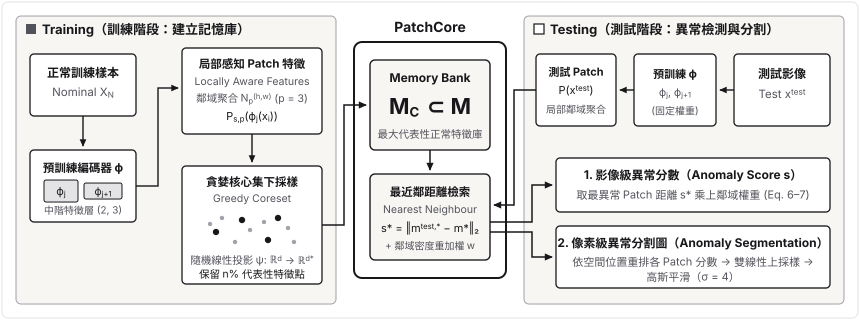

# Towards Total Recall in Industrial Anomaly Detection (PatchCore)

## 1. 基本資訊

- **簡稱**：`PatchCore`（出自論文 p. 1 Abstract）
- **發表年份與出處**：`2022`（`arXiv:2106.08265v2 [cs.CV] 5 May 2022`，出自論文 p. 1 左側邊欄；正式發表會議名稱於本 PDF 內未載明，記為「待確認」）
- **作者**：Karsten Roth（University of Tübingen；實習於 Amazon AWS）、Latha Pemula、Joaquin Zepeda、Bernhard Schölkopf、Thomas Brox、Peter Gehler（Amazon AWS，出自論文 p. 1）
- **主分類**：`異常檢測方法`
- **技術標籤**：`Memory Bank`、`Patch-Level Features`、`Coreset Subsampling`、`Pretrained CNN`、`WideResNet50`、`kNN`、`Cold-Start AD`
- **官方外部連結**：
  - arXiv：`https://arxiv.org/abs/2106.08265`（`arXiv:2106.08265v2 [cs.CV] 5 May 2022`，出自論文 p. 1 左側邊欄）
  - 官方 GitHub：`https://github.com/amazon-research/patchcore-inspection`（出自論文 p. 1 Abstract）
  - DOI：待確認（PDF 內未載明）
- **關聯 Wiki 頁面**：
  - 核心概念頁：[局部特徵記憶庫與核心集下採樣（Patch-Level Memory Bank & Coreset Subsampling）](../concepts/memory-bank.md)
  - 核心概念頁：[非監督式視覺異常檢測（Unsupervised Visual Anomaly Detection）](../concepts/unsupervised-anomaly-detection.md)
  - 跨論文比較頁：[預訓練特徵嵌入 vs. 重建式異常檢測流派對比](../comparisons/embedding-vs-reconstruction.md)
  - 評估資料集頁：[MVTec AD 資料集與評估指標](../datasets/mvtec-ad.md)（參見 [Bergmann et al. (2019)](bergmann2019-mvtec-ad.md)）

---

## 2. 一句話總結（TL;DR）與核心貢獻

- **TL;DR**：針對僅有正常樣本的冷啟動（Cold-start）工業異常檢測，提出無須在目標資料集上訓練微調的 **PatchCore**——透過擷取 ImageNet 預訓練網路的中階局部鄰域聚合特徵（Locally aware mid-level patch features）建立最大化正常上下文的記憶庫 $\mathcal{M}$，並引入貪婪核心集下採樣（Greedy coreset subsampling）大幅削減冗餘與推論耗時，於 [MVTec AD](../datasets/mvtec-ad.md) 達成單模型 **99.1%**（整合模型達 **99.6%**）Image AUROC 與 **98.1%** Pixel AUROC，將前人最佳檢測錯誤率減半以上（出自論文 p. 1 Abstract、p. 2 Sec. 1、p. 6–7 Tables 1–4）。
- **解決的核心痛點**（出自論文 p. 1–2 Sec. 1、p. 2–4 Sec. 2–3.2）：
  1. **深層 ImageNet 特徵具類別偏置且解析度過低**：直接使用預訓練網路最深層特徵（如 [SPADE] 的影像級特徵或早期方法）雖具高階抽象性，但空間解析度極低且嚴重偏向 ImageNet 自然影像分類語意，與工業檢測所需的細微結構特徵重疊極少（出自論文 p. 1–2 Sec. 1、p. 3 Sec. 3.1）。
  2. **SPADE 全量記憶庫檢索過慢 vs. PaDiM 位置綁定限制**：`SPADE` 儲存多層特徵但因最近鄰搜尋計算量過大，必須先以較弱的全圖深層特徵預篩選；而 `PaDiM` 雖在每個固定空間位置獨立估計高斯分佈（Mean 與 Covariance）並計算 Mahalanobis 距離，卻使每個測試 Patch 只能與同一空間座標的正常分佈比對，高度依賴影像剛性對齊且無法跨位置共享正常上下文（出自論文 p. 2–3 Sec. 2、p. 4 Sec. 3.2）。
- **核心貢獻**（出自論文 p. 2 Sec. 1、p. 3–5 Sec. 3）：
  1. **局部感知中階 Patch 特徵記憶庫（Locally Aware Patch-Feature Memory Bank）**：基於「只要單一 Patch 異常即可判定整張影像異常」之特性，選取預訓練網路中階層級（預設 `WideResNet50` 第 **2** 與第 **3** 區塊）並對 $p \times p$（預設 $p = 3$）局部鄰域進行自適應平均池化聚合，兼顧高空間解析度、足夠感受野（Receptive field）與低 ImageNet 分類偏置（出自論文 p. 2 Sec. 1、p. 3–4 Sec. 3.1）。
  2. **貪婪極小化極大核心集下採樣（Greedy Coreset Subsampling）**：以極小化極大設施選址（Minimax facility location）目標配合 Johnson-Lindenstrauss 隨機線性降維投影，將記憶庫壓縮 **100** 倍（`PatchCore-1%`）仍完整保留特徵空間覆蓋率，使推論速度超越 `PaDiM`（每張圖 **0.17** 秒 vs. **0.19** 秒）且維持 **99.0%** Image AUROC（出自論文 p. 4–5 Sec. 3.2、p. 6–7 Tables 1 & 5）。
  3. **刷新工業異常檢測與少樣本（Low-shot）基準**：於 [MVTec AD](../datasets/mvtec-ad.md) 將影像級檢測錯誤率自 `PaDiM*` 的 **2.1%** 降至 **0.9%**（削減 **57%** 錯誤，在 **1,725** 張測試影像中僅錯 **42** 張，**15** 類中有 **6** 類達 **100%** AUROC），整合高解析度模型更達 **99.6%** AUROC（錯誤率 **0.4%**）；且僅用 **1/5**（**20%**）正常訓練樣本即可追平前人 **100%** 訓練資料之 SOTA 表現（出自論文 p. 6–8 Sec. 4.2–4.5、p. 12 Sec. B）。

---

## 3. 初學者版（AI 整理）

> **（AI 整理）**
> - **為什麼不用自己訓練神經網路，直接拿「看過貓狗的預訓練網路」就能抓工廠瑕疵？**
>   在 [RIAD](zavrtanik2021-riad.md) 等重建方法裡，每換一種零件就要重新訓練一個 `U-Net` 來修補圖片。但 `PatchCore` 走的完全是另一條路：**「借用已經看過上百萬張照片的 ImageNet 預訓練模型（如 WideResNet50）當作現成的超級顯微鏡，直接把所有正常良品零件的局部細節拍下來存進『記憶相簿（Memory Bank）』裡！」**
> - **設計這本「記憶相簿」會遇到哪三個難題？PatchCore 怎麼解決？**
>   1. **難題一：看太淺見樹不見林，看太深又只認得貓狗（選哪一層特徵？）**
>      神經網路第 **1** 層只看得到單純的點跟線（太淺）；最後第 **4** 層滿腦子都在想「這是貴賓狗還是跑車」（太偏向 ImageNet 分類，且圖片被縮得太小、位置都糊掉了）。
>      - **PatchCore 解法（中階特徵 + 鄰居打包）**：只取中間第 **2、3** 層特徵，並把每個小方格（Patch）周圍 $3 \times 3$ 的鄰居特徵平均融合在一起（Locally aware patch features）。這樣每一格特徵既有高解析度，又看得到周圍一小圈的結構上下文！
>   2. **難題二：相簿只准「同座標比對」還是「全本相簿都能查」？（勝過 PaDiM 的關鍵）**
>      前一代方法 `PaDiM` 規定「測試圖片左上角第 $(3, 5)$ 格，只能跟訓練圖片左上角第 $(3, 5)$ 格比對」——如果螺絲稍微轉個角度或偏了一點就會誤報。
>      - **PatchCore 解法**：把所有正常訓練圖片切出來的所有局部特徵統統放進同一個大記憶庫 $\mathcal{M}$，測試時任何位置的 Patch 都可以在整個記憶庫裡找最像的正常特徵，因此不怕零件沒對齊，甚至測試圖片跟訓練圖片尺寸不同也沒問題！
>   3. **難題三：幾百張高清圖切出幾百萬個小方格，全部比對太慢怎麼辦？（貪婪核心集 Coreset 挑選法）**
>      如果把幾百萬個正常 Patch 全存進相簿，其中 **90%** 以上都是重複的正常背景紋理！但如果用「隨機亂抽 **1%**」，又很可能剛好漏掉某個罕見但正常的螺紋角落（見論文 Fig. 3）。
>      - **PatchCore 解法（Greedy Coreset Subsampling）**：改用「最遠點優先挑選法」——每次都挑選**「距離目前已入選特徵最遠」**的那個正常特徵放進精簡版相簿 $\mathcal{M}_C$。就像在地圖上蓋消防局，確保每一個角落都有代表駐守！結果就算把記憶庫砍掉 **99%**（只留 **1%**，即 `PatchCore-1%`），準確率幾乎完全不掉（**99.1%** $\to$ **99.0%**），推論速度還飛快（**0.17** 秒／張）！

---

## 4. 方法架構與核心設計

*示意圖，依論文 Fig. 2 重繪（出自論文 p. 4 Fig. 2）。*

### 4.1 局部感知 Patch 特徵（Locally Aware Patch Features，出自論文 Sec. 3.1, p. 3–4 Eq. 1–4）
1. **問題設定與預訓練特徵符號**：
   - 設訓練階段可用的全數正常（Nominal）影像集合為 $\mathcal{X}_N$（$\forall x \in \mathcal{X}_N : y_x = 0$），測試階段樣本集合為 $\mathcal{X}_T$（$\forall x \in \mathcal{X}_T : y_x \in \{0, 1\}$，$0$ 表正常、$1$ 表異常）。
   - 使用 ImageNet 預訓練網路 $\phi$（預設為 `WideResNet50`），以 $\phi_{i,j} = \phi_j(x_i) \in \mathbb{R}^{c^* \times h^* \times w^*}$ 表示影像 $x_i$ 在網路層級 $j \in \{1, 2, 3, 4\}$ 輸出的三維特徵圖（深度 $c^*$、高 $h^*$、寬 $w^*$），並以 $\phi_{i,j}(h, w) = \phi_j(x_i, h, w) \in \mathbb{R}^{c^*}$ 表示空間座標 $h \in \{1, \dots, h^*\}$、$w \in \{1, \dots, w^*\}$ 處的 $c^*$ 維特徵切片（Feature slice）。
2. **局部鄰域聚合（Local Neighbourhood Aggregation）**：
   - 為在不犧牲空間解析度與不引入深層 ImageNet 偏置的前提下擴大感受野（Receptive field），針對奇數鄰域尺寸 $p$（Patchsize，預設 $p = 3$），定義位置 $(h, w)$ 周圍的空間座標鄰域集合 $\mathcal{N}_p^{(h,w)}$ 與聚合特徵 $\phi_{i,j}(\mathcal{N}_p^{(h,w)})$（出自論文 p. 3 Eq. 1–2）：
     $$
     \begin{gathered}
     \mathcal{N}_p^{(h,w)} = \left\{ (a, b) \,\middle|\, a \in \left[h - \lfloor p/2 \rfloor, \dots, h + \lfloor p/2 \rfloor\right], \; b \in \left[w - \lfloor p/2 \rfloor, \dots, w + \lfloor p/2 \rfloor\right] \right\} \\
     \phi_{i,j}\left(\mathcal{N}_p^{(h,w)}\right) = f_{\text{agg}}\left( \left\{ \phi_{i,j}(a, b) \,\middle|\, (a, b) \in \mathcal{N}_p^{(h,w)} \right\} \right)
     \end{gathered}
     $$
   - 其中聚合函數 $f_{\text{agg}}$ 採用**自適應平均池化（Adaptive average pooling）**，將鄰域特徵平滑融合為單一預定維度 $d$ 的向量，並對所有 $(h, w)$ 執行以保持原始特徵圖解析度 $h^* \times w^*$。
   - 給定步長參數 $s$（預設 $s = 1$），單張特徵圖 $\phi_{i,j}$ 的局部感知 Patch 特徵集合 $\mathcal{P}_{s,p}(\phi_{i,j})$ 定義為（出自論文 p. 3 Eq. 3）：
     $$
     \mathcal{P}_{s,p}(\phi_{i,j}) = \left\{ \phi_{i,j}\left(\mathcal{N}_p^{(h,w)}\right) \,\middle|\, h, w \bmod s = 0, \; h < h^*, \; w < w^*, \; h, w \in \mathbb{N} \right\}
     $$
3. **跨層級中階特徵融合與記憶庫建構**：
   - 為兼顧特徵通用性與空間解析度，PatchCore 僅取兩個相鄰的中階特徵層級 $j$ 與 $j+1$（預設 $j = 2, j+1 = 3$，即 `WideResNet50` 的第 **2** 與第 **3** 區塊輸出，出自論文 p. 3 Sec. 3.1、p. 4 Sec. 3.1、p. 12 Supp. A）。
   - 將較深層特徵集合 $\mathcal{P}_{s,p}(\phi_{i,j+1})$ 透過雙線性插值（Bilinearly rescaling）上採樣至與較淺層 $\mathcal{P}_{s,p}(\phi_{i,j})$ 相同的空間解析度（使 $|\mathcal{P}_{s,p}(\phi_{i,j+1})| = |\mathcal{P}_{s,p}(\phi_{i,j})|$）並對應聚合，最後將所有正常訓練樣本 $x_i \in \mathcal{X}_N$ 的 Patch 特徵聯集組成記憶庫 $\mathcal{M}$（出自論文 p. 4 Eq. 4）：
     $$
     \mathcal{M} = \bigcup_{x_i \in \mathcal{X}_N} \mathcal{P}_{s,p}(\phi_j(x_i))
     $$

### 4.2 貪婪核心集下採樣記憶庫（Coreset-Reduced Memory Bank，出自論文 Sec. 3.2, p. 4–5 Eq. 5 & Algorithm 1）
1. **極小化極大設施選址核心集目標（Minimax Facility Location Coreset）**：
   - 隨著正常訓練集 $\mathcal{X}_N$ 規模增加，原始記憶庫 $\mathcal{M}$ 包含大量冗餘特徵（測試時實際被用到的特徵不到 **30%**，出自論文 p. 7 Sec. 4.4.2），導致儲存空間與最近鄰檢索時間暴增。然而若採用隨機下採樣（Random subsampling），在高倍率壓縮下會嚴重丟失特徵空間的局部叢集覆蓋（見論文 p. 4 Fig. 3）。
   - 由於 PatchCore 依賴最近鄰距離運算，作者採用**極小化極大設施選址（Minimax facility location）**問題定義核心集子集 $\mathcal{M}_C \subset \mathcal{M}$，確保原始記憶庫 $\mathcal{M}$ 中任意元素 $m$ 到核心集 $\mathcal{M}_C$ 最近鄰點 $n$ 的最大歐氏距離最小化（出自論文 p. 4 Eq. 5）：
     $$
     \mathcal{M}_C^* = \arg\min_{\mathcal{M}_C \subset \mathcal{M}} \max_{m \in \mathcal{M}} \min_{n \in \mathcal{M}_C} \|m - n\|_2
     $$
2. **貪婪迭代近似與隨機線性投影加速（Algorithm 1）**：
   - 由於精確求解 $\mathcal{M}_C^*$ 為 NP-Hard 問題，PatchCore 採用迭代貪婪近似（Iterative greedy approximation）：每次迭代挑選與當前已選集合 $\mathcal{M}_C$ 距離最遠的點 $m_i$ 加入 $\mathcal{M}_C$，共迭代 $l$ 次（達到目標保留比例 $n\%$，記為 `PatchCore-n%`）。
   - 為進一步降低核心集挑選階段的距離計算耗時，依據 **Johnson-Lindenstrauss 定理**，使用隨機線性投影 $\psi: \mathbb{R}^d \to \mathbb{R}^{d^*}$（$d^* < d$）在低維度空間計算貪婪選擇（出自論文 p. 4 Sec. 3.2、p. 5 Algorithm 1）：
     $$
     m_i \leftarrow \arg\max_{m \in \mathcal{M} - \mathcal{M}_C} \min_{n \in \mathcal{M}_C} \|\psi(m) - \psi(n)\|_2, \quad \mathcal{M}_C \leftarrow \mathcal{M}_C \cup \{m_i\}
     $$

### 4.3 異常檢測與像素級分割推論（Anomaly Detection & Segmentation，出自論文 Sec. 3.3, p. 5 Eq. 6–7）
1. **最異常 Patch 最近鄰距離 $s^*$**：
   - 給定測試影像 $x^{\text{test}}$，擷取其局部感知 Patch 特徵集合 $\mathcal{P}(x^{\text{test}}) = \mathcal{P}_{s,p}(\phi_j(x^{\text{test}}))$。對每個測試 Patch 特徵 $m^{\text{test}}$ 計算其與記憶庫 $\mathcal{M}$ 中最近鄰的 $\ell_2$ 距離，並找出全圖距離最大的測試 Patch $m^{\text{test},*}$ 及其對應的記憶庫最近鄰點 $m^*$（出自論文 p. 5 Eq. 6）：
     $$
     \begin{gathered}
     m^{\text{test},*}, m^* = \arg\max_{m^{\text{test}} \in \mathcal{P}(x^{\text{test}})} \arg\min_{m \in \mathcal{M}} \|m^{\text{test}} - m\|_2 \\
     s^* = \|m^{\text{test},*} - m^*\|_2
     \end{gathered}
     $$
2. **鄰域密度感知重加權之影像級異常分數 $s$**：
   - 若記憶庫中距離異常候選特徵 $m^{\text{test},*}$ 最近的正常特徵 $m^*$ 本身就遠離記憶庫中的其他正常樣本（代表該處屬於罕見的邊緣正常特徵），作者利用記憶庫中距離 $m^*$ 最近的 $b$ 個鄰居集合 $\mathcal{N}_b(m^*)$ 對最大距離 $s^*$ 進行軟性重加權（Re-weighting），拉高最終影像級異常分數 $s \in \mathbb{R}$（出自論文 p. 5 Eq. 7）：
     $$
     s = \left( 1 - \frac{\exp \|m^{\text{test},*} - m^*\|_2}{\sum_{m \in \mathcal{N}_b(m^*)} \exp \|m^{\text{test},*} - m\|_2} \right) \cdot s^*
     $$
3. **像素級異常分割圖生成**：
   - 在計算 Eq. 6 各測試 Patch 最近鄰距離的同一時間，將每個 Patch 的異常距離分數依其原本的空間座標重新排列為二維特徵異常圖，再以**雙線性插值（Bi-linear interpolation）**上採樣回原始輸入影像解析度，最後套用核寬度 $\sigma = 4$ 的**高斯平滑（Gaussian smoothing）**即可獲得最終像素級異常分割圖（作者註明未對此平滑參數進行額外調優，出自論文 p. 5 Sec. 3.3）。

---

## 5. 實驗與應用表現

### 5.1 實驗設定與評估基準（出自論文 Sec. 4.1, p. 5 & Supp. A, p. 12）
- **硬體與軟體環境**：使用 Python 3.7、PyTorch 與 `torchvision` / `timm`（PyTorch Image Models）之 ImageNet 預訓練權重，最近鄰檢索與距離計算使用 `faiss` 函式庫，於 Nvidia Tesla V4 GPU 上執行（出自論文 p. 12 Supp. A）。
- **預設骨幹與超參數**：為與 `SPADE` 及 `PaDiM` 公平比較，預設使用 `WideResNet50` 骨幹網路，擷取第 **2** 與第 **3** 區塊（Blocks `2+3`）特徵；鄰域大小 $p = 3$，步長 $s = 1$（出自論文 p. 6–7 Sec. 4.3–4.4、p. 12 Supp. A）。
- **評估資料集與前處理**：
  1. **[MVTec AD](../datasets/mvtec-ad.md)**：**15** 個子資料集、共 **5,354** 張影像（其中 **1,725** 張測試影像）。依循前人協定，將影像縮放至 $256 \times 256$ 後中心裁切（Center crop）為 $224 \times 224$，**完全不使用任何資料擴增（No data augmentation）**（出自論文 p. 5 Sec. 4.1）。
  2. **Magnetic Tile Defects (MTD)**：含 **925** 張無缺陷與 **392** 張異常磁磚影像（具多變光照與不同影像尺寸，導致 `PaDiM` 等空間固定方法無法直接套用）；依循 `DifferNet` 協定取 **20%** 無缺陷影像供測試評估，其餘用於冷啟動訓練（出自論文 p. 5 Sec. 4.1、p. 8 Sec. 4.6）。
  3. **Mini Shanghai Tech Campus (mSTC)**：`STC` 行人監控影片資料集之子集（每 **5** 格訓練與測試影格取樣 **1** 格，涵蓋 **12** 個場景，異常包含打架或騎腳踏車）；影像縮放至 $256 \times 256$，因場景接近 ImageNet 自然影像，改取較深層的第 **3** 與第 **4** 階層特徵，其餘超參數不變（出自論文 p. 5 Sec. 4.1、p. 8 Sec. 4.6）。
- **評估指標**：影像級採用 Class-average `AUROC`（以及 F1-optimal 閾值下的總誤分類張數 Misclassifications）；像素級分割同時採用 `Pixelwise AUROC` 與 `PRO`（Per-Region Overlap）指標（出自論文 p. 5 Sec. 4.1、p. 6 Table 1）。

### 5.2 MVTec AD 整體表現與推論速度對照（出自論文 Tables 1–5, p. 6–7）

#### (A) 影像級異常檢測（Table 1, p. 6）與像素級異常分割（Table 2, p. 6 & Table 3, p. 7）匯總
*註：`PaDiM*` 代表原論文中針對不同任務特別挑選骨幹網路之結果；`Error` 為 $100\% - \text{Score}$；`Misclassifications` 為在 F1-optimal 閾值下 **1,725** 張測試影像中 False-Positive 與 False-Negative 的總和（`PatchCore-25%` 僅錯 **42** 張，包含 **19** 張 FP 與 **23** 張 FN，出自論文 p. 6 Table 1、p. 12 Sec. C.4）。*

| 方法 (Method) | Image AUROC ↑ (%) | Image Error ↓ (%) | 誤分類張數 ↓ (共 1,725 張) | Pixel AUROC ↑ (%) | Pixel Error ↓ (%) | PRO ↑ (%) | PRO Error ↓ (%) |
| :--- | :---: | :---: | :---: | :---: | :---: | :---: | :---: |
| **$\text{AE}_{\text{SSIM}}$** | - | - | - | 87.0 | 13.0 | 69.4 | 30.6 |
| **Student** | - | - | - | - | - | 85.7 | 14.3 |
| **$\gamma$-VAE + grad.** | - | - | - | 88.8 | 11.2 | - | - |
| **$\text{CAVGA-R}_w$** | - | - | - | 89.0 | 11.0 | - | - |
| **SPADE** | 85.5 | 14.5 | - | 96.0 | 4.0 | 91.7 | 8.3 |
| **PatchSVDD** | 92.1 | 7.9 | - | 95.7 | 4.3 | - | - |
| **DifferNet** | 94.9 | 5.1 | - | - | - | - | - |
| **PaDiM** | 95.3 | 4.7 | - | 97.5 | 2.5 | 92.1 | 7.9 |
| **Mah.AD (MahalanobisAD)** | 95.8 | 4.2 | - | - | - | - | - |
| **PaDiM*** | 97.9 | 2.1 | - | - | - | - | - |
| **PatchCore-25%** | **99.1** | **0.9** | **42** | **98.1** | **1.9** | 93.4 | 6.6 |
| **PatchCore-10%** | 99.0 | 1.0 | 47 | **98.1** | **1.9** | **93.5** | **6.5** |
| **PatchCore-1%** | 99.0 | 1.0 | 49 | 98.0 | 2.0 | 93.1 | 6.9 |

#### (B) 放大解析度、更深骨幹與模型整合表現（出自論文 Table 4, p. 7）
*註：受惠於 `1%` 核心集下採樣極高的計算效率，可將 `PatchCore-1%` 套用至更大影像尺寸（$280$ 或 $320$）與多骨幹整合，推論時間仍低於預設解析度之 `PatchCore-10%`（出自論文 p. 6 Sec. 4.2、p. 7 Table 4）。*

| 模型配置（皆採 `PatchCore-1%`） | Image AUROC ↑ / Error ↓ (%) | Pixel AUROC ↑ / Error ↓ (%) | PRO ↑ / Error ↓ (%) |
| :--- | :---: | :---: | :---: |
| **DenseNet-201 & ResNeXt-101 & WRN-101 (層級 2+3), 影像尺寸 $320 \times 320$** | **99.6** / **0.4** | 98.2 / 1.8 | 94.9 / 5.6（原文如此，100 − 94.9 應為 5.1） |
| **WideResNet-101 (層級 2+3), 影像尺寸 $280 \times 280$** | 99.4 / 0.6 | 98.2 / 1.8 | 94.4 / 5.6 |
| **WideResNet-101 (層級 1+2+3), 影像尺寸 $280 \times 280$** | 99.2 / 0.8 | **98.4** / **1.6** | **95.0** / **5.0** |

#### (C) 單張影像平均推論時間與近似最近鄰比較（出自論文 Table 5, p. 7）
*註：所有方法皆在同一硬體上以 `WideResNet50` 骨幹測量（包含通過骨幹網路的前向傳播時間，並儘可能於 GPU 運算，出自論文 p. 6 Sec. 4.3、p. 7 Table 5）。*

| 方法 (Method) | Image AUROC (%) | Pixel AUROC (%) | PRO (%) | 單張影像平均推論時間 (秒) |
| :--- | :---: | :---: | :---: | :---: |
| **SPADE（重實作，WideResNet50）** | 85.3 | 96.6 | 91.5 | 0.66 s |
| **PaDiM（重實作，WideResNet50）** | 95.4 | 97.3 | 91.8 | 0.19 s |
| **PatchCore-100%（無下採樣）** | **99.1** | 98.0 | 93.3 | 0.60 s |
| **PatchCore-100% + IVFPQ（近似最近鄰搜尋）** | 98.0 | 97.9 | 93.0 | 0.20 s |
| **PatchCore-10%** | 99.0 | **98.1** | **93.5** | 0.22 s |
| **PatchCore-1%** | 99.0 | 98.0 | 93.1 | **0.17 s** |

### 5.3 MVTec AD 15 類別逐類完整表現（出自論文補充材料 Tables S1–S4, p. 15）

#### (A) 逐類 Image-level AUROC (%)（出自論文 Table S1 & Table S4, p. 15）

| 方法 \ 類別 | Avg | Bottle | Cable | Capsule | Carpet | Grid | Hazeln. | Leather | Metal Nut | Pill | Screw | Tile | Toothb. | Trans. | Wood | Zipper |
| :--- | :---: | :---: | :---: | :---: | :---: | :---: | :---: | :---: | :---: | :---: | :---: | :---: | :---: | :---: | :---: | :---: |
| **GeoTrans** | 67.2 | 74.4 | 78.3 | 67.0 | 43.7 | 61.9 | 35.9 | 84.1 | 81.3 | 63.0 | 50.0 | 41.7 | 97.2 | 86.9 | 61.1 | 82.0 |
| **GANomaly** | 76.2 | 89.2 | 75.7 | 73.2 | 69.9 | 70.8 | 78.5 | 84.2 | 70.0 | 74.3 | 74.6 | 79.4 | 65.3 | 79.2 | 83.4 | 74.5 |
| **DSEBM** | 70.9 | 81.8 | 68.5 | 59.4 | 41.3 | 71.7 | 76.2 | 41.6 | 67.9 | 80.6 | **99.9** | 69.0 | 78.1 | 74.1 | 95.2 | 58.4 |
| **OCSVM** | 71.9 | 99.0 | 80.3 | 54.4 | 62.7 | 41.0 | 91.1 | 88.0 | 61.1 | 72.9 | 74.7 | 87.6 | 61.9 | 56.7 | 95.3 | 51.7 |
| **ITAE** | 83.9 | 94.1 | 83.2 | 68.1 | 70.6 | 88.3 | 85.5 | 86.2 | 66.7 | 78.6 | **100** | 73.5 | **100** | 84.3 | 92.3 | 87.6 |
| **$\text{CAVGA-R}_w$** | 90 | 96 | 92 | 93 | 88 | 84 | 97 | 89 | 82 | 86 | 81 | 97 | 89 | 99 | 79 | 96 |
| **PatchSVDD** | 92.1 | 98.6 | 90.3 | 76.7 | 92.9 | 94.6 | 92.0 | 90.9 | 94.0 | 86.1 | 81.3 | 97.8 | **100** | 91.5 | 96.5 | 97.9 |
| **DifferNet** | 94.9 | 99.0 | 95.9 | 86.9 | 92.9 | 84.0 | 99.3 | 97.1 | 96.1 | 88.8 | 96.3 | 99.4 | 98.6 | 91.1 | **99.8** | 95.1 |
| **MahalanobisAD** | 95.8 | **100** | 95.0 | 95.1 | **100** | 89.7 | 99.1 | **100** | 94.7 | 88.7 | 85.2 | **99.8** | 96.9 | 95.5 | 99.6 | 97.9 |
| **PatchCore-25%** | **99.1** | **100** | **99.5** | **98.1** | **98.7** | 98.2 | **100** | **100** | **100** | 96.6 | **98.1** | 98.7 | **100** | **100** | 99.2 | 99.4 |
| **PatchCore-10%** | 99.0 | **100** | 99.4 | 97.8 | **98.7** | 97.9 | **100** | **100** | **100** | 96.0 | 97.0 | 98.9 | 99.7 | **100** | 99.0 | **99.5** |
| **PatchCore-1%** | 99.0 | **100** | 99.3 | 98.0 | 98.0 | **98.6** | **100** | **100** | 99.7 | **97.0** | 96.4 | **99.4** | **100** | 99.9 | 99.2 | 99.2 |
| *PatchCore-1% (WRN101, 2+3, 280)* | *99.4* | *100* | *99.6* | *98.2* | *98.4* | *99.8* | *100* | *100* | *100* | *97.2* | *98.9* | *98.9* | *100* | *100* | *99.5* | *99.9* |
| *PatchCore-1% (WRN101, 1+2+3, 280)* | *99.2* | *100* | *99.7* | *98.1* | *98.2* | *98.3* | *100* | *100* | *100* | *97.1* | *99.0* | *98.9* | *98.9* | *99.7* | *99.9* | *99.7* |

#### (B) 逐類 Pixelwise AUROC (%) 與 PRO (%)（出自論文 Table S2, Table S3 & Table S4, p. 15）

| 方法（指標） \ 類別 | Avg | Bottle | Cable | Capsule | Carpet | Grid | Hazeln. | Leather | Metal Nut | Pill | Screw | Tile | Toothb. | Trans. | Wood | Zipper |
| :--- | :---: | :---: | :---: | :---: | :---: | :---: | :---: | :---: | :---: | :---: | :---: | :---: | :---: | :---: | :---: | :---: |
| **SPADE (pwAUROC)** | 96.0 | 98.4 | 97.2 | **99.0** | 97.5 | 93.7 | **99.1** | 97.6 | 98.1 | 96.5 | 98.9 | 87.4 | 97.9 | 94.1 | 88.5 | 96.5 |
| **PaDiM (pwAUROC)** | 97.5 | 98.3 | 96.7 | 98.5 | **99.1** | 97.3 | 98.2 | 99.2 | 97.2 | 95.7 | 98.5 | 94.1 | **98.8** | **98.5** | 94.9 | 98.5 |
| **PatchCore-25% (pwAUROC)** | **98.1** | **98.6** | 98.4 | 98.8 | 99.0 | **98.7** | 98.7 | **99.3** | **98.4** | 97.4 | **99.4** | 95.6 | 98.7 | 96.3 | 95.0 | 98.8 |
| **PatchCore-10% (pwAUROC)** | **98.1** | **98.6** | **98.5** | 98.9 | **99.1** | **98.7** | 98.7 | **99.3** | **98.4** | **97.6** | **99.4** | 95.9 | 98.7 | 96.4 | **95.1** | **98.9** |
| **PatchCore-1% (pwAUROC)** | 98.0 | 98.5 | 98.2 | 98.8 | 98.9 | 98.6 | 98.6 | **99.3** | **98.4** | 97.1 | 99.2 | **96.1** | 98.5 | 94.9 | **95.1** | 98.8 |
| **SPADE (PRO)** | 91.7 | 95.5 | 90.9 | 93.7 | 94.7 | 86.7 | **95.4** | 97.2 | **94.4** | **94.6** | 96.0 | 75.6 | **93.5** | **87.4** | 87.4 | 92.6 |
| **PaDiM (PRO)** | 92.1 | 94.8 | 88.8 | 93.5 | 96.2 | 94.6 | 92.6 | 97.8 | 85.6 | 92.7 | 94.4 | 86.0 | 93.1 | 84.5 | **91.1** | 95.9 |
| **PatchCore-25% (PRO)** | 93.4 | **96.2** | 92.5 | **95.5** | **96.6** | 96.0 | 93.8 | **98.9** | 91.4 | 93.2 | **97.9** | 87.3 | 91.5 | 83.7 | 89.4 | **97.1** |
| **PatchCore-10% (PRO)** | **93.5** | 96.1 | **92.6** | **95.5** | **96.6** | 95.9 | 93.9 | **98.9** | 91.3 | 94.1 | **97.9** | 87.4 | 91.4 | 83.5 | 89.6 | **97.1** |
| **PatchCore-1% (PRO)** | 93.1 | 95.9 | 91.6 | **95.5** | 96.5 | **96.1** | 93.8 | **98.9** | 91.2 | 92.9 | 97.1 | 88.3 | 90.2 | 81.2 | 89.5 | 97.0 |

*(註：Table S2 亦包含 `vis. expl. VAE` 平均 **86%**、$\text{AE}_{\text{SSIM}}$ **87%**、$\gamma\text{-VAE + grad.}$ **88.8%**、$\text{CAVGA-R}_w$ **89%**、`PatchSVDD` **95.7%**；Table S3 亦包含 $\text{AE}_{\text{SSIM}}$ 平均 PRO **69.4%** 與 `Student` **85.7%**。)*

### 5.4 少樣本（Low-Shot）實驗與其他基準資料集表現

#### (A) MVTec AD 少樣本（Low-Shot）異常檢測表現（出自論文 Sec. 4.5, p. 7–8 Fig. 6 & Supp. Table S5, p. 16）
*註：每類別正常訓練樣本數自 **1** 張（占總訓練集 **0.4%**）變化至 **50** 張（占 **21%**），`SPADE` 與 `PaDiM` 皆以相同 `WideResNet50` 骨幹重新實作比較。僅用 **16** 張樣本時，`PatchCore` 即顯著超越使用 `Normalizing Flows` 進行特徵調適的 `DifferNet`（**95.5%** vs. **87.3%**）；僅用 **50** 張（約 **1/5** 訓練集）即追平前人 **100%** 訓練集之最佳表現（出自論文 p. 8 Sec. 4.5、p. 16 Table S5）。*

| 指標 / 方法 | 1 Shot (0.4%) | 2 Shots (0.8%) | 5 Shots (2.1%) | 10 Shots (4.1%) | 16 Shots (6.6%) | 20 Shots (8.3%) | 50 Shots (21%) |
| :--- | :---: | :---: | :---: | :---: | :---: | :---: | :---: |
| **Image AUROC — SPADE** | 71.6 ± 0.7 | 73.4 ± 1.3 | 75.2 ± 1.5 | 77.5 ± 1.1 | 78.9 ± 0.9 | 79.6 ± 0.8 | 81.1 ± 0.4 |
| **Image AUROC — PaDiM** | 76.1 ± 0.4 | 78.9 ± 0.6 | 81.0 ± 0.2 | 83.2 ± 0.7 | 85.5 ± 0.6 | 86.5 ± 0.3 | 90.1 ± 0.3 |
| **Image AUROC — DifferNet** | - | - | - | - | 87.3 | - | - |
| **Image AUROC — PatchCore-10%** | 83.4 ± 0.6 | 86.4 ± 0.9 | 90.8 ± 0.8 | 93.6 ± 0.6 | 95.4 ± 0.7 | 95.8 ± 0.6 | 97.5 ± 0.3 |
| **Image AUROC — PatchCore-25%** | **84.1 ± 0.7** | **87.2 ± 1.0** | **91.0 ± 0.9** | **93.8 ± 0.5** | **95.5 ± 0.6** | **95.9 ± 0.6** | **97.7 ± 0.4** |
| **Pixel AUROC — SPADE** | 91.9 ± 0.3 | 93.1 ± 0.2 | 94.5 ± 0.1 | 95.4 ± 0.1 | 95.7 ± 0.2 | 95.7 ± 0.2 | 96.2 ± 0.0 |
| **Pixel AUROC — PaDiM** | 88.2 ± 0.3 | 90.5 ± 0.2 | 92.5 ± 0.1 | 93.9 ± 0.1 | 94.8 ± 0.1 | 95.1 ± 0.1 | 96.3 ± 0.0 |
| **Pixel AUROC — PatchCore-10%** | 92.0 ± 0.2 | 93.1 ± 0.2 | **94.8 ± 0.1** | **96.2 ± 0.1** | **96.8 ± 0.3** | **96.9 ± 0.3** | **97.8 ± 0.0** |
| **Pixel AUROC — PatchCore-25%** | **92.4 ± 0.3** | **93.3 ± 0.2** | **94.8 ± 0.1** | 96.1 ± 0.1 | **96.8 ± 0.3** | **96.9 ± 0.3** | 97.7 ± 0.0 |
| **PRO — SPADE** | 83.5 ± 0.4 | 85.8 ± 0.1 | 88.3 ± 0.2 | 89.6 ± 0.1 | 90.1 ± 0.2 | 90.1 ± 0.3 | 90.8 ± 0.1 |
| **PRO — PaDiM** | 72.4 ± 1.2 | 77.8 ± 0.7 | 82.7 ± 0.2 | 85.9 ± 0.2 | 87.5 ± 0.2 | 88.2 ± 0.2 | 90.4 ± 0.1 |
| **PRO — PatchCore-10%** | 82.4 ± 0.3 | 85.1 ± 0.3 | 88.7 ± 0.2 | **90.9 ± 0.1** | **91.8 ± 0.2** | **92.0 ± 0.2** | **93.0 ± 0.1** |
| **PRO — PatchCore-25%** | **83.7 ± 0.5** | **86.0 ± 0.3** | **88.8 ± 0.2** | **90.9 ± 0.1** | 91.7 ± 0.1 | 91.9 ± 0.2 | 92.8 ± 0.0 |

#### (B) 其他基準資料集表現：mSTC 與 MTD（出自論文 Sec. 4.6 & Table 6, p. 8）

| 資料集與評估指標 | 對照方法 1 | 對照方法 2 | 對照方法 3 | PatchCore-10% (Ours) |
| :--- | :---: | :---: | :---: | :---: |
| **mSTC（Pixelwise AUROC %）** | $\text{CAVGA-R}_u$: 85.0 | SPADE: 89.9 | PaDiM: 91.2 | **91.8** |
| **MTD（Image AUROC %）** | GANomaly: 76.6 | 1-NN: 80.0 | DifferNet: 97.7 | **97.9** |

### 5.5 消融實驗重點（Ablation Studies，出自論文 Sec. 4.4, p. 6–7 & Supp. Sec. C, p. 12–18）

| 消融維度 | 出處圖表與公式 | 關鍵實驗數據與結論 |
| :--- | :--- | :--- |
| **1. 局部鄰域大小 $p$（Local Awareness）** | Sec. 4.4.1, Fig. 4 top (p. 6–7) & Fig. S5 (p. 17) | 在測試 $p \in \{1, \dots, 7\}$ 時，無論有無核心集下採樣，都在 **$p = 3$** 達到局部性與全域上下文的最佳平衡（$p = 1$ 即無鄰域聚合時檢測與分割表現顯著較低，$p$ 過大則因過度平滑而退化）。 |
| **2. 預訓練特徵層級選擇（Feature Hierarchies）** | Sec. 4.4.1, Fig. 4 bottom (p. 6–7) & Fig. S5 (p. 17) | 比較 `WideResNet50` 前三區塊組合（`1`、`2`、`3`、`1+2`、`2+3`、`1+2+3`）：單用層級 `2` 已達 SOTA 水準，而結合中階層級 **`2+3`**（預設配置）在 Image AUROC、Pixel AUROC 與 PRO 綜合表現最佳（單用層級 `1` 解析度高但語意不足，單用層級 `3` 則解析度下降且偏向 ImageNet 分類）。 |
| **3. 記憶庫下採樣方法比較（Coreset vs. Random vs. Learned Proxies）** | Sec. 4.4.2, Fig. 5, Eq. 8 (p. 7) & Fig. S6 (p. 18) | 對比三種縮減記憶庫 $\mathcal{M}$ 的方法：(1) 貪婪核心集（Greedy Coreset）、(2) 隨機下採樣（Random）、(3) 透過最小化基底重建損失 $\mathcal{L}_{\text{rec}}(m_i) = \left\| m_i - \sum_{p_k \in \mathcal{P}} \frac{\exp(\|m_i - p_k\|_2)}{\sum_{p_j \in \mathcal{P}} \exp(\|m_i - p_j\|)} p_k \right\|_2^2$（Eq. 8）學習代理基底點（Learned proxies）。結果顯示 **Greedy Coreset 在所有壓縮比例下全面勝出**；壓縮 **2** 個數量級（至 **1%**）仍與未壓縮表現相當，且在 **50% 至 10%** 區間甚至因去除冗餘而使檢測與定位表現略微提升；記憶庫元素於測試期的實際使用率也從未壓縮時的 **$< 30\%$** 大幅提升至 `1%` 核心集的 **近 $95\%$**。 |
| **4. 步長下採樣（Striding $s$）vs. 核心集下採樣** | Sec. 4.4.2 (p. 7) | 若改用增大 Eq. 3 的步長 $s$ 來縮減記憶庫，會因喪失高解析度上下文導致性能明顯下滑：步長 $s = 2$ 時 Image AUROC 降至 **97.6%**，步長 $s = 3$ 時更降至 **96.8%**（遠低於 `PatchCore-1%` 的 **99.0%**）。 |
| **5. 不同預訓練骨幹網路穩定性** | Supp. Sec. C.2 & Table S6 (p. 12, p. 17) | 測試 5 種骨幹網路在 `10%` / `1%` 核心集下的表現（格式：`Image AUROC / Pixel AUROC / PRO`）： - `ResNet50`: **99.0 / 98.1 / 93.3** (`10%`)、**98.7 / 97.8 / 93.3** (`1%`) - `WideResNet50`: **98.9 / 98.1 / 93.5** (`10%`)、**99.0 / 98.0 / 93.1** (`1%`) - `ResNet101`: **98.6 / 97.9 / 92.5** (`10%`)、**98.7 / 97.8 / 92.2** (`1%`) - `WideResNet101`: **99.1 / 98.2 / 93.4** (`10%`)、**99.0 / 98.1 / 93.0** (`1%`) - `ResNeXt101`: **98.9 / 98.0 / 92.8** (`10%`)、**98.7 / 97.8 / 92.6** (`1%`) 證實 PatchCore 跨不同預訓練架構高度穩定。 |

---

## 6. 論文限制（Limitations）與延伸筆記

### 6.1 論文明確指出的限制與剩餘錯誤分析（出自論文 Sec. 5, p. 8 & Supp. Sec. C.4, p. 12–14）
1. **受限於預訓練特徵之跨領域可遷移性（Transferability of Pretrained Features）**：
   - 作者於結論（p. 8 Sec. 5 Limitations）明確指出：雖然 PatchCore 無須針對目標問題進行訓練調適即可在工業異常檢測展現極高效能，但其適用性根本上仍受限於所借用之預訓練特徵的可遷移性。未來可將 PatchCore 的記憶庫機制與「特徵對目標領域的自監督／無監督調適（Feature adaptation）」相結合。
2. **MVTec AD 剩餘 42 張誤分類樣本之深度剖析（出自論文 Supp. Sec. C.4, p. 12–14 & Figs. S1–S2）**：
   - 在 F1-optimal 閾值下，`PatchCore-25%` 於全部 **1,725** 張測試影像中僅剩 **42** 張錯誤（**19** 張假陽性 False-Positive ＋ **23** 張假陰性 False-Negative）：
   - **假陽性（19 張，Fig. S1）成因**：主要來自 (a) **標註模糊性（Ambiguity in labelling）**，即正常測試影像上出現了其實也可被視為異常的明顯外觀變化；(b) **極高的正常樣本變異（High nominal variance）** 或背景干擾，因未對目標資料進行特徵調適而被誤判為異常。
   - **假陰性（23 張，Fig. S2）成因**：(a) 大多數假陰性其實**在像素異常圖上已被成功定位出來**，但異常區域獲得的權重不足以跨過整張圖的分類閾值（可透過後處理改善）；(b) 極細微異常（Finegrained anomalies），需提高輸入影像解析度（如 $280 \times 280$ 至 $448 \times 448$，見 Sec. C.3 & Fig. S4）才能捕捉；(c) 其中 **1** 張異常則是因為前處理中心裁切（$256 \times 256 \to 224 \times 224$）剛好把邊緣的真實瑕疵區域裁切掉了。

### 6.2 延伸筆記（AI 整理）
- **（AI 整理）PatchCore 在異常檢測演進史上的里程碑意義**：
  1. **將 MVTec AD 推向飽和（99.1% ~ 99.6%）**：相較於早期 [MVTec AD](bergmann2019-mvtec-ad.md) 基準中的 `CNN Feature Dictionary`（因丟失空間結構且僅用 K-means **10** 個群心，在物件類別表現不佳）以及重建流派的 [RIAD](zavrtanik2021-riad.md)（**91.7%** Image / **94.2%** Pixel AUROC，需訓練且單圖推論需 **12** 次 `U-Net` 前向傳播），PatchCore 證明了「保留中階空間特徵 + 局部鄰域池化 + 貪婪核心集記憶庫」可以在**完全不訓練神經網路**的前提下，以 **0.17** 秒的極速將 MVTec AD 推向接近完美的 **99.6%**。
  2. **催生下一代更嚴苛基準（MVTec AD 2）與生成式修復對比**：正因為 PatchCore 在標準 MVTec AD 上幾乎達到滿分，學界一方面開始探索結合預訓練特徵與擴散重建的方法（如 `DiffusionAD`、`LAMBDA`），另一方面也促使 MVTec 團隊後續推出難度大幅提升、包含高正常變異與極微弱缺陷的 `MVTec AD 2`。

---

## 7. 相關 Wiki 頁面連結

- **核心概念**：
  - [局部特徵記憶庫與核心集下採樣（Patch-Level Memory Bank & Coreset Subsampling）](../concepts/memory-bank.md)
  - [非監督式視覺異常檢測（Unsupervised Visual Anomaly Detection）](../concepts/unsupervised-anomaly-detection.md)
  - [遮罩修復重建與多尺度梯度相似度（Reconstruction by Inpainting & MSGMS）](../concepts/reconstruction-by-inpainting.md)
  - [去噪擴散機率模型（Denoising Diffusion Probabilistic Models, DDPM）](../concepts/denoising-diffusion-probabilistic-models.md)
  - [規範引導一步去噪與合成異常分割（Norm-Guided One-Step Denoising & Anomaly Synthesis）](../concepts/norm-guided-one-step-denoising.md)
  - [潛在空間記憶庫引導去噪與引導尺度圖（Latent Diffusion with MBG & GSM）](../concepts/memory-bank-guided-latent-diffusion.md)
- **跨論文流派比較**：
  - [預訓練特徵嵌入 vs. 重建式異常檢測流派對比](../comparisons/embedding-vs-reconstruction.md)
- **資料集與評估指標**：
  - [MVTec AD 資料集與評估指標](../datasets/mvtec-ad.md)
  - [MVTec AD 2 資料集與進階評估協定（AU-PRO0.05、F1 與光照分佈偏移）](../datasets/mvtec-ad-2.md)
- **相關收錄論文**：
  - [Bergmann et al. (2019) — MVTec AD](bergmann2019-mvtec-ad.md)
  - [Ho et al. (2020) — DDPM](ho2020-ddpm.md)
  - [Zavrtanik et al. (2021) — RIAD](zavrtanik2021-riad.md)
  - [Zhang et al. (2023/2025) — DiffusionAD](zhang2023-diffusionad.md)
  - [Lee & Kang (2026) — LAMBDA](lee2026-lambda.md)
  - [Heckler-Kram et al. (2025) — MVTec AD 2](hecklerkram2025-mvtec-ad-2.md)
