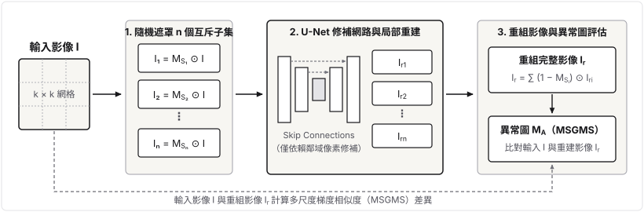

# Reconstruction by Inpainting for Visual Anomaly Detection (RIAD)

## 1. 基本資訊

- **簡稱**：`RIAD`（Reconstruction-by-Inpainting Anomaly Detection，出自論文 p. 1 Abstract、p. 2 Sec. 3）
- **發表年份與出處**：`Pattern Recognition 2021`（Vol. **112**, Article **107706**, pp. 1–9；2020 年 5 月 29 日收稿、2020 年 10 月 17 日線上發表，出自論文 p. 1）
- **作者**：Vitjan Zavrtanik, Matej Kristan, Danijel Skočaj（University of Ljubljana，出自論文 p. 1）
- **主分類**：`異常檢測方法`
- **技術標籤**：`Inpainting`、`Reconstruction`、`Self-Supervised Learning`、`U-Net`、`Skip Connections`、`MSGMS`、`Multi-Scale`
- **官方外部連結**：
  - DOI：`https://doi.org/10.1016/j.patcog.2020.107706`（出自論文 p. 1 左下角）
  - 期刊主頁：`https://www.elsevier.com/locate/patcog`（出自論文 p. 1 頁首）
  - arXiv / 官方 GitHub：待確認（PDF 內未載明）
- **關聯 Wiki 頁面**：
  - 核心概念頁：[遮罩修復重建（Reconstruction by Inpainting）](../concepts/reconstruction-by-inpainting.md)
  - 核心概念頁：[非監督式視覺異常檢測（Unsupervised Visual Anomaly Detection）](../concepts/unsupervised-anomaly-detection.md)
  - 評估資料集頁：[MVTec AD 資料集與評估指標](../datasets/mvtec-ad.md)（參見 [Bergmann et al. (2019)](bergmann2019-mvtec-ad.md)）

---

## 2. 一句話總結（TL;DR）與核心貢獻

- **TL;DR**：將視覺異常檢測重新定義為自監督「影像遮罩修補（Reconstruction-by-Inpainting）」問題，透過隨機挖空 $k \times k$ 局部區塊並迫使含 Skip Connections 的 `U-Net` 僅根據周圍鄰域像素修補被遮蔽區域，徹底解決傳統 Autoencoder 連異常也一起完美重建（過強泛化）的問題，並搭配多尺度梯度幅值相似度（`MSGMS`）於 [MVTec AD](../datasets/mvtec-ad.md) 創下 **91.7%** 影像級與 **94.2%** 像素級 ROC AUC 新紀錄（出自論文 p. 1 Abstract & Sec. 1、p. 6 Tables 1–2）。
- **解決的核心痛點**（出自論文 p. 1 Abstract & Sec. 1、p. 3 Sec. 3.2）：
  1. **Autoencoder 的過強泛化（Over-accurate Anomaly Reconstruction）与 Skip Connections 平凡解**：傳統深度自編碼器泛化能力過強，常將未見過的異常區域也高保真地重建出來，導致正常與異常區域的重建誤差難以區分；且傳統 Autoencoder 若加入 `U-Net` 的 Skip Connections，低階特徵會直接傳遞至輸出層產生「直接照抄輸入」的平凡解（Trivial solution）。
  2. **自監督幾何變換預測不適用於對稱或旋轉不變物件**：基於旋轉、平移預測的前置任務（Pretext tasks，如 `GeoTrans`）在面對具旋轉不變性的紋理或對稱工業物件時表現嚴重退化。
- **核心貢獻**（出自論文 p. 1 Sec. 1、p. 2–4 Sec. 3）：
  1. **提出遮罩修補重建架構（RIAD）**：將輸入影像切分為 $k \times k$ 網格並隨機分為 $n$ 個互斥子集輪流遮蔽，使網路在重建目標區塊時「完全看不見該區塊內的原始像素」，僅能依賴鄰域上下文推理，從而在大幅拉大異常區域重建誤差的同時，安全地啟用 `U-Net` Skip Connections 以精確還原正常高頻細節。
  2. **提出多尺度梯度幅值相似度（MSGMS）損失與異常評分函數**：將梯度幅值相似度（GMS）擴展至 **4** 個影像尺度（`MSGMS`），用於訓練損失（結合 `SSIM` 與 $L_2$ 損失）及測試期多尺度異常圖計算，對隨機紋理區域具備高度強健性（在異常檢測 ROC AUC 上比單純用 `SSIM` 評分高出 **6.5** 個百分點，出自論文 p. 8 Sec. 6 & Table 6）。

---

## 3. 初學者版（AI 整理）

> **（AI 整理）**
> - **為什麼傳統 Autoencoder 會「幫倒忙」把瑕疵也畫出來？（描圖紙的比喻）**：
>   在 [MVTec AD](bergmann2019-mvtec-ad.md) 裡我們看到，傳統 Autoencoder 為了不讓畫出來的圖太模糊，如果把網路容量加大、甚至加上像 `U-Net` 一樣的捷徑（Skip Connections），AI 就會發現一個偷懶絕招：**「我根本不用管什麼是正常螺絲，只要把看到的輸入像素原封不動照抄到輸出，重建誤差就是 0！」** 結果測試時遇到一道大刮痕，AI 也照樣把刮痕一五一十描出來，導致原圖跟重建圖一相減，根本抓不到瑕疵。
> - **RIAD 怎麼破解這個偷懶絕招？（克漏字挖空填空法）**：
>   RIAD 的想法非常巧妙：**「不准看答案，把圖片挖洞叫你憑周圍線索補起來！」**
>   1. 把圖片切成許多小方格（大小 $k \times k$），隨機分成 **3** 組（$n = 3$）。
>   2. 第 **1** 次把第 **1** 組方格塗黑挖空，叫 `U-Net` 只看周圍沒被塗黑的鄰居，把塗黑的洞補回來；接著換塗黑第 **2** 組、第 **3** 組。
>   3. 最後只取每次「被挖空後補回來的那塊拼圖」，把 **3** 次的結果拼成一張完整的重建圖 $\mathbf{I}_r$。
>   - **如果挖空的地方原本是正常表面**：AI 看一眼周圍的正常紋理，就能輕鬆補出正常的樣子。
>   - **如果挖空的地方剛好蓋住瑕疵**：因為瑕疵像素已經被塗黑拿走了，AI 只看周圍的正常鄰居，一定會把洞補成**「沒有瑕疵的正常表面」**！最後拿原圖跟拼湊出的無瑕疵重建圖比對邊緣梯度（`MSGMS`），瑕疵立刻無所遁形！

---

## 4. 方法架構與核心設計

### 4.1 遮罩修補重建流程（Reconstruction-by-Inpainting Formulation）

*示意圖，依論文 Fig. 1 重繪（出自論文 p. 2 Fig. 1；局部遮罩與拼貼細節亦對應 p. 3 Fig. 3）。*

1. **網格切分與互斥子集遮罩**（出自論文 p. 2–3 Sec. 3.1 Eq. 1–2 & p. 4 Algorithm 1）：
   - 將高為 $H$、寬為 $W$ 的輸入影像 $\mathbf{I}$（預先縮放使 $H, W$ 可被 $k$ 整除）切分為 $\frac{H}{k} \times \frac{W}{k}$ 個邊長為 $k \times k$ 像素的正方形網格，總網格數為 $N = \frac{H}{k} \times \frac{W}{k}$。
   - 將全部 $N$ 個網格隨機均分為 $n$ 個互斥子集（Disjoint subsets）$S_i$（$i \in \{1, 2, \dots, n\}$），每個子集包含 $\frac{N}{n}$ 個網格（約占全圖 $\frac{1}{n}$ 的像素）。
   - 為每個子集 $S_i$ 建立同尺寸二元遮罩 $M_{S_i}$（屬於 $S_i$ 的區塊填 `0`，其餘填 `1`），其二元反轉遮罩記為 $\overline{M_{S_i}}$。由於所有子集聯集剛好覆蓋整張影像，滿足：
     $$
     \begin{gathered}
     \sum_{i=1}^{n} \overline{M_{S_i}} = \mathbf{1}_{H \times W} \\
     \mathbf{I}_i = M_{S_i} \odot \mathbf{I}
     \end{gathered}
     $$
   - 將 $n$ 張遮蔽後的影像 $\mathbf{I}_i$ 依序輸入修補網路得到局部重建影像 $\mathbf{I}_{ri}$，最後**僅取每個 $\mathbf{I}_{ri}$ 中原本被遮蔽的區塊**重新拼裝為完整重建影像 $\mathbf{I}_r$：
     $$
     \mathbf{I}_r = \sum_{i=1}^{n} \overline{M_{S_i}} \odot \mathbf{I}_{ri}
     $$
2. **U-Net 修補網路架構**（出自論文 p. 3 Sec. 3.2 & Fig. 4）：
   - 採用含 Skip Connections（Concatenation）的 `U-Net` 編碼器—解碼器架構，共 **5** 個空間解析度層級：輸入通道為 **3**（$256 \times 256$），編碼器特徵圖通道數與尺寸依序為 `64`（$256 \times 256$）→ `128`（$128 \times 128$）→ `256`（$64 \times 64$）→ `512`（$32 \times 32$）→ Bottleneck `512`（$16 \times 16$），解碼器對稱還原至 `64`（$256 \times 256$）並輸出 **3** 通道影像（每層皆由捲積、BatchNorm 與 ReLU 組成）。
   - 由於網路輸入 $\mathbf{I}_i$ 已將目標重建區域像素置零，Skip Connections 不會洩漏目標區域的異常像素，反而能安全傳遞周圍正常區域的低階邊緣與紋理特徵。

### 4.2 訓練損失函數：MSGMS + SSIM + L2（出自論文 p. 3–4 Sec. 3.2 Eq. 3–7）
1. **梯度幅值相似度（GMS）與多尺度擴展（MSGMS）**：
   - 使用 $3 \times 3$ Prewitt 濾波器 $h_x, h_y$ 計算影像 $\mathbf{I}$ 的梯度幅值圖 $g(\mathbf{I})$，並計算原圖 $\mathbf{I}$ 與重建圖 $\mathbf{I}_r$ 之間的梯度幅值相似度圖 $GMS(\mathbf{I}, \mathbf{I}_r)$（常數 $c$ 用於維持數值穩定並抑制雜訊區域過度反應）：
     $$
     \begin{gathered}
     g(\mathbf{I}) = \sqrt{(\mathbf{I} * h_x)^2 + (\mathbf{I} * h_y)^2} \\
     GMS(\mathbf{I}, \mathbf{I}_r) = \frac{2g(\mathbf{I})g(\mathbf{I}_r) + c}{g(\mathbf{I})^2 + g(\mathbf{I}_r)^2 + c}
     \end{gathered}
     $$
   - 以 $2 \times 2$ 視窗、步長 **2** 的平均池化（Average pooling）建立包含原圖與 $\frac{1}{2}, \frac{1}{4}, \frac{1}{8}$ 尺寸的 **4** 層影像金字塔，定義多尺度 `MSGMS` 損失 $L_G(\mathbf{I}, \mathbf{I}_r)$：
     $$
     L_G(\mathbf{I}, \mathbf{I}_r) = \frac{1}{4} \sum_{l=1}^{4} \frac{1}{N_l} \sum_{i=1}^{H_l} \sum_{j=1}^{W_l} \left(1 - GMS(\mathbf{I}_l, \mathbf{I}_{rl})_{(i,j)}\right)
     $$
2. **結構相似度損失（$L_S$）與總訓練損失（$L$）**：
   - 結合全圖像素數 $N_p$ 上的 `SSIM` 損失 $L_S(\mathbf{I}, \mathbf{I}_r)$ 與像素級 $L_2$ 正則化損失（實驗將權重設為 $\lambda_G = 1, \lambda_S = 1$，出自論文 p. 4 Eq. 6–7、p. 6 Sec. 4.3）：
     $$
     \begin{gathered}
     L_S(\mathbf{I}, \mathbf{I}_r) = \frac{1}{N_p} \sum_{i=1}^{H} \sum_{j=1}^{W} \left(1 - SSIM(\mathbf{I}, \mathbf{I}_r)_{(i,j)}\right) \\
     L = \lambda_G L_G + \lambda_S L_S + L_2
     \end{gathered}
     $$

### 4.3 多尺度訓練與測試期異常評分（出自論文 p. 4 Sec. 3.3–3.4 Eq. 8–10 & Algorithms 2–3）
- **多尺度遮罩集合 $K$**：為涵蓋不同尺寸的異常，設定多組區塊大小 $K = \{k_i\}_{i=1:N_K}$（MVTec AD 與 Avenue17 預設 $K = \{2, 4, 8, 16\}$，共 $N_K = 4$ 種尺度；訓練時每次迭代從 $K$ 隨機抽取一個 $k$，測試時則對所有 $k \in K$ 分別重建並平均異常圖）。
- **像素級異常圖 $G_A(\mathbf{I}, \mathbf{I}_r)$ 與影像級異常分數 $\epsilon(\mathbf{I}, \mathbf{I}_r)$**：
  - 對每個尺度 $k \in K$，將 **4** 個金字塔層級的 GMS 圖上採樣回原始解析度並逐像素平均得到 $MSGMS(\mathbf{I}, \mathbf{I}_r)$，再以尺寸 $s_f \times s_f$（預設 $21 \times 21$）的均值濾波器 $f_{s_f \times s_f}$ 平滑聚合局部誤差，最後對所有 $k \in K$ 平均並取最大值作為影像級異常分數：
    $$
    \begin{gathered}
    G(\mathbf{I}, \mathbf{I}_r)_k = \mathbf{1}_{H \times W} - \left(MSGMS(\mathbf{I}, \mathbf{I}_r) * f_{s_f \times s_f}\right) \\
    G_A(\mathbf{I}, \mathbf{I}_r) = \frac{1}{N_K} \sum_{k \in K} G(\mathbf{I}, \mathbf{I}_r)_k \\
    \epsilon(\mathbf{I}, \mathbf{I}_r) = \max\left(G_A(\mathbf{I}, \mathbf{I}_r)\right)
    \end{gathered}
    $$

---

## 5. 實驗與應用表現

### 5.1 實驗設定（出自論文 Sec. 4.1–4.3, p. 5–6）
- **評估資料集**：
  1. **[MVTec AD](../datasets/mvtec-ad.md)**：**15** 個類別（**5** 類紋理、**10** 類物件），**3,629** 張無缺陷訓練影像與 **1,725** 張測試影像（出自論文 p. 5 Sec. 4.1）。
  2. **影片異常檢測資料集**：`UCSD Ped2`（**16** 段訓練影片、**12** 段測試影片）與 `Avenue`（共 **30,652** 影格，分為 **16** 段訓練與 **21** 段測試影片；依前人協定於移除模糊靜態物件之 `Avenue17` 子集上評估）（出自論文 p. 5 Sec. 4.1）。
- **訓練與推論超參數**：
  - 輸入影像尺寸：$256 \times 256$（出自論文 p. 3 Fig. 4）。
  - 訓練每個 MVTec AD 類別 **300** 個 Epochs，Batch size **8**，使用 `Adam` 優化器，初始學習率 **0.0001**，於第 **250** 個 Epoch 後除以 **10**；損失權重 $\lambda_S = 1, \lambda_G = 1$（出自論文 p. 6 Sec. 4.3）。
  - 遮罩參數：互斥子集數 $n = 3$；區域尺寸集合於 MVTec AD 及 Avenue17 為 $K = \{2, 4, 8, 16\}$，於物件較小的 Ped2 為 $K = \{2, 4\}$（影片資料集將異常分數對過去 **3** 個影格進行時間平均）；平滑均值濾波器尺寸為 $21 \times 21$（出自論文 p. 6 Sec. 4.3）。

### 5.2 MVTec AD 影像級異常檢測結果（出自論文 Table 1, p. 6，指標：Image ROC AUC %）
*註：表中 `US`（Uninformed Students）數據為 RIAD 作者重新實作之多尺度版本，並依 Eq. 10 取異常圖最大值作為影像級分數；US 原論文僅評估像素級異常定位，未提供產生影像級結果之方法（出自論文 Sec. 4.2, p. 5–6）。*

| 類別 (Class) | GeoTrans | GANomaly | ITAE | US (Uninformed Students) | RIAD (Ours) |
| :--- | :---: | :---: | :---: | :---: | :---: |
| **bottle** | 74.4 | 89.2 | 94.1 | 99.0 | **99.9** |
| **capsule** | 67.0 | 73.2 | 68.1 | 86.1 | **88.4** |
| **grid** | 61.9 | 70.8 | 88.3 | 81.0 | **99.6** |
| **leather** | 84.1 | 84.2 | 86.2 | 88.2 | **100** |
| **pill** | 63.0 | 74.3 | 78.6 | **87.9** | 83.8 |
| **tile** | 41.7 | 79.4 | 73.5 | **99.1** | 98.7 |
| **transistor** | 86.9 | 79.2 | 84.3 | 81.8 | **90.9** |
| **zipper** | 82.0 | 74.5 | 87.6 | 91.9 | **98.1** |
| **cable** | 78.3 | 75.7 | 83.2 | **86.2** | 81.9 |
| **carpet** | 43.7 | 69.9 | 70.6 | **91.6** | 84.2 |
| **hazelnut** | 35.9 | 78.5 | 85.5 | **93.1** | 83.3 |
| **metal nut** | 81.3 | 70.0 | 66.7 | 82.0 | **88.5** |
| **screw** | 50.0 | 74.6 | **100** | 54.9 | 84.5 |
| **toothbrush** | 97.2 | 65.3 | **100** | 95.3 | **100** |
| **wood** | 61.1 | 83.4 | 92.3 | **97.7** | 93.0 |
| **$\text{avg}_{\text{tex}}$（紋理平均）** | 58.5 | 76.5 | 82.2 | 91.5 | **95.1** |
| **$\text{avg}_{\text{obj}}$（物件平均）** | 71.6 | 75.4 | 84.8 | 85.8 | **89.9** |
| **$\text{avg}$（全類別平均）** | 67.2 | 76.2 | 83.9 | 87.7 | **91.7** |

### 5.3 MVTec AD 像素級異常定位結果（出自論文 Table 2, p. 6，指標：Pixel ROC AUC %）
*註：表中 `US` 數據同樣為 RIAD 作者重新實作之多尺度版本（9 個獨立訓練模型之整合；US 原論文未提供影像級結果，出自論文 Sec. 4.2, p. 5 & Sec. 5, p. 6）。*

| 類別 (Class) | AE-SSIM | AnoGAN | VEVAE | US (9-Model Ensemble) | RIAD (Single Model) |
| :--- | :---: | :---: | :---: | :---: | :---: |
| **bottle** | 93.0 | 86.0 | 87.0 | 97.8 | **98.4** |
| **capsule** | 94.0 | 84.0 | 74.0 | **96.8** | 92.8 |
| **grid** | 94.0 | 58.0 | 73.0 | 89.9 | **98.8** |
| **leather** | 78.0 | 64.0 | 95.0 | 97.8 | **99.4** |
| **pill** | 91.0 | 87.0 | 83.0 | **96.5** | 95.7 |
| **tile** | 59.0 | 50.0 | 80.0 | **92.5** | 89.1 |
| **transistor** | 80.0 | 80.0 | **93.0** | 73.7 | 87.7 |
| **zipper** | 88.0 | 78.0 | 78.0 | 95.6 | **97.8** |
| **cable** | 82.0 | 78.0 | 90.0 | **91.9** | 84.2 |
| **carpet** | 87.0 | 54.0 | 78.0 | 93.5 | **96.3** |
| **hazelnut** | 97.0 | 87.0 | 98.0 | **98.2** | 96.1 |
| **metal nut** | 89.0 | 76.0 | 94.0 | **97.2** | 92.5 |
| **screw** | 96.0 | 80.0 | 97.0 | 97.4 | **98.8** |
| **toothbrush** | 92.0 | 90.0 | 94.0 | 97.9 | **98.9** |
| **wood** | 73.0 | 62.0 | 77.0 | **92.1** | 85.8 |
| **$\text{avg}_{\text{tex}}$（紋理平均）** | 78.2 | 57.7 | 80.6 | 93.2 | **93.9** |
| **$\text{avg}_{\text{obj}}$（物件平均）** | 90.2 | 82.6 | 88.8 | **94.3** | **94.3** |
| **$\text{avg}$（全類別平均）** | 86.2 | 74.3 | 86.1 | 93.9 | **94.2** |

### 5.4 影片異常檢測表現（出自論文 Table 3, p. 6，指標：ROC AUC %）
- 在完全未使用光流或運動資訊（僅逐影格獨立評估）的不利設定下，RIAD 於 `Ped2` 取得 **92.5%**、於 `Avenue17` 取得 **88.9%**，超越 `Conv-AE`（`Ped2` **90.0%** / `Avenue17` **76.9%**）並與使用運動資訊的 `FRCN-action`（`Ped2` **92.2%** / `Avenue17` **89.8%**）表現相當（對照其他結合運動資訊方法：`Appearance Motion AE` 於 `Ped2` 為 **96.2%**、`Future Frame Prediction` 為 **95.4%**、`Growing Gas` 為 **94.1%**、`Object Centric AE` 於 `Ped2` 為 **97.8%** / `Avenue17` 為 **91.6%**，出自論文 p. 6 Table 3 & Sec. 5）。

### 5.5 消融實驗重點（Ablation Studies，出自論文 Sec. 6 & Tables 4–6, p. 7–8）

| 消融維度 | 出處表格 | 關鍵比較設定與平均 Image ROC AUC (%) | 實驗結論 |
| :--- | :--- | :--- | :--- |
| **1. 單一遮罩區塊尺寸 $k$ vs. 多尺度整合** | Table 4 (p. 7) | 單一尺度：$k=2$ (**86.1%**) / $k=4$ (**88.2%**) / $k=8$ (**89.1%**) / $k=16$ (**87.6%**) vs. 多尺度 $K=\{2,4,8,16\}$ (**91.7%**, Table 1) | 較小 $k \in \{2,4\}$ 適合紋理類別（如 `tile` 在 $k=2$ 達 **98.9%**，在 $k=16$ 降至 **65.1%**），較大 $k \in \{8,16\}$ 適合需重建較大部件的物件類別（如 `cable` 在 $k=2$ 僅 **55.7%**，在 $k=16$ 達 **87.4%**）；多尺度整合兼顧各類異常大小。 |
| **2. 遮罩互斥子集數 $n$（移除像素比例 $\frac{1}{n}$）** | Table 5 (p. 8) | 固定 $k=8$：$n=2$ (**86.2%**) / $n=3$ (**89.1%**) / $n=4$ (**88.8%**) / $n=5$ (**88.7%**) | 在 $n \in \{3, 4, 5\}$ 範圍內表現相當穩定；僅在 $n=2$（一次移除 **50%** 影像資訊）時因可用上下文過少導致平均表現下滑。 |
| **3. U-Net Skip Connections 與異常評分函數** | Table 6 (p. 8) | 無 Skip Connections `RIAD_ns` (**88.6%**) vs. 改用 SSIM 評分 `RIAD_SSIM` (**85.2%**) vs. 完整 `RIAD` (**91.7%**) | 論文指出 Skip Connections 的效果依類別而異：在低階結構重要的紋理類別上能提升表現，但在含大量雜訊、與鄰域缺乏相關性的區域，傳遞低階雜訊特徵反而會拉高異常分數（出自論文 Sec. 6, p. 7–8）；整體而言加入 Skip Connections 使總平均提升 **3.1** 個百分點（`88.6%` → `91.7%`）**（AI 整理，依 Table 6 計算）**。此外，使用 `MSGMS` 作為異常評分比使用 `SSIM` 高出 **6.5** 個百分點（`85.2%` → `91.7%`），在隨機紋理多的 `hazelnut`（**83.3%** vs. **62.6%**）與 `metal nut`（**88.5%** vs. **44.2%**）差距尤為顯著（出自論文 Sec. 6, p. 8）。 |

*(註：Table 4、Table 5、Table 6 之全部 15 個類別逐類完整數據皆已收錄於下方「數字核對表」與對應章節分析中。)*

---

## 6. 論文限制（Limitations）與延伸筆記

### 6.1 論文明確指出的限制與失敗情境（出自論文 Sec. 3.3, Sec. 5 & Sec. 6, p. 4, p. 6–8）
1. **隨機雜訊／不規則紋理區域難以由鄰域推論**：在包含大量隨機結構或雜訊的類別（如 `cable`、`hazelnut`、`tile`、`metal nut`），由於被遮蔽的正常隨機紋理與周圍鄰域缺乏強相關性，修補網路難以從鄰域精確猜出原本的隨機圖樣（尤其當包含 Skip Connections 傳遞低階雜訊特徵時），導致非異常區域也產生較高重建誤差（出自論文 p. 6 Sec. 5、p. 8 Sec. 6）。
2. **純色彩變化或高梯度正常結構對 MSGMS 較不利**：在 `pill`（`RIAD_SSIM` **93.2%** vs. `RIAD` **83.8%**）與 `screw`（`RIAD_SSIM` **93.9%** vs. `RIAD` **84.5%**）類別上，`SSIM` 表現優於 `MSGMS`。作者指出這是因為部分異常僅表現為顏色差異（未產生顯著梯度幅值誤差），或是正常區域本身含有高梯度幅值且被遮蔽後難以精確重建（出自論文 p. 8 Sec. 6 & Table 6）。
3. **多次前向修補增加推論計算量**：為了完整重建一張影像並涵蓋多尺度 $K = \{2, 4, 8, 16\}$（$N_K = 4$）與 $n = 3$ 個互斥子集，單張測試影像需依序通過 `U-Net` 執行 $N_K \times n = 12$ 次局部修補推論（出自論文 p. 2–4 Sec. 3.1, Sec. 3.3–3.4 & p. 6 Sec. 4.3）。
4. **影片異常檢測未利用時間動態資訊**：RIAD 僅針對單一靜態影格進行空間修補，未整合光流或未來影格預測等時間序列特徵（出自論文 p. 6 Sec. 5、p. 8 Sec. 7）。

### 6.2 延伸筆記（AI 整理）
- **（AI 整理）從「空間挖空（RIAD）」到「高斯加噪（Diffusion）」的重建演進脈絡**：
  RIAD 證明了要讓重建模型不發生「恆等映射（Identity Mapping，直接照抄異常）」，關鍵在於**「在輸入端破壞異常像素的可見性」**。RIAD 採用的是**空間域硬遮罩（Binary Masking）**，其缺點是需要 $n \times N_K$ 次前向傳播才能拼回整張圖，且當瑕疵面積遠大於最大遮罩 $k=16$ 時，鄰域仍可能殘留異常線索。這啟發了後續研究將破壞機制升級為 [DDPM](ho2020-ddpm.md) 的**全圖高斯加噪（Gaussian Corruption）**或**特徵空間遮罩／合成異常**，在單次或少步傳播內同時抹除不同尺度的異常訊號。

---

## 7. 相關 Wiki 頁面連結

- **核心概念**：
  - [遮罩修復重建（Reconstruction by Inpainting）](../concepts/reconstruction-by-inpainting.md)
  - [非監督式視覺異常檢測（Unsupervised Visual Anomaly Detection）](../concepts/unsupervised-anomaly-detection.md)
  - [去噪擴散機率模型（Denoising Diffusion Probabilistic Models, DDPM）](../concepts/denoising-diffusion-probabilistic-models.md)
  - [規範引導一步去噪與合成異常分割（Norm-Guided One-Step Denoising & Anomaly Synthesis）](../concepts/norm-guided-one-step-denoising.md)
  - [潛在空間記憶庫引導去噪與引導尺度圖（Latent Diffusion with MBG & GSM）](../concepts/memory-bank-guided-latent-diffusion.md)
  - [局部特徵記憶庫與核心集下採樣（Patch-Level Memory Bank & Coreset Subsampling）](../concepts/memory-bank.md)
- **跨論文流派比較**：
  - [預訓練特徵嵌入 vs. 重建式異常檢測流派對比](../comparisons/embedding-vs-reconstruction.md)
- **資料集與評估指標**：
  - [MVTec AD 資料集與評估指標](../datasets/mvtec-ad.md)
  - [MVTec AD 2 資料集與進階評估協定（AU-PRO0.05、F1 與光照分佈偏移）](../datasets/mvtec-ad-2.md)
- **相關收錄論文**：
  - [Bergmann et al. (2019) — MVTec AD](bergmann2019-mvtec-ad.md)
  - [Ho et al. (2020) — DDPM](ho2020-ddpm.md)
  - [Roth et al. (2022) — PatchCore](roth2022-patchcore.md)
  - [Zhang et al. (2023/2025) — DiffusionAD](zhang2023-diffusionad.md)
  - [Lee & Kang (2026) — LAMBDA](lee2026-lambda.md)
  - [Heckler-Kram et al. (2025) — MVTec AD 2](hecklerkram2025-mvtec-ad-2.md)
