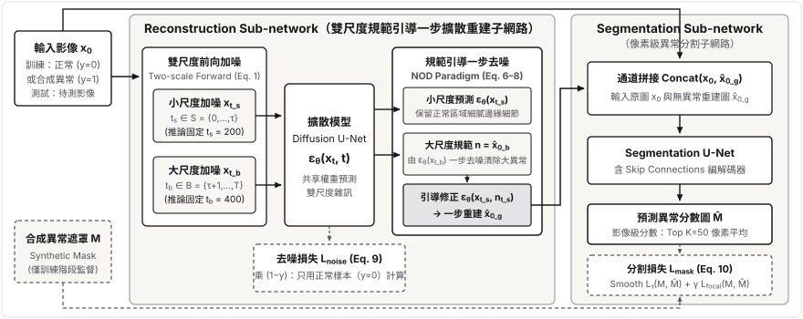

# DiffusionAD：規範引導一步去噪擴散模型之視覺異常檢測（Zhang et al., 2023 / 2025 v4）

## 1. 基本資訊

- **論文標題**：DiffusionAD: Norm-guided One-step Denoising Diffusion for Anomaly Detection
- **簡稱**：`DiffusionAD`
- **作者**：Hui Zhang、Zuxuan Wu（通訊作者）、Yu-Gang Jiang（通訊作者）（Institute of Trustworthy Embodied AI, Fudan University）；Zheng Wang（School of Computer Science, Zhejiang University of Technology）；Dan Zeng（School of Communication & Information Engineering, Shanghai University）
- **發表年份／出處**：2023 年首次公開預印本，本 PDF 版本為 2025 年 5 月 17 日更新之 `arXiv:2303.08730v4 [cs.CV]`（PDF 第 1 頁頁眉顯示 IEEE LaTeX 樣板預設字樣 `JOURNAL OF LATEX CLASS FILES, VOL. 14, NO. 8, AUGUST 2021`；正式發表期刊或會議於 PDF 內未載明，記為**待確認**）
- **主分類**：`異常檢測方法`（生成擴散重建 + 判別式分割雙子網路流派）
- **官方外部連結**：
  - **arXiv**：https://arxiv.org/abs/2303.08730 （出自論文 p. 1 左側邊欄 `arXiv:2303.08730v4 [cs.CV] 17 May 2025`）
  - **GitHub 官方程式碼**：https://github.com/HuiZhang0812/DiffusionAD （出自論文 p. 1 Abstract）
  - **DOI**：待確認（PDF 內未載明）

---

## 2. 一句話總結（TL;DR）與核心貢獻

- **一句話總結（TL;DR）**：`DiffusionAD` 將異常檢測建模為「由雜訊恢復正常（`Noise-to-Norm`）」的兩階段流程（擴散重建子網路 + U-Net 異常分割子網路），透過**一步去噪（One-step Denoising）**將推論速度較傳統逐步去噪提升數十至數百倍（達 `23.5 FPS`），並提出**規範引導雙尺度去噪（Norm-guided One-step Denoising, `NOD`）**融合大尺度無異常語意與小尺度正常細節，在 [MVTec AD](../datasets/mvtec-ad.md)、`VisA`、`DAGM` 與 `MPDD` 四大工業基準上全面超越 `DRAEM`、[PatchCore](roth2022-patchcore.md) 與 `SimpleNet`（出自論文 p. 1 Abstract、Table V–VII）。

### 解決痛點與核心貢獻

1. **突破傳統 Autoencoder 重建與多步擴散的速度／品質瓶頸**：
   - 傳統基於 Autoencoder（`AE`）的重建與判別方法（如 `DRAEM`）面臨兩大固有缺陷（出自論文 Sec. I, p. 1–2, Fig. 1–2）：
     - **異常區域不變重建（Invariant reconstruction of abnormal regions）**：低維特徵仍殘留異常資訊，導致解碼器將異常原封不動重建出來，引發漏檢（False Negatives）。
     - **正常區域粗糙重建（Coarse reconstruction of normal regions）**：受限於網路容量與重建能力，複雜紋理與邊緣重建模糊，引發誤報（False Positives）。
   - 先前將 [DDPM](ho2020-ddpm.md) 引入異常檢測的方法（如 `AnoDDPM`、`DiffAD` 需 50 步、`KLAD` 需 20 步）雖改善了重建能力，但在推論時必須執行數十至數百步逐步去噪，推論速度僅約 `1.2 FPS`（出自論文 Sec. I & II, p. 2–3, Table VI），難以滿足即時工業檢測需求。
2. **提出「雜訊轉正常（`Noise-to-Norm`）」結合「一步去噪（One-step Denoising）」範式**：
   - 對輸入影像 $x_0$ 注入高斯雜訊使異常像素喪失顯著特徵並被視為待去除雜訊（出自論文 Sec. I, p. 1–2）。
   - 基於**觀察一（Observation I）**發現：當加噪步數 $t < 500$（$t \le 400$）時，直接由 $x_t$ 與預測雜訊 $\epsilon_\theta(x_t, t)$ 進行**一步去噪（One-step Denoising）**即可獲得與逐步去噪相當的重建品質與異常檢測精度，同時使推論速度提升 $t$ 倍，並讓擴散重建子網路與分割子網路得以在訓練與推論保持一致地端到端聯合訓練（出自論文 Sec. I & IV-A, p. 2, 4, Fig. 4, Eq. 6, Table VII–VIII）。
3. **提出「規範引導一步去噪（Norm-guided One-step Denoising, `NOD`）」雙尺度機制**：
   - 基於**觀察二（Observation II）**：小範圍細微異常適合在**小加噪尺度 $t_s$** 下修復以保留正常細節，但大範圍或語意級異常在 $t_s$ 下會殘留異常結構，必須在**大加噪尺度 $t_b$** 下才能徹底清除（卻會犧牲正常背景高頻細節）（出自論文 Sec. I & IV-B, p. 2, 5, Fig. 3, Fig. 5）。
   - `NOD` 先在大尺度 $t_b$ 一步預測無異常基準影像（Norm）$n = \hat{x}_{0_b}$，再將其作為條件參考影像引導小尺度 $t_s$ 的一步去噪，兼顧大尺度無異常語意修復與小尺度細膩正常邊緣保留（出自論文 Sec. IV-B, p. 5, Eq. 7–8）。
4. **四大工業異常檢測資料集全面刷新 SOTA**：
   - 在 `MVTec AD`、`VisA`、`DAGM` 與 `MPDD` 四大資料集上，四項指標平均達 **`98.6%` Image AUROC、`98.4%` Pixel AUROC、`95.2%` Pixel PRO、`58.2%` Pixel AP**，其中在 `MVTec AD` 達 **`99.7%` Image AUROC / `98.7%` Pixel AUROC / `95.7%` PRO / `76.1%` AP**，同時維持 **`23.5 FPS`** 高速推論（出自論文 Table V–VI, p. 9）。

---

## 初學者版（AI 整理）

> **本節為初學者導讀（AI 整理）**：以下痛點動機、生活化比喻與直覺說明由 AI 依據論文內容轉譯整理，旨在幫助初學者建立直覺，與下方第 4、5 節之論文原始公式及實驗數據嚴格區分。

### 為什麼舊的「畫家修圖法（Autoencoder）」與「傳統擴散模型（DDPM）」都不夠好？（AI 整理）

在重建式異常檢測中，我們希望訓練一個「只看過正常品」的 AI 修圖師：當拿到一張有瑕疵的測試照片時，AI 能把瑕疵抹掉、還原成正常的樣子，接著只要把「原圖」和「修好的正常圖」相減比對，就能抓出瑕疵在哪裡（AI 整理）。然而過去的方法遇到兩個大麻煩（AI 整理）：

1. **Autoencoder（如 `DRAEM`）的兩難：「照抄瑕疵」又「把背景畫糊」**（AI 整理）
   - 傳統 Autoencoder 把圖片壓縮再放大，如果壓縮得不夠狠，異常瑕疵會偷渡過去被「照抄畫出來」（導致漏抓異常）；如果壓縮得太狠，連正常產品上的精細螺紋、印刷字樣都會被畫得模模糊糊（導致正常背景也被誤判為異常）（AI 整理）。
2. **傳統擴散模型（[DDPM](ho2020-ddpm.md)）的致命傷：「修一張圖要畫幾百步，產線等不及」**（AI 整理）
   - 擴散模型先在圖片上撒一把沙子（高斯雜訊）把瑕疵蓋住，再把沙子掃掉還原成正常圖片，修圖品質比 Autoencoder 好非常多（AI 整理）。
   - 但傳統擴散模型規定「沙子必須一粒一粒慢慢掃」，修一張圖要重複推論 20 到 1000 次，每秒只能檢查約 1 張圖（`1.2 FPS`），工廠流水線根本無法使用（AI 整理）。

### DiffusionAD 的三大聰明解法（AI 整理）

`DiffusionAD` 透過三個關鍵設計，同時做到「修得乾淨、背景清晰、而且一步到位」（AI 整理）：

1. **一步去噪（One-step Denoising）：只要沙子別撒太厚，一掃帚就能直接掃乾淨！**（AI 整理）
   - 為什麼傳統 [DDPM](ho2020-ddpm.md) 要分 1000 步慢慢畫？因為它是從「100% 全是雪花雜訊、完全看不出原圖」的狀態無中生有（AI 整理）。
   - `DiffusionAD` 發現：異常檢測並不需要把整張圖炸成純雜訊！只要撒上「中低程度」的雜訊（加噪步數 $t \le 400$），照片裡還有正常產品的輪廓，此時直接套用擴散公式**「一步算出乾淨圖（$\hat{x}_0$）」**，畫出來的品質跟慢慢走 400 步幾乎一樣好，速度卻快了幾百倍（AI 整理）！
2. **雙尺度規範引導（`NOD`）：「大號砂紙除大疤」＋「小號細筆保細節」**（AI 整理）
   - 產品上的瑕疵有大有小（AI 整理）：
     - 如果只撒**薄薄一層雜訊（小尺度 $t_s = 200$）**，小刮痕會被蓋住修好，且正常背景的細紋非常清晰；但如果遇到「一大塊白色異物擋住電路板」，薄雜訊蓋不住它，修出來的圖還是殘留異物（AI 整理）。
     - 如果撒**厚厚一層雜訊（大尺度 $t_b = 400$）**，連大塊異物都能徹底抹除還原成正常結構，但代價是正常背景的小細節也一起被磨糊了（AI 整理）。
   - `DiffusionAD` 設計了 **`NOD`（規範引導一步去噪）**：同時撒一把薄雜訊（$t_s$）與一把厚雜訊（$t_b$）送進同一個擴散網路，先用厚雜訊一步算出「大方向完全正常的參考範本（Norm $n = \hat{x}_{0_b}$）」，再用這張範本去導引薄雜訊（$t_s$）的去噪方向——最終得到的重建圖 $\hat{x}_{0_g}$ **既把大塊異常徹底消滅，又保留了正常區域的銳利細節**（AI 整理）！
3. **專屬找碴裁判（Segmentation U-Net）：端到端直接畫出瑕疵位置**（AI 整理）
   - 因為「一步去噪」非常快，訓練時就能即時算出重建圖 $\hat{x}_{0_g}$，直接和原圖 $x_0$ 疊在一起交給後面的「找碴裁判（Segmentation U-Net）」，配合 Perlin 雜訊合成的假瑕疵進行端到端訓練，推論時完全不需要繁瑣的手工後處理就能直接輸出精準的瑕疵熱力圖（AI 整理）。

---

## 4. 方法架構與核心設計

`DiffusionAD` 由兩大子網路串聯組成：**擴散重建子網路（Reconstruction Sub-network）**與**像素級異常分割子網路（Segmentation Sub-network）**（出自論文 Sec. IV, p. 4–6, Fig. 3）。

*示意圖，依論文 Fig. 3 重繪：DiffusionAD 整體訓練與推論架構。輸入影像 $x_0$ 經雙尺度前向加噪產生 $x_{t_s}$ 與 $x_{t_b}$，由擴散模型 $\epsilon_\theta$ 預測兩尺度雜訊後，透過規範引導一步去噪（`NOD`）以大尺度重建範本 $n = \hat{x}_{0_b}$ 引導小尺度一步重建出無異常影像 $\hat{x}_{0_g}$，最後將 $x_0$ 與 $\hat{x}_{0_g}$ 通道拼接送入 Segmentation U-Net 預測像素級異常分數圖 $\hat{M}$。*

### 4.1 預備知識：擴散模型前向加噪與條件引導（Preliminaries）

給定輸入影像 $x_0$，[DDPM](ho2020-ddpm.md) 的前向擴散過程在時間步 $t \in \{0, 1, \dots, T\}$ 注入高斯雜訊產生 $x_t$（出自論文 Sec. III-A, p. 3, Eq. 1）：

$$
x_t = x_0 \sqrt{\bar{\alpha}_t} + \epsilon_t \sqrt{1 - \bar{\alpha}_t}, \quad \epsilon_t \sim \mathcal{N}(\mathbf{0}, \mathbf{I}) \tag{1}
$$

其中 $\bar{\alpha}_t = \prod_{i=0}^t \alpha_i = \prod_{i=0}^t (1 - \beta_i)$，變異數排程 $\beta_1, \dots, \beta_T \in (0, 1)$ 採用線性排程（由 $\beta_1 = 10^{-4}$ 至 $\beta_T = 10^{-2}$，總步數 $T = 1000$）。標準擴散訓練目標為最小化真實雜訊與 U-Net 預測雜訊 $\epsilon_\theta(x_t, t)$ 的均方誤差，並在推論時由 $x_t$ 逐步迭代採樣至 $x_0$（出自論文 Sec. III-A, p. 3, Eq. 2–3）：

$$
\begin{gathered}
\mathcal{L} = \mathbb{E}_{t \sim [1-T],\, x_0 \sim q(x_0),\, \epsilon \sim \mathcal{N}(\mathbf{0}, \mathbf{I})}\left[\|\epsilon - \epsilon_\theta(x_t, t)\|^2\right] \tag{2} \\
x_{t-1} = \frac{1}{\sqrt{\alpha_t}}\left(x_t - \frac{1 - \alpha_t}{\sqrt{1 - \bar{\alpha}_t}}\epsilon_\theta(x_t, t)\right) + \tilde{\beta}_t z, \quad z \sim \mathcal{N}(\mathbf{0}, \mathbf{I}), \quad \tilde{\beta}_t = \frac{1 - \bar{\alpha}_{t-1}}{1 - \bar{\alpha}_t}\beta_t \tag{3}
\end{gathered}
$$

此外，條件引導擴散（如分類器引導 Classifier Guidance 與語意擴散引導 `SDG`）可在逆向去噪時透過類別標籤 $y$ 或參考影像 $r$（加噪至 $t$ 步為 $r_t$）之相似度梯度修正預測雜訊，權重為引導尺度 $w$（出自論文 Sec. III-B, p. 3–4, Eq. 4–5）：

$$
\begin{gathered}
\epsilon_\theta(x_t, t, y) = \epsilon_\theta(x_t, t) - \sqrt{1 - \bar{\alpha}_t}\, w \nabla_{x_t} \log p_\phi(y \mid x_t) \tag{4} \\
\epsilon_\theta(x_t, t, r_t) = \epsilon_\theta(x_t, t) - \sqrt{1 - \bar{\alpha}_t}\, w \nabla_{x_t} \text{sim}(x_t, r_t) \tag{5}
\end{gathered}
$$

### 4.2 觀察一與一步去噪範式（One-Step Denoising Paradigm）

- **Noise-to-Norm 核心機制**：測試時輸入影像 $x_0$ 可能包含異常區域。前向加噪（Eq. 1）將全圖像素與高斯雜訊混合，使異常像素失去原有的局部異常顯著性；由於擴散模型 $\epsilon_\theta$ 僅在正常像素分佈上訓練，逆向去噪時會將異常特徵一併視為待濾除的雜訊，從而恢復出無異常（Anomaly-free）的正常重建影像（出自論文 Sec. I & IV-A, p. 1–2, 4）。
- **觀察一（Observation I）**：在生成任務中，起點為純高斯雜訊 $x_T$（$T = 1000$），一步預測會因高非線性與模糊性而嚴重崩潰；但在異常檢測中，$x_t$ 僅施加部分加噪（$t < T$），仍保留大量正常結構先驗。論文實驗（出自論文 Fig. 4, p. 4）證實：**當 $t < 500$（特別是 $t \le 400$）時，一步去噪與 $t$ 步逐步去噪的重建均方誤差（MSE）幾乎完全重合**，視覺重建品質無顯著差異，卻能省去 $t - 1$ 次神經網路前向推論（出自論文 Sec. IV-A, p. 4）。
- **一步去噪公式**：由前向加噪公式（Eq. 1）直接移項，以網路預測之 $\epsilon_\theta(x_t, t)$ 近似真實雜訊 $\epsilon_t$，即可一步重建出無異常影像 $\hat{x}_0$（出自論文 Sec. IV-A, p. 4, Eq. 6）：

$$
\hat{x}_0 = \frac{1}{\sqrt{\bar{\alpha}_t}}\left(x_t - \sqrt{1 - \bar{\alpha}_t}\,\epsilon_\theta(x_t, t)\right) \tag{6}
$$

- **訓練與推論一致性（Training-Inference Consistency）**：若訓練時使用一步去噪產生的 $\hat{x}_0$ 訓練後段分割網路，推論時卻改用逐步去噪或 `DDIM`，兩者的細微像素分佈偏移（Distribution Shift）反而會使分割網路性能下降（見 §5.6 Table VIII）。一步去噪使訓練與推論完全一致，且無需在訓練時耗費數百步採樣時間（出自論文 Sec. IV-A & V-C, p. 4, 10）。

### 4.3 觀察二與規範引導一步去噪（Norm-Guided One-Step Denoising, `NOD`）

- **觀察二（Observation II：異常尺度與加噪尺度的權衡）**：
  - 單一固定加噪步數 $t$ 無法同時應對所有尺度的異常（出自論文 Sec. I & IV-B, p. 2, 5, Fig. 5）：
    - **小加噪尺度 $t_s$**（如 $t_s = 200$）：保留了豐富的原圖細節，能完美修復小面積異常（如 `Carpet` 上的小破洞）並維持清晰的正常背景；但面對大面積或語意異常（如 `PCB` 上大塊白色異物）時，加噪不足以掩蓋異常特徵，導致重建圖 $\hat{x}_{0_s}$ 仍殘留異常陰影。
    - **大加噪尺度 $t_b$**（如 $t_b = 400$）：強烈的雜訊能徹底破壞大面積異常，使一步重建圖 $\hat{x}_{0_b}$ 恢復正確的無異常語意結構；但同時也洗掉了原圖的高頻細節，導致正常區域（如印刷文字、細密紋理）重建變得粗糙模糊。
- **雙尺度劃分與無異常規範（Norm）建立**：
  - 將總時間步 $\{0, 1, \dots, T\}$ 以分界點 $\tau = 300$ 劃分為**小加噪區間 $S = \{0, 1, \dots, \tau\}$** 與**大加噪區間 $B = \{\tau + 1, \dots, T\}$**（出自論文 Sec. IV-B & IV-C, p. 5–6）。
  - 對輸入影像 $x_0$ 分別採樣 $t_s \in S$（推論時固定 $t_s = 200$）與 $t_b \in B$（推論時固定 $t_b = 400$），依 Eq. 1 加噪得到 $x_{t_s}$ 與 $x_{t_b}$，並送入同一個擴散模型預測雜訊 $\epsilon_\theta(x_{t_s})$ 與 $\epsilon_\theta(x_{t_b})$（為簡潔省略時間步參數符號）（出自論文 Sec. IV-B, p. 5）。
  - 先利用大尺度預測雜訊 $\epsilon_\theta(x_{t_b})$ 代入 Eq. 6，一步算出大尺度無異常重建圖 $\hat{x}_{0_b}$，並將其定義為**條件參考規範影像（Condition / Norm）$n = \hat{x}_{0_b}$**（出自論文 Sec. IV-B, p. 5）。
- **確定性加噪對齊與規範引導公式**：
  - 為計算小尺度加噪圖 $x_{t_s}$ 與參考規範 $n$ 在時間步 $t_s$ 的相似度，需將 $n$ 加噪至 $t_s$ 得到 $n_{t_s}$。若對 $n$ 注入隨機高斯雜訊，會引入額外隨機不確定性；因此論文直接使用模型已預測出的小尺度雜訊 $\epsilon_\theta(x_{t_s})$ 對 $n$ 進行確定性加噪（出自論文 Sec. IV-B, p. 5）：
    $$n_{t_s} = \sqrt{\bar{\alpha}_{t_s}}\, n + \sqrt{1 - \bar{\alpha}_{t_s}}\, \epsilon_\theta(x_{t_s})$$
  - 定義兩者在 $t_s$ 時刻的負歐氏距離平方相似度為 $\text{sim}(x_{t_s}, n_{t_s}) = -\frac{1}{2}\|n_{t_s} - x_{t_s}\|^2$，對 $x_{t_s}$ 求梯度得 $\nabla_{x_{t_s}} \text{sim}(x_{t_s}, n_{t_s}) = n_{t_s} - x_{t_s}$，代入條件引導公式（Eq. 5）與一步去噪公式（Eq. 6），即可得到規範引導修正後的預測雜訊 $\epsilon_\theta(x_{t_s}, n_{t_s})$ 與最終規範引導一步重建影像 $\hat{x}_{0_g}$（出自論文 Sec. IV-B, p. 5, Eq. 7–8）：

$$
\begin{gathered}
\epsilon_\theta(x_{t_s}, n_{t_s}) = \epsilon_\theta(x_{t_s}) - \sqrt{1 - \bar{\alpha}_{t_s}}\, w (n_{t_s} - x_{t_s}) \tag{7} \\
\hat{x}_{0_g} = \frac{1}{\sqrt{\bar{\alpha}_{t_s}}}\left(x_{t_s} - \sqrt{1 - \bar{\alpha}_{t_s}}\,\epsilon_\theta(x_{t_s}, n_{t_s})\right) \tag{8}
\end{gathered}
$$

  - 其中 $w$ 為控制規範引導強度的超參數（預設 $w = 1$）。當 $x_0$ 僅含小異常時，$\hat{x}_{0_s}$ 與 $n = \hat{x}_{0_b}$ 結構一致，$n_{t_s} - x_{t_s}$ 差異極小，$\hat{x}_{0_g}$ 完美保留 $\hat{x}_{0_s}$ 的高頻細節；當 $x_0$ 含大面積異常時，$n_{t_s} - x_{t_s}$ 在異常區域產生強大引導梯度，強制將小尺度去噪拉向無異常規範 $n$（出自論文 Sec. IV-B, p. 5, Fig. 5）。

### 4.4 異常分割子網路與聯合訓練損失（Segmentation Sub-network & Joint Loss）

- **分割子網路架構**：採用具備跳躍連接（Skip Connections）的編解碼器 U-Net，輸入為原圖 $x_0$ 與規範引導重建圖 $\hat{x}_{0_g}$ 的**通道維度拼接（Channel-wise Concatenation）**，直接預測像素級異常分數圖 $\hat{M}$（出自論文 Sec. IV-C, p. 5–6, Fig. 3）。
- **訓練損失函數**：
  - 訓練集每批次同時包含正常樣本（標籤 $y = 0$，真實遮罩 $M = \mathbf{0}$）與線上合成異常樣本（標籤 $y = 1$，真實遮罩為 $M$）。
  - **去噪損失 $\mathcal{L}_{noise}$**：為確保擴散模型只學習正常樣本分佈，損失函數乘上 $(1 - y)$ **明確排除合成異常樣本**，僅對正常樣本計算雙尺度預測雜訊與真實高斯雜訊的均方誤差（出自論文 Sec. IV-C, p. 5, Eq. 9；註：論文內文亦提及在異常區域外計算雜訊損失，數學定義以 Eq. 9 為準）：
  - **分割損失 $\mathcal{L}_{mask}$**：結合 Smooth $L_1$ 損失與 Focal Loss（權重 $\gamma = 5$），以緩解異常像素與正常像素比例懸殊的類別不平衡問題，提升邊緣分割銳利度（出自論文 Sec. IV-C, p. 5–6, Eq. 10–11）：

$$
\begin{gathered}
\mathcal{L}_{noise} = \frac{(1 - y)\left(\|\epsilon_{t_s} - \epsilon_\theta(x_{t_s})\|^2 + \|\epsilon_{t_b} - \epsilon_\theta(x_{t_b})\|^2\right)}{2} \tag{9} \\
\mathcal{L}_{mask} = \text{Smooth}_{\mathcal{L}_1}(M, \hat{M}) + \gamma \mathcal{L}_{focal}(M, \hat{M}) \tag{10} \\
\mathcal{L}_{total} = \mathcal{L}_{noise} + \mathcal{L}_{mask} \tag{11}
\end{gathered}
$$

### 4.5 線上異常合成策略（Online Anomaly Synthesis Strategy）

為使分割子網路與擴散重建網路聯合訓練，`DiffusionAD` 改良了基於 Perlin 雜訊的異常合成流程（出自論文 Sec. IV-C, p. 6, Fig. 6, Eq. 12）：

1. **前景遮罩限制（Foreground Constrained Mask $M$）**：隨機產生 Perlin 雜訊並二值化為遮罩 $P$；為確保合成異常落於有意義的物件區域，將 $P$ 與物件前景遮罩 $F$（紋理類別則隨機取整張影像局部區域）做元素級相乘，得到合成異常遮罩 $M = P \odot F$（其反向正常遮罩記為 $\bar{M} = 1 - M$）。
2. **雙來源紋理混合**：異常外觀來源 $A$ 隨機取自外部紋理資料集 `DTD`（Describing Textures Dataset）或正常樣本自身的隨機色彩／幾何增強（Self-augmentation），並以不透明度參數 $\beta$ 與原正常影像 $N$ 混合生成合成異常影像 $S$（出自論文 Sec. IV-C, p. 6, Eq. 12）：

$$
S = \beta (M \odot N) + (1 - \beta)(M \odot A) + \bar{M} \odot N \tag{12}
$$

---

## 5. 實驗與應用表現

### 5.1 實驗設定、資料集與評估指標

- **模型與訓練超參數**（出自論文 Sec. IV-C & V-A, p. 6–7）：
  - **影像解析度**：所有資料集影像皆縮放（Resize）至 $256 \times 256$。
  - **擴散網路（Denoising U-Net）**：基於 PixelCNN 與 Wide ResNet 架構並加入正弦位置嵌入（Sinusoidal Positional Embedding），總步數 $T = 1000$，雙尺度分界點 $\tau = 300$，基礎通道數 $128$，自注意力解析度為 $32, 16, 8$，注意力頭數為 $4$，**不使用指數移動平均（No EMA）**。
  - **訓練配置**：訓練 `3000` 個 Epochs，Batch Size 為 `16`（含 `8` 張正常影像 + `8` 張合成異常影像），使用 `Adam` 最佳化器，初始學習率 $10^{-4}$，於 NVIDIA A100 GPU 上訓練。
  - **推論配置**：固定小尺度步數 $t_s = 200$、大尺度步數 $t_b = 400$、規範引導權重 $w = 1$；分割子網路輸出 $\hat{M}$ 即為像素級異常分數圖，取 $\hat{M}$ 中**前 $K = 50$ 個最高異常分數像素之平均值**作為影像級異常分數（Image-level Anomaly Score）。
- **四大評測資料集**（出自論文 Sec. V-A, p. 6–7）：
  1. **[MVTec AD](../datasets/mvtec-ad.md)**：15 類別（5 類紋理、10 類物件），共 `4,096` 張正常影像（3,629 張訓練 + 467 張測試正常）與 `1,258` 張測試異常影像。
  2. **`VisA`（Visual Anomaly Dataset）**：共 `10,821` 張影像（`9,621` 張正常、`1,200` 張異常），涵蓋 12 個子類別，分為三大類：(1) 4 類複雜結構印刷電路板（`pcb1`–`pcb4`）；(2) 4 類多實例（Multiple instances）類別（`Capsules`、`Candles`、`Macaroni1`、`Macaroni2`）；(3) 4 類單實例大致對齊物件（`Cashew`、`Chewing gum`、`Fryum`、`Pipe fryum`）。
  3. **`DAGM`**：10 類人工生成但高度模擬真實工業表面缺陷之紋理資料集，共 `15,000` 張正常影像與 `2,100` 張異常影像。
  4. **`MPDD`（Metal Parts Defect Detection）**：聚焦金屬製造過程缺陷檢測，於可變空間方向、位置、距離與非均勻光照及有色背景下拍攝，共 `1,064` 張正常影像與 `282` 張異常影像。
- **五項評估指標**（出自論文 Sec. V-A, p. 7）：
  - **Image AUROC（`I`）**：影像級異常分類 ROC 曲線下面積。
  - **Pixel AUROC（`P`）**：像素級異常分割 ROC 曲線下面積。
  - **Pixel PRO（`O`）**：區域重疊率指標（Per-Region Overlap，將每個連通異常區域視為獨立單位計算重疊率）。
  - **Pixel AP（`A`）**：像素級平均精確率（Average Precision，針對異常像素佔比極低的嚴重類別不平衡更具鑑別力）。
  - **FPS（`F`）**：每秒推論幀數（Frames Per Second）。

### 5.2 四大資料集綜合基準對比（出自論文 Table V）

下表整理 `DiffusionAD` 與 7 種代表性異常檢測方法（預訓練記憶庫 [PatchCore](roth2022-patchcore.md)、知識蒸餾 `RD4AD` / `RD++`、特徵合成判別 `SimpleNet`、變形重建 `DMAD`、正規化流 `FastFlow`、自編碼器重建判別 `DRAEM`）於四大資料集上的綜合表現（數值格式為 `I / P / O / A`，單位為 %，出自論文 Table V, p. 9）：

| 方法（Method） | VisA (`I / P / O / A`) | MVTec AD (`I / P / O / A`) | DAGM (`I / P / O / A`) | MPDD (`I / P / O / A`) | 四資料集平均 (`I / P / O / A`) |
| :--- | :---: | :---: | :---: | :---: | :---: |
| **[PatchCore](roth2022-patchcore.md)** (2022) | 95.1 / 98.8 / 91.2 / 40.1 | 99.1 / 98.1 / 93.5 / 56.1 | 93.6 / 96.7 / 89.3 / 51.7 | 94.8 / **99.0** / 93.9 / 43.2 | 95.7 / 98.2 / 92.0 / 47.8 |
| **RD4AD** (2022) | 96.0 / 90.1 / 70.9 / 27.7 | 98.5 / 97.8 / 93.9 / 58.0 | 95.8 / **97.5** / 93.0 / 53.4 | 92.7 / 98.7 / **95.3** / 45.5 | 95.8 / 96.0 / 88.3 / 46.2 |
| **RD++** (2023) | 95.9 / 98.7 / 93.4 / 40.8 | 99.4 / 98.3 / 95.0 / 60.8 | 98.5 / 97.4 / **93.8** / 64.3 | 92.9 / 98.3 / 94.9 / 43.7 | 96.7 / 98.2 / 94.3 / 52.4 |
| **SimpleNet** (2023) | 96.8 / 97.8 / 88.7 / 36.3 | 99.6 / 97.6 / 90.0 / 54.8 | 95.3 / 97.1 / 91.3 / 48.1 | 96.1 / 97.6 / 91.2 / 40.7 | 96.9 / 97.5 / 90.3 / 45.0 |
| **DMAD** (2023) | 95.5 / 98.6 / 91.3 / 41.0 | 99.6 / 98.2 / 90.6 / 53.5 | 89.1 / 92.5 / 83.8 / 46.0 | 91.7 / 98.0 / 92.6 / 42.6 | 94.0 / 96.8 / 89.6 / 45.8 |
| **FastFlow** (2021) | 82.2 / 88.2 / 59.8 / 15.6 | 90.5 / 95.5 / 85.6 / 39.8 | 87.4 / 91.1 / 79.9 / 34.2 | 88.7 / 80.8 / 49.8 / 11.5 | 87.2 / 88.9 / 68.8 / 25.3 |
| **DRAEM** (2021) | 88.7 / 94.4 / 73.7 / 30.5 | 98.0 / 97.3 / 92.1 / 68.4 | 90.8 / 86.8 / 71.0 / 30.6 | 94.1 / 91.8 / 78.1 / 28.8 | 92.9 / 92.6 / 78.7 / 39.6 |
| **DiffusionAD（本篇）** | **98.8** / **98.9** / **96.0** / **45.8** | **99.7** / **98.7** / **95.7** / **76.1** | **99.6** / **97.5** / **93.8** / **65.1** | **96.2** / 98.5 / **95.3** / **45.8** | **98.6** / **98.4** / **95.2** / **58.2** |

### 5.3 MVTec AD 15 類別詳細數據（出自論文 Table III & Table IV）

#### (A) MVTec AD 逐類異常檢測與定位：`Image AUROC / Pixel AUROC`（出自論文 Table III, p. 8，單位：%）

| Category | PatchCore [2] | RD4AD [7] | RD++ [8] | SimpleNet [4] | DMAD [12] | DRAEM [3] | FastFlow [26] | DiffusionAD (Ours) |
| :--- | :---: | :---: | :---: | :---: | :---: | :---: | :---: | :---: |
| **Carpet** | 98.7 / 99.0 | 98.9 / 98.8 | **100** / **99.2** | 99.0 / 98.4 | **100** / 99.1 | 97.0 / 95.5 | 87.5 / 98.0 | 99.3 / 99.0 |
| **Grid** | 98.2 / 98.7 | **100** / 97.0 | **100** / 99.3 | 97.8 / 98.9 | **100** / 99.2 | 99.9 / **99.7** | 88.1 / 93.5 | **100** / **99.7** |
| **Leather** | **100** / 99.3 | **100** / 98.6 | **100** / 99.4 | 99.3 / 98.0 | **100** / 99.5 | **100** / 98.6 | 96.1 / 93.0 | **100** / **99.8** |
| **Tile** | 98.7 / 95.6 | 99.3 / 98.9 | 99.7 / 96.6 | 99.7 / 96.6 | **100** / 96.0 | 99.6 / 99.2 | 63.2 / 96.1 | 99.9 / **99.7** |
| **Wood** | 99.2 / 95.0 | 99.2 / **99.3** | 99.3 / 95.8 | 99.9 / 93.2 | **100** / 95.5 | 99.1 / 96.4 | 90.8 / 95.9 | 99.9 / 96.7 |
| **Bottle** | **100** / 98.6 | **100** / 99.0 | **100** / 98.8 | **100** / 94.0 | **100** / 98.9 | 99.2 / **99.1** | **100** / 92.7 | 99.7 / **99.1** |
| **Cable** | 99.5 / 98.4 | 95.0 / **99.4** | 99.2 / 98.4 | **99.9** / 98.7 | 99.1 / 98.1 | 91.8 / 94.7 | 91.2 / 97.5 | 99.6 / 98.1 |
| **Capsule** | 98.1 / **98.8** | 96.3 / 97.3 | 99.0 / **98.8** | **100** / 97.4 | 98.9 / 98.3 | 98.5 / 94.3 | 99.2 / 97.4 | 98.9 / 98.3 |
| **Hazelnut** | **100** / 98.7 | 99.9 / 98.2 | **100** / 99.2 | **100** / 98.6 | **100** / 99.1 | **100** / **99.7** | 98.8 / 98.9 | **100** / **99.7** |
| **Metal nut** | **100** / 98.4 | **100** / 99.6 | **100** / 98.1 | **100** / 97.0 | **100** / 97.7 | 98.7 / 99.5 | 90.8 / 98.1 | **100** / **99.7** |
| **Pill** | 96.6 / 97.4 | 99.6 / 95.7 | 98.4 / 98.3 | **100** / 98.8 | 97.3 / 98.7 | 98.9 / 97.6 | 98.0 / 92.3 | 99.0 / **99.3** |
| **Screw** | 98.1 / 99.4 | 97.0 / 99.1 | 98.9 / **99.7** | **100** / 98.0 | **100** / 99.6 | 93.9 / 97.6 | 97.8 / 99.4 | 99.4 / 99.0 |
| **Toothbrush** | **100** / 98.7 | 99.5 / 93.0 | **100** / 99.1 | 98.1 / 99.2 | **100** / **99.4** | **100** / 98.1 | **100** / 92.7 | **100** / 98.8 |
| **Transistor** | **100** / 96.3 | 96.7 / 95.4 | 98.5 / 94.3 | **100** / **97.8** | 98.7 / 95.4 | 93.1 / 90.9 | 88.1 / 94.3 | 99.8 / 92.9 |
| **Zipper** | 99.4 / 98.8 | 98.5 / 98.2 | 98.6 / 98.8 | **100** / 99.2 | 99.6 / 98.3 | **100** / 98.8 | 67.5 / 93.4 | **100** / **99.2** |
| **Average** | 99.1 / 98.1 | 98.5 / 97.8 | 99.4 / 98.3 | 99.6 / 97.6 | 99.6 / 98.2 | 98.0 / 97.3 | 90.5 / 95.5 | **99.7** / **98.7** |

#### (B) MVTec AD 逐類異常定位：`Pixel PRO / Pixel AP`（出自論文 Table IV, p. 9，單位：%）

| Category | PatchCore [2] | RD4AD [7] | RD++ [8] | SimpleNet [4] | DMAD [12] | DRAEM [3] | FastFlow [26] | DiffusionAD (Ours) |
| :--- | :---: | :---: | :---: | :---: | :---: | :---: | :---: | :---: |
| **Carpet** | 96.6 / 76.8 | 97.0 / 78.7 | **97.7** / 63.6 | 93.2 / **79.8** | 86.1 / 44.6 | 92.0 / 53.5 | 84.2 / 68.8 | 95.0 / 77.2 |
| **Grid** | 95.9 / 65.3 | 97.6 / 52.7 | 97.7 / 48.5 | 92.8 / 42.1 | 72.4 / 7.4 | 97.8 / 65.7 | 83.8 / 27.6 | **98.9** / **68.8** |
| **Leather** | 98.9 / 44.2 | 99.1 / 45.1 | **99.2** / 50.1 | 87.4 / 43.3 | 97.7 / 41.3 | 96.8 / 75.3 | 91.0 / 41.8 | 98.9 / **69.2** |
| **Tile** | 87.4 / 62.7 | 90.6 / 57.4 | 92.4 / 53.4 | 87.4 / 28.8 | 82.7 / 54.3 | 97.4 / 92.3 | 81.8 / 20.5 | **98.3** / **97.1** |
| **Wood** | 89.6 / 32.5 | 90.9 / 49.2 | **93.3** / 52.0 | 86.2 / 59.8 | 86.3 / 44.4 | 92.8 / **77.7** | 85.1 / 53.9 | 90.3 / 77.4 |
| **Bottle** | 96.1 / 53.7 | 96.6 / 62.1 | **97.0** / 79.9 | 82.2 / 45.2 | 96.0 / 78.9 | 96.4 / 86.5 | 91.9 / 45.5 | 96.8 / **89.7** |
| **Cable** | 92.6 / 45.6 | 91.0 / 48.2 | 93.9 / 62.5 | 94.7 / 63.7 | 95.1 / 58.3 | 75.4 / 52.4 | 80.8 / 35.1 | **95.5** / **72.5** |
| **Capsule** | 95.5 / **87.0** | **95.8** / 79.1 | 96.4 / 48.1 | 92.0 / 66.6 | 89.7 / 41.4 | 90.4 / 49.4 | 76.7 / 27.6 | 93.3 / 59.2 |
| **Hazelnut** | 93.9 / 77.7 | 95.5 / 78.4 | 96.3 / 65.4 | 91.9 / 40.4 | 96.4 / 60.2 | 97.5 / 92.9 | 89.0 / 63.3 | **97.5** / **92.6** |
| **Metal nut** | 91.3 / 35.4 | 92.3 / 53.6 | 93.0 / 82.3 | 93.1 / 68.1 | 94.6 / 83.5 | 93.2 / 96.3 | 86.6 / 31.1 | **97.8** / **97.1** |
| **Pill** | 94.1 / 54.6 | 96.4 / 53.2 | 97.0 / 78.1 | 86.4 / 92.0 | 95.0 / 77.6 | 88.1 / 48.5 | 94.6 / 25.9 | **98.7** / **86.9** |
| **Screw** | 97.9 / 37.2 | 98.2 / 51.8 | **98.6** / 54.4 | 89.9 / **70.2** | 94.3 / 48.2 | 97.0 / 58.2 | 91.5 / 52.5 | 91.6 / 59.4 |
| **Toothbrush** | 91.4 / 61.0 | 94.5 / 54.9 | 94.2 / 53.8 | 95.4 / 33.6 | 92.5 / 52.5 | 89.9 / 44.7 | **98.0** / 60.9 | 93.7 / **61.1** |
| **Transistor** | 83.5 / 47.7 | 78.0 / 48.2 | 81.8 / 58.6 | 81.2 / 46.5 | 86.9 / **60.7** | 81.0 / 50.7 | 73.1 / 37.8 | **91.7** / 58.2 |
| **Zipper** | **97.1** / 59.5 | 95.4 / 57.1 | 96.3 / 60.9 | 96.6 / 42.6 | 92.9 / 49.6 | 95.4 / **81.5** | 75.6 / 4.5 | 96.5 / 74.2 |
| **Average** | 93.5 / 56.1 | 93.9 / 58.0 | 95.0 / 60.8 | 90.0 / 54.8 | 90.6 / 53.5 | 92.1 / 68.4 | 85.6 / 39.8 | **95.7** / **76.1** |

*(註：在極具挑戰的像素級精確率 `Pixel AP` 上，`DiffusionAD` 平均達 `76.1%`，領先特徵嵌入流派最佳方法 `RD++`（`60.8%`）達 `+15.3%`、領先生成模型流派最佳方法 `DRAEM`（`68.4%`）達 `+7.7%`；在 `Pixel PRO` 上亦領先 `DRAEM`（`92.1%`）達 `+3.6%`，出自論文 Sec. V-B, p. 7–9。)*

### 5.4 VisA 12 類別詳細數據（出自論文 Table I & Table II）

#### (A) VisA 逐類異常檢測與定位：`Image AUROC / Pixel PRO`（出自論文 Table I, p. 7，單位：%）

| Category | PatchCore [2] | RD4AD [7] | RD++ [8] | SimpleNet [4] | DMAD [12] | DRAEM [3] | FastFlow [26] | DiffusionAD (Ours) |
| :--- | :---: | :---: | :---: | :---: | :---: | :---: | :---: | :---: |
| **candle** | 98.6 / 94.0 | 92.2 / 92.2 | 96.4 / 93.8 | **98.7** / 89.0 | 92.7 / 90.6 | 94.4 / 93.7 | 92.8 / 86.7 | **98.7** / **97.0** |
| **capsules** | 81.6 / 85.5 | 90.1 / 56.9 | 92.1 / 95.8 | 89.9 / 91.4 | 88.0 / 88.4 | 76.3 / 84.5 | 71.2 / 33.3 | **97.9** / **98.7** |
| **cashew** | 97.3 / **94.5** | **99.6** / 79.0 | 97.8 / 91.2 | 97.5 / 82.8 | 95.0 / 88.8 | 90.7 / 51.8 | 91.0 / 68.3 | 96.5 / 91.8 |
| **chewinggum** | 99.1 / 84.6 | 99.7 / 92.5 | 96.4 / 88.1 | 99.8 / 85.3 | 97.4 / 73.9 | 94.2 / 60.4 | 91.4 / 74.8 | **99.9** / **92.2** |
| **fryum** | 96.2 / 85.3 | 96.6 / 81.0 | 95.8 / 90.0 | 98.1 / 87.8 | 98.0 / 92.2 | 97.4 / 93.1 | 88.6 / 74.3 | **98.3** / **96.5** |
| **macaroni1** | 97.5 / 95.4 | 98.4 / 71.3 | 94.0 / 96.9 | 99.4 / **98.9** | 94.3 / 97.1 | 95.0 / 96.7 | 98.3 / 77.7 | **99.5** / 98.5 |
| **macaroni2** | 78.1 / 94.4 | 97.6 / 68.0 | 88.0 / 97.7 | 82.4 / 97.3 | 90.4 / 98.5 | 96.2 / **99.6** | 86.3 / 43.4 | **99.0** / **99.6** |
| **pcb1** | 98.5 / 94.3 | 97.6 / 43.2 | 97.0 / 95.8 | 99.0 / 91.1 | 95.8 / 96.2 | 54.8 / 24.8 | 77.4 / 59.9 | **99.2** / **96.9** |
| **pcb2** | 97.3 / 89.2 | 91.1 / 46.4 | 97.2 / 90.6 | **99.1** / 91.0 | 96.9 / 89.3 | 77.8 / 49.4 | 61.9 / 40.7 | **99.1** / **94.2** |
| **pcb3** | 97.9 / 90.9 | 95.5 / 80.3 | 96.8 / 93.1 | 98.5 / 93.0 | 98.3 / 93.6 | 94.5 / 89.7 | 74.3 / 61.5 | **98.6** / **94.9** |
| **pcb4** | 99.6 / 90.1 | 96.5 / 72.2 | **99.8** / 91.9 | 99.6 / 64.5 | 99.7 / 91.4 | 93.4 / 64.3 | 80.9 / 58.8 | 98.9 / **94.6** |
| **pipe fryum** | **99.8** / 95.7 | 97.0 / 68.3 | 99.6 / 95.6 | 99.7 / 91.7 | 99.0 / 95.3 | 99.4 / 75.9 | 72.0 / 38.0 | **99.8** / **97.2** |
| **Average** | 95.1 / 91.2 | 96.0 / 70.9 | 95.9 / 93.4 | 96.8 / 88.7 | 95.5 / 91.3 | 88.7 / 73.7 | 82.2 / 59.8 | **98.8** / **96.0** |

#### (B) VisA 逐類異常定位：`Pixel AUROC / Pixel AP`（出自論文 Table II, p. 8，單位：%）

| Category | PatchCore [2] | RD4AD [7] | RD++ [8] | SimpleNet [4] | DMAD [12] | DRAEM [3] | FastFlow [26] | DiffusionAD (Ours) |
| :--- | :---: | :---: | :---: | :---: | :---: | :---: | :---: | :---: |
| **candle** | **99.5** / 17.6 | 97.9 / 19.0 | 98.6 / 16.3 | 97.7 / 12.8 | 98.1 / 18.9 | 97.3 / 32.7 | 94.9 / 4.9 | 99.2 / **49.7** |
| **capsules** | 99.5 / **68.7** | 89.5 / 12.3 | 99.4 / 57.1 | 99.0 / 57.9 | 99.2 / 50.5 | 99.1 / 47.9 | 75.3 / 1.4 | **99.5** / 51.8 |
| **cashew** | 98.9 / 58.5 | 95.8 / 28.2 | 95.8 / 53.9 | 98.8 / 58.6 | 95.3 / 57.3 | 88.2 / 28.5 | 91.4 / 9.2 | **98.9** / **61.4** |
| **chewinggum** | 99.1 / 42.8 | 99.0 / 58.9 | **99.4** / **65.8** | 98.3 / 17.7 | 97.9 / 56.1 | 97.1 / 39.0 | 98.6 / 43.6 | 99.3 / 50.0 |
| **fryum** | 93.8 / 37.2 | 94.3 / 54.3 | 96.5 / 49.7 | 91.1 / 38.0 | 97.0 / 49.2 | 92.7 / 41.1 | 97.3 / 35.3 | **98.2** / **51.5** |
| **macaroni1** | **99.8** / 7.6 | 97.7 / 43.8 | 99.7 / 21.1 | 99.6 / 6.7 | 99.7 / 16.3 | 99.7 / **45.8** | 97.3 / 27.8 | 99.2 / 41.3 |
| **macaroni2** | 99.1 / 3.2 | 87.7 / 35.2 | 99.7 / 11.1 | 98.9 / 4.4 | 99.7 / 9.8 | 99.9 / 41.0 | 89.2 / 29.8 | **99.9** / **44.1** |
| **pcb1** | **99.9** / **91.7** | 75.0 / 0.5 | 99.7 / 82.6 | 99.6 / 88.6 | 99.8 / 82.8 | 90.5 / 28.1 | 75.2 / 0.2 | 97.8 / 25.6 |
| **pcb2** | 99.0 / 14.3 | 64.8 / 0.6 | 99.0 / 14.8 | 98.3 / 12.5 | **99.0** / **14.7** | 90.5 / 4.9 | 67.3 / 0.1 | 98.6 / 15.0 |
| **pcb3** | 99.2 / 38.9 | 95.5 / 59.1 | 99.2 / 20.1 | 99.2 / 44.3 | 99.3 / 29.6 | 98.6 / 20.3 | 94.8 / 23.7 | **99.4** / **50.6** |
| **pcb4** | 98.6 / 42.4 | 92.8 / 10.6 | 98.6 / 42.6 | 93.9 / 34.0 | **98.8** / **46.8** | 88.0 / 20.6 | 89.9 / 5.4 | 97.6 / 43.1 |
| **pipe fryum** | 99.1 / 58.5 | 92.0 / 10.4 | 99.1 / 54.9 | 98.9 / 60.5 | **99.3** / 60.2 | 90.9 / 16.5 | 87.3 / 5.4 | 99.0 / **64.9** |
| **Average** | 98.8 / 40.1 | 90.1 / 27.7 | 98.7 / 40.8 | 97.8 / 36.3 | 98.6 / 41.0 | 94.4 / 30.5 | 88.2 / 15.6 | **98.9** / **45.8** |

### 5.5 與其他擴散異常檢測方法之速度與精度對比（出自論文 Table VI）

在 [MVTec AD](../datasets/mvtec-ad.md) 資料集上，`DiffusionAD` 與其他基於擴散模型的異常檢測方法（`DiffAD`、`KLAD`）對比如下（出自論文 Table VI, p. 9）：

| 方法（Method） | 推論去噪步數（Step） | 推論速度 `FPS (F)` | Image AUROC (`I`) | Pixel AUROC (`P`) | Pixel PRO (`O`) | Pixel AP (`A`) |
| :--- | :---: | :---: | :---: | :---: | :---: | :---: |
| **DiffAD** [18] | 50 | 1.2 | 98.7% | 98.3% | N/A | 74.6% |
| **KLAD** [19] | 20 | N/A | N/A | 96.7% | 94.1% | N/A |
| **DiffusionAD（本篇）** | **1** | **23.5** | **99.7%** | **98.7%** | **95.7%** | **76.1%** |

- `DiffusionAD` 將推論去噪步數降至 **`1` 步**，推論速度達 **`23.5 FPS`**（約為 `DiffAD` `1.2 FPS` 的 **19.6 倍**），同時在所有檢測與分割指標上全面勝出（出自論文 Sec. V-B, p. 9, Table VI）。

### 5.6 消融實驗與超參數敏感度分析（Ablation Studies）

#### (A) 核心模組與去噪範式消融實驗（出自論文 Table VII）

於 `VisA` 資料集上逐步替換重建模型與去噪策略（出自論文 Sec. V-C, p. 9–10, Table VII）：

| 實驗設定（Configuration） | Image AUROC (`I`) | Pixel AUROC (`P`) | Pixel PRO (`O`) | Pixel AP (`A`) | 推論速度 `FPS (F)` |
| :--- | :---: | :---: | :---: | :---: | :---: |
| 1. `Segmentation + Auto-Encoder`（類似 DRAEM） | 90.6% | 96.2% | 76.1% | 31.9% | **32.4** |
| 2. `Segmentation + Diffusion + Iterative-400`（400 步逐步去噪） | 96.8% | 98.5% | 92.5% | 42.5% | 0.09 |
| 3. `Segmentation + Diffusion + DDIM-30`（30 步 DDIM 加速採樣） | 96.6% | 98.2% | 91.9% | 41.4% | 0.92 |
| 4. `Segmentation + Diffusion + One-step`（單尺度一步去噪） | 98.0% | 98.6% | 94.7% | 44.2% | 26.7 |
| 5. `Segmentation + Diffusion + One-step + Norm-guided`（完整 `DiffusionAD`） | **98.8%** | **98.9%** | **96.0%** | **45.8%** | 23.5 |

- **關鍵發現**（出自論文 Sec. V-C, p. 9–10）：
  1. **Diffusion vs. Auto-Encoder**（Row 4 vs. Row 1）：將 Auto-Encoder 替換為一步去噪擴散模型後，`Image AUROC` 大幅提升 **`+7.4%`**（`90.6% → 98.0%`）、`PRO` 提升 **`+18.6%`**（`76.1% → 94.7%`）、`AP` 提升 **`+12.3%`**（`31.9% → 44.2%`），證明 `Noise-to-Norm` 擴散重建能有效解決 Auto-Encoder 異常原樣重建與背景模糊的問題。
  2. **One-step vs. Iterative / DDIM**（Row 4 vs. Row 2 & 3）：一步去噪（`26.7 FPS`）比 400 步逐步去噪（`0.09 FPS`）快了近 **300 倍**，比 30 步 `DDIM`（`0.92 FPS`）快了 **29 倍**，且精度反而更高（因訓練時採用一步去噪，維持了訓練與推論分佈一致性）。
  3. **Norm-guided (`NOD`) 效益**（Row 5 vs. Row 4）：加入雙尺度規範引導後，僅多預測一次大尺度雜訊，速度維持在 `23.5 FPS`，而 `Image AUROC` 再提升 `+0.8%`（達 `98.8%`）、`PRO` 提升 `+1.3%`（達 `96.0%`）、`AP` 提升 `+1.6%`（達 `45.8%`）。

#### (B) 訓練與推論去噪策略一致性消融（出自論文 Table VIII）

論文進一步於 `VisA` 驗證「訓練階段」與「推論階段」使用不同去噪步數對分割網路的影響（出自論文 Sec. V-C, p. 10, Table VIII）：

| 訓練階段去噪方式（Training） | 推論階段去噪方式（Inference） | Image AUROC (`I`) | Pixel AUROC (`P`) |
| :--- | :--- | :---: | :---: |
| `One-step (1)` | `One-step (1)` | 98.0% | 98.6% |
| `One-step (1)` | `Iterative (400)` | 96.8% | 98.5% |
| `One-step (1)` | `DDIM (30)` | 96.6% | 98.2% |
| `Iterative (400)` | `Iterative (400)` | **98.3%** | **98.8%** |
| `DDIM (30)` | `DDIM (30)` | 98.2% | 98.6% |

- 當訓練使用 `One-step (1)` 而推論改用 `Iterative (400)` 或 `DDIM (30)` 時，重建影像的細微分布差異會造成分割網路發生分布偏移（Distribution Shift），導致 `Image AUROC` 由 `98.0%` 跌至 `96.8%` / `96.6%`；而若訓練與推論皆使用 `Iterative (400)`，雖能微幅提升 `+0.3%` Image AUROC 與 `+0.2%` Pixel AUROC，但訓練與推論時間皆暴增數百倍，得不償失（出自論文 Sec. V-C, p. 10）。

#### (C) 加噪尺度（Noise Scale）與規範引導權重 $w$ 消融分析（出自論文 Sec. IV、Sec. V-A & Sec. V-C, Fig. 8–10）

- **推論雙加噪尺度設定（出自論文 Sec. IV-B & IV-C, p. 5–6；Sec. V-A, p. 7）**：
  - 總擴散步數 $T = 1000$ 與雙尺度分界點 $\tau = 300$（出自論文 Sec. V-A, p. 7）將時間步劃分為小尺度區間 $S = \{0, 1, \dots, \tau\}$ 與大尺度區間 $B = \{\tau + 1, \dots, T\}$，並於推論階段固定採樣小尺度 **$t_s = 200$** 與大尺度 **$t_b = 400$**（出自論文 Sec. IV-B & IV-C, p. 5–6）。
- **單尺度加噪強度對重建與檢測之影響（出自論文 Sec. V-C, p. 9–10, Fig. 8 & Fig. 9）**：
  - **對無異常重建品質之影響（Fig. 8）**：一步去噪隨加噪步數 $t$ 增大，直接預測難度提高、像素細節品質下降；然而修復較顯著的大面積異常需要較大的加噪尺度才能徹底擾動異常結構以獲得較佳語意品質。`NOD` 結合兩尺度優勢，使一步重建同時具備像素細節與語意正確性，逼近 $t = 400$ 逐步去噪的重建上限。
  - **對異常檢測性能與速度之影響（Fig. 9）**：採用一步去噪時，不同加噪尺度 $t$ 的推論時間維持恆定；但當加噪步數過大（**$t \ge 500$**）時，由於單步重建品質下降，`Image AUROC` 隨之明顯下滑。相對地，逐步去噪（Iterative）與 `DDIM` 雖在不同加噪尺度 $t$ 下 `Image AUROC` 變化不大，但其推論耗時隨加噪步數 $t$ 增加而上升。
- **規範引導權重 $w$ 消融（出自論文 Sec. V-C, p. 10–11, Fig. 10）**：
  - Fig. 10 展示大尺度重建規範 $\hat{x}_{0_b}$ 如何透過引導尺度 $w \in \{1, 2, 3\}$ 調節最終無異常重建：隨著 $w$ 增大，引導重建結果越來越趨近於大尺度參考規範 $\hat{x}_{0_b}$。論文經驗上將 **$w$ 設為 `1`**（Empirically set to 1），以取得雙尺度重建的最佳融合效果（註：論文 Fig. 11–13 則為 `MVTec AD`、`VisA`、`DAGM` 與 `MPDD` 上的額外定性視覺化範例，出自論文 p. 8, 11）。

---

## 6. 論文限制（Limitations）與延伸筆記

### 6.1 論文作者明確指出之限制（出自論文 Sec. VI, p. 11）

1. **固定預定義加噪尺度的靈活性限制**：
   - `DiffusionAD` 目前依賴預先固定的雙加噪尺度（推論時固定 $t_s = 200, t_b = 400$），面對高度動態變化或強烈依賴上下文的複雜異常型態時，固定步數可能並非每張影像的最優解。作者指出未來應探索**自適應加噪尺度（Adaptive Noise Scales）**與**動態引導機制（Dynamic Guidance）**（出自論文 Sec. VI, p. 11）。
2. **異常合成策略的多樣性限制**：
   - 雖然模型在多個基準資料集表現優異，但目前的訓練仍仰賴基於 Perlin 雜訊與紋理替換（`DTD`／自身增強）的合成異常，這類合成異常未必能完全涵蓋真實工業場景中所有複雜或邏輯性的異常分布（出自論文 Sec. VI, p. 11）。

### 6.2 延伸技術筆記（AI 整理）

- **重建式流派的重大逆襲（AI 整理）**：在 [PatchCore](roth2022-patchcore.md)（2022）發表時，預訓練特徵嵌入／記憶庫流派在 [MVTec AD](../datasets/mvtec-ad.md) 上以 `99.1%` Image AUROC 大幅碾壓早期重建方法（如 [RIAD](zavrtanik2021-riad.md) 的 `91.7%`）；而 `DiffusionAD` 透過將「擴散去噪重建（`Noise-to-Norm` + `NOD`）」與「合成異常監督之判別式 U-Net 分割」結合，一舉將重建流派推升至 `99.7%` Image AUROC 與 `76.1%` Pixel AP（超越 `PatchCore` 的 `56.1%` AP），同時以一步去噪（`23.5 FPS`）克服了擴散模型最受詬病的推論延遲問題（AI 整理）。
- **像素空間擴散 vs. 潛在空間／記憶庫引導擴散的演進（AI 整理）**：`DiffusionAD` 直接在 $256 \times 256$ 像素空間對單一類別執行雙尺度加噪與一步去噪，雖精度極高但訓練時耗用達 `48.4 GB` GPU 記憶體；後續的 [Lee & Kang (2026) — LAMBDA](lee2026-lambda.md) 則進一步將擴散重建移至預訓練 `VAE` 的潛在空間（$64\times$ 空間降維），並以正常潛在記憶庫引導（`MBG`）與引導尺度圖（`GSM`）取代雙尺度加噪分支，將訓練記憶體壓低 `80.8%`（至 `9.3 GB`）並將推論速度推升至 `42.3 FPS`（出自 `lee2026-lambda.pdf` Table 1，AI 整理）。

---

## 7. 相關 Wiki 頁面連結

- **基礎方法與後續衍生論文**：
  - [Ho et al. (2020) — DDPM](ho2020-ddpm.md)：提出 `DiffusionAD` 所依賴的前向高斯加噪閉式解（Eq. 1）與 $\epsilon_\theta$ 雜訊預測參數化（Eq. 2）。
  - [Bergmann et al. (2019) — MVTec AD](bergmann2019-mvtec-ad.md)：`DiffusionAD` 核心評測基準資料集。
  - [Zavrtanik et al. (2021) — RIAD](zavrtanik2021-riad.md)：以遮罩修補（Mask-to-Norm）解決 Autoencoder 恆等映射的早期重建代表作，與 `DiffusionAD` 的加噪修補（Noise-to-Norm）形成對照。
  - [Roth et al. (2022) — PatchCore](roth2022-patchcore.md)：預訓練特徵記憶庫流派代表作，為 `DiffusionAD` 論文 Table I–V 的核心比較基準之一。
  - [Lee & Kang (2026) — LAMBDA](lee2026-lambda.md)：結合預訓練 `VAE` 潛在空間、記憶庫引導去噪（`MBG`）與引導尺度圖（`GSM`）的輕量化延伸架構。
  - [Heckler-Kram et al. (2025) — MVTec AD 2](hecklerkram2025-mvtec-ad-2.md)：針對 `MVTec AD` 與 `VisA` 趨近飽和（引用 `DiffusionAD` [15]）所提出的新世代高難度工業基準資料集。
- **核心概念頁**：
  - [規範引導一步去噪與合成異常分割（Norm-Guided One-Step Denoising & Anomaly Synthesis）](../concepts/norm-guided-one-step-denoising.md)
  - [潛在空間記憶庫引導去噪與引導尺度圖（Latent Diffusion with MBG & GSM）](../concepts/memory-bank-guided-latent-diffusion.md)
  - [去噪擴散機率模型（Denoising Diffusion Probabilistic Models, DDPM）](../concepts/denoising-diffusion-probabilistic-models.md)
  - [遮罩修復重建與多尺度梯度相似度（Reconstruction by Inpainting & MSGMS）](../concepts/reconstruction-by-inpainting.md)
  - [局部特徵記憶庫與核心集下採樣（Patch-Level Memory Bank & Coreset Subsampling）](../concepts/memory-bank.md)
  - [非監督式視覺異常檢測（Unsupervised Visual Anomaly Detection）](../concepts/unsupervised-anomaly-detection.md)
- **資料集與比較頁**：
  - [MVTec AD 資料集與評估指標（ROC AUC & PRO）](../datasets/mvtec-ad.md)
  - [MVTec AD 2 資料集與進階評估協定（AU-PRO0.05、F1 與光照分佈偏移）](../datasets/mvtec-ad-2.md)
  - [預訓練特徵嵌入 vs. 重建式異常檢測流派對比（Feature Embedding vs. Reconstruction-Based AD）](../comparisons/embedding-vs-reconstruction.md)
